# Device-noise validation report -- 2026-07-22 17:49

> Tool: `comparison.py`
> Compared per (device, circuit): Ideal (QPlayer, no noise) · FakeBackend (Aer `from_backend`) · QPlayer (`load_device`)
> Devices: manila (5q) · oslo (7q) · geneva (27q; generic-circuit distributions simulated on the active qubits via QubitTruncationPass)
> Tiers: (1) q0 T1/T2/T2*/T_phi/readout · (1b) per-qubit round-trip · (1b plot) measured T1/T2 decay with exp(-t/T) fit · (2) distribution + Hellinger fidelity / TVD
> Key metric: the `FakeBackend vs QPlayer` Hellinger fidelity (-> 1.0 = QPlayer reproduces the device noise faithfully)
> Agreement: per experiment, `QPlayer vs IBM (FakeBackend) agreement` reports distribution overlap (1 - TVD) and Hellinger fidelity as percentages; the Matrix summary lists Hellinger fidelity and TVD as raw [0, 1] values (see the note under that table).

## Environment
| Item | Value |
|------|-------|
| datetime | 2026-07-22 17:49 |
| host | Linux 6.8.0-124-generic x86_64 |
| cpu | Intel(R) Xeon(R) Platinum 8452Y |
| qiskit | 2.4.2 |
| qiskit-aer | 0.17.2 |
| qiskit-ibm-runtime | 0.47.0 |
| matplotlib | 3.10.1 |
| scipy | 1.18.0 |
| qplayer | 5.5.0 (.so built 2026-07-22 17:31:48) |
| generic shots / ansatz shots | 1024 / 4096 |
| seed | 2093836441 |
| max_sim_qubits | 14 |

## Matrix summary
| Device | Circuit | Transpiled width | Tier 2 (distribution) | Effective shots | Hellinger | TVD |
|--------|---------|-----------------:|:---------------------:|----------------:|----------:|----------:|
| manila | bell.qasm | 5 | ✓ | 1024 | 0.9994 | 0.0215 |
| manila | ghz3.qasm | 5 | ✓ | 1024 | 0.9895 | 0.0430 |
| manila | ghz5.qasm | 5 | ✓ | 1024 | 0.9755 | 0.0576 |
| manila | x_relax_q0.qasm | 5 | ✓ | 1024 | 0.9983 | 0.0166 |
| manila | qaoa_5q.qasm | 5 | ✓ | 4096 | 0.9943 | 0.0510 |
| manila | vqe_5q.qasm | 5 | ✓ | 4096 | 0.9940 | 0.0500 |
| oslo | bell.qasm | 7 | ✓ | 2048 ↑ (floor 1024) | 0.9991 | 0.0137 |
| oslo | ghz3.qasm | 7 | ✓ | 2048 ↑ (floor 1024) | 0.9980 | 0.0317 |
| oslo | ghz5.qasm | 7 | ✓ | 2048 ↑ (floor 1024) | 0.9920 | 0.0425 |
| oslo | x_relax_q0.qasm | 7 | ✓ | 2048 ↑ (floor 1024) | 0.9998 | 0.0029 |
| oslo | qaoa_7q.qasm | 7 | ✓ | 4096 | 0.9801 | 0.0981 |
| oslo | vqe_7q.qasm | 7 | ✓ | 4096 | 0.9869 | 0.0815 |
| geneva | bell.qasm | 27 → sim 2 | ✓ | 1024 | 0.9984 | 0.0215 |
| geneva | ghz3.qasm | 27 → sim 3 | ✓ | 1024 | 0.9971 | 0.0342 |
| geneva | ghz5.qasm | 27 → sim 5 | ✓ | 1024 | 0.9810 | 0.0430 |
| geneva | x_relax_q0.qasm | 27 → sim 1 | ✓ | 1024 | 0.9997 | 0.0049 |
| geneva | qaoa_12q.qasm | 27 → sim 12 | ✓ | 65536 ↑ (floor 4096) | 0.9588 | 0.1297 |
| geneva | vqe_12q.qasm | 27 → sim 12 | ✓ | 65536 ↑ (floor 4096) | 0.9653 | 0.0935 |

Both columns compare the **QPlayer noisy run against the FakeBackend** (the IBM device-noise reference), higher/lower being better as noted:

- **Hellinger fidelity** `(sum_o sqrt(p_o * q_o))^2` in [0, 1] -- statistical similarity of the two measurement distributions. **1.0 = identical**; higher is better. Robust but saturates near 1.0, so small differences look compressed.
- **TVD** (total-variation distance) `0.5 * sum_o |p_o - q_o|` in [0, 1] -- how far apart the two distributions are. **0.0 = identical**; lower is better. A true distance, so it shows error changes with more contrast than Hellinger.
- Read both together with *Effective shots*: at a low shot count both metrics are dominated by sampling noise (two samples of the same distribution already disagree), not by model mismatch.

## Results

## Device: manila
### manila -- q0 T1/T2 relaxation (measured + exp fit)
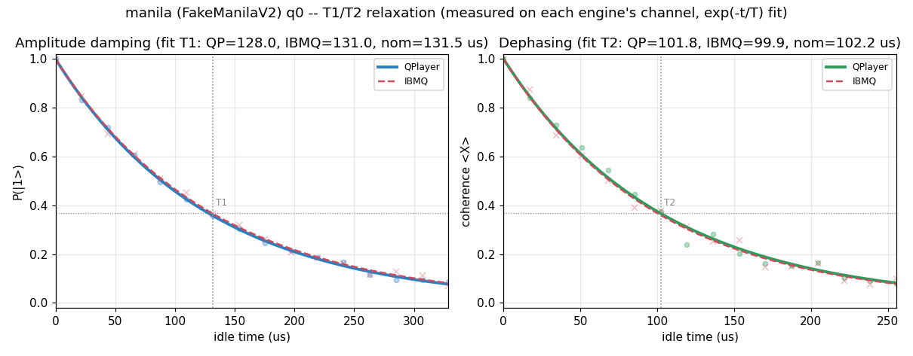


### manila / bell.qasm
```text
# Device-noise validation -- device=manila (FakeManilaV2)  circuit=bell.qasm
#   device JSON: /home/ksjin/github/QPlayer-II/examples/benchmarks/noise/device_json/fake_manila_v2.json
#   shots=1024  seed=2093836441  max_sim_qubits=14

# Logical circuit: qubits=2 clbits=2 gates=[measurex2, cxx1, hx1]
# Transpiled circuit: qubits=5 clbits=2 gates=[measurex2, rzx2, cxx1, sxx1]

## Tier 1 -- qubit 0 coherence parameters (ns)
param    |    IBMQ reported |  QPlayer DeviceModel
---------+------------------+---------------------
T1       |        131,528.6 |            131,528.6
T2       |        102,203.9 |            102,203.9
T2*      | N/A (not in snapshot) | N/A (derived T_phi below)
T_phi    |                - |            167,142.8
# readout q0: P(0|1)=0.05479999999999996, P(1|0)=0.0158, symmetric=0.0353

## Tier 1b -- per-qubit T1/T2 round-trip (5 qubits)
# max |IBMQ - QPlayer|: T1=0.000 ns, T2=0.000 ns (0 => DeviceModel loads device coherence exactly)

# T1 fit (us): QPlayer=128.0 IBMQ=131.0  nominal=131.5
# T2 fit (us): QPlayer=101.8 IBMQ=99.9  nominal=102.2
# t1t2_plot: /home/ksjin/github/QPlayer-II/examples/benchmarks/noise/result/plots-2026-07-22-1749/manila_T1T2.png  (q0 measured decay + exp fit)

## Tier 2 -- measured distribution (probabilities)
state |     ideal | FakeBcknd |   QPlayer
-----------------------------------------
   11 |    0.5049 |    0.4746 |    0.4609
   00 |    0.4951 |    0.4570 |    0.4785
   10 |    0.0000 |    0.0381 |    0.0332
   01 |    0.0000 |    0.0303 |    0.0273

## Tier 2 -- distribution agreement
pair                       | Hellinger fidelity |        TVD
---------------------------+--------------------+-----------
ideal      vs FakeBackend  |            0.93162 |    0.06836
ideal      vs QPlayer      |            0.93926 |    0.06055
FakeBackend vs QPlayer (key) |            0.99941 |    0.02148

# QPlayer vs IBM (FakeBackend) agreement: 97.85% distribution overlap (1 - TVD)  |  99.94% Hellinger fidelity
# Higher Hellinger fidelity (-> 1.0) and lower TVD (-> 0.0) on the 'FakeBackend vs QPlayer' row mean QPlayer reproduces the device noise more faithfully. ideal-vs-* rows quantify how far each noisy run departs from the noiseless distribution.
# plot: /home/ksjin/github/QPlayer-II/examples/benchmarks/noise/result/plots-2026-07-22-1749/manila_bell.png
```
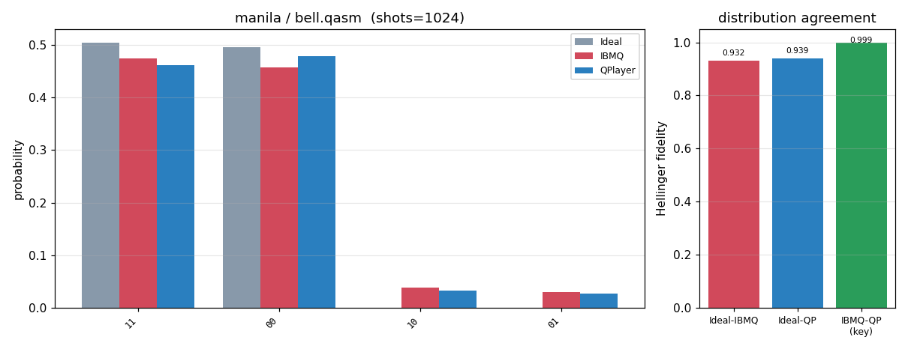


### manila / ghz3.qasm
```text
# Device-noise validation -- device=manila (FakeManilaV2)  circuit=ghz3.qasm
#   device JSON: /home/ksjin/github/QPlayer-II/examples/benchmarks/noise/device_json/fake_manila_v2.json
#   shots=1024  seed=2093836441  max_sim_qubits=14

# Logical circuit: qubits=3 clbits=3 gates=[measurex3, cxx2, hx1]
# Transpiled circuit: qubits=5 clbits=3 gates=[measurex3, cxx2, rzx2, sxx1]

## Tier 1 -- qubit 0 coherence parameters (ns)
param    |    IBMQ reported |  QPlayer DeviceModel
---------+------------------+---------------------
T1       |        131,528.6 |            131,528.6
T2       |        102,203.9 |            102,203.9
T2*      | N/A (not in snapshot) | N/A (derived T_phi below)
T_phi    |                - |            167,142.8
# readout q0: P(0|1)=0.05479999999999996, P(1|0)=0.0158, symmetric=0.0353

## Tier 1b -- per-qubit T1/T2 round-trip (5 qubits)
# max |IBMQ - QPlayer|: T1=0.000 ns, T2=0.000 ns (0 => DeviceModel loads device coherence exactly)

## Tier 2 -- measured distribution (probabilities)
state |     ideal | FakeBcknd |   QPlayer
-----------------------------------------
  111 |    0.5049 |    0.4297 |    0.4238
  000 |    0.4951 |    0.4180 |    0.4307
  011 |    0.0000 |    0.0469 |    0.0586
  100 |    0.0000 |    0.0439 |    0.0254
  110 |    0.0000 |    0.0127 |    0.0312
  101 |    0.0000 |    0.0176 |    0.0127
  001 |    0.0000 |    0.0195 |    0.0078
  010 |    0.0000 |    0.0117 |    0.0098

## Tier 2 -- distribution agreement
pair                       | Hellinger fidelity |        TVD
---------------------------+--------------------+-----------
ideal      vs FakeBackend  |            0.84765 |    0.15234
ideal      vs QPlayer      |            0.85442 |    0.14551
FakeBackend vs QPlayer (key) |            0.98950 |    0.04297

# QPlayer vs IBM (FakeBackend) agreement: 95.70% distribution overlap (1 - TVD)  |  98.95% Hellinger fidelity
# Higher Hellinger fidelity (-> 1.0) and lower TVD (-> 0.0) on the 'FakeBackend vs QPlayer' row mean QPlayer reproduces the device noise more faithfully. ideal-vs-* rows quantify how far each noisy run departs from the noiseless distribution.
# plot: /home/ksjin/github/QPlayer-II/examples/benchmarks/noise/result/plots-2026-07-22-1749/manila_ghz3.png
```
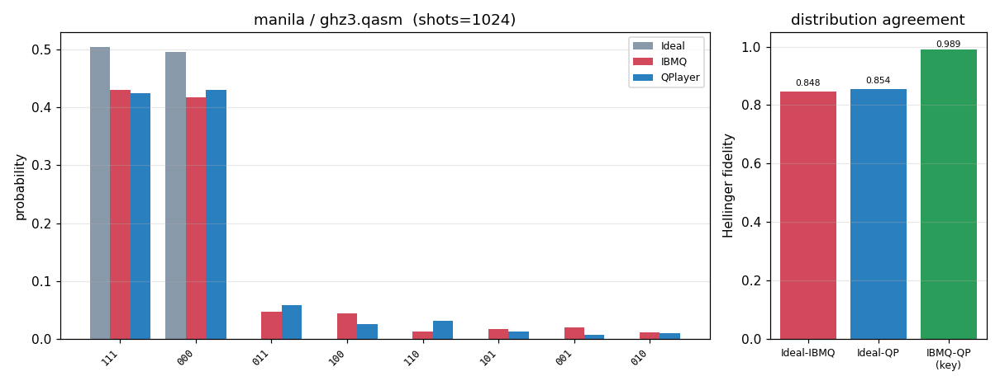


### manila / ghz5.qasm
```text
# Device-noise validation -- device=manila (FakeManilaV2)  circuit=ghz5.qasm
#   device JSON: /home/ksjin/github/QPlayer-II/examples/benchmarks/noise/device_json/fake_manila_v2.json
#   shots=1024  seed=2093836441  max_sim_qubits=14

# Logical circuit: qubits=5 clbits=5 gates=[measurex5, cxx4, hx1]
# Transpiled circuit: qubits=5 clbits=5 gates=[measurex5, cxx4, rzx2, sxx1]

## Tier 1 -- qubit 0 coherence parameters (ns)
param    |    IBMQ reported |  QPlayer DeviceModel
---------+------------------+---------------------
T1       |        131,528.6 |            131,528.6
T2       |        102,203.9 |            102,203.9
T2*      | N/A (not in snapshot) | N/A (derived T_phi below)
T_phi    |                - |            167,142.8
# readout q0: P(0|1)=0.05479999999999996, P(1|0)=0.0158, symmetric=0.0353

## Tier 1b -- per-qubit T1/T2 round-trip (5 qubits)
# max |IBMQ - QPlayer|: T1=0.000 ns, T2=0.000 ns (0 => DeviceModel loads device coherence exactly)

## Tier 2 -- measured distribution (probabilities)
state |     ideal | FakeBcknd |   QPlayer
-----------------------------------------
00000 |    0.4951 |    0.4023 |    0.4141
11111 |    0.5049 |    0.4121 |    0.3916
11011 |    0.0000 |    0.0420 |    0.0449
00100 |    0.0000 |    0.0449 |    0.0283
11110 |    0.0000 |    0.0137 |    0.0264
00001 |    0.0000 |    0.0146 |    0.0146
11101 |    0.0000 |    0.0107 |    0.0186
10111 |    0.0000 |    0.0059 |    0.0127
01111 |    0.0000 |    0.0068 |    0.0098
00010 |    0.0000 |    0.0068 |    0.0078
10000 |    0.0000 |    0.0088 |    0.0029
01000 |    0.0000 |    0.0078 |    0.0039
11010 |    0.0000 |    0.0039 |    0.0059
00111 |    0.0000 |    0.0059 |    0.0010
00011 |    0.0000 |    0.0039 |    0.0029
01011 |    0.0000 |    0.0000 |    0.0039

## Tier 2 -- distribution agreement
pair                       | Hellinger fidelity |        TVD
---------------------------+--------------------+-----------
ideal      vs FakeBackend  |            0.81445 |    0.18555
ideal      vs QPlayer      |            0.80538 |    0.19434
FakeBackend vs QPlayer (key) |            0.97554 |    0.05762

# QPlayer vs IBM (FakeBackend) agreement: 94.24% distribution overlap (1 - TVD)  |  97.55% Hellinger fidelity
# Higher Hellinger fidelity (-> 1.0) and lower TVD (-> 0.0) on the 'FakeBackend vs QPlayer' row mean QPlayer reproduces the device noise more faithfully. ideal-vs-* rows quantify how far each noisy run departs from the noiseless distribution.
# plot: /home/ksjin/github/QPlayer-II/examples/benchmarks/noise/result/plots-2026-07-22-1749/manila_ghz5.png
```
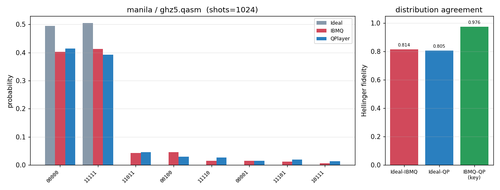


### manila / x_relax_q0.qasm
```text
# Device-noise validation -- device=manila (FakeManilaV2)  circuit=x_relax_q0.qasm
#   device JSON: /home/ksjin/github/QPlayer-II/examples/benchmarks/noise/device_json/fake_manila_v2.json
#   shots=1024  seed=2093836441  max_sim_qubits=14

# Logical circuit: qubits=1 clbits=1 gates=[measurex1, xx1]
# Transpiled circuit: qubits=5 clbits=1 gates=[measurex1, xx1]

## Tier 1 -- qubit 0 coherence parameters (ns)
param    |    IBMQ reported |  QPlayer DeviceModel
---------+------------------+---------------------
T1       |        131,528.6 |            131,528.6
T2       |        102,203.9 |            102,203.9
T2*      | N/A (not in snapshot) | N/A (derived T_phi below)
T_phi    |                - |            167,142.8
# readout q0: P(0|1)=0.05479999999999996, P(1|0)=0.0158, symmetric=0.0353

## Tier 1b -- per-qubit T1/T2 round-trip (5 qubits)
# max |IBMQ - QPlayer|: T1=0.000 ns, T2=0.000 ns (0 => DeviceModel loads device coherence exactly)

## Tier 2 -- measured distribution (probabilities)
state |     ideal | FakeBcknd |   QPlayer
-----------------------------------------
    1 |    1.0000 |    0.9658 |    0.9492
    0 |    0.0000 |    0.0342 |    0.0508

## Tier 2 -- distribution agreement
pair                       | Hellinger fidelity |        TVD
---------------------------+--------------------+-----------
ideal      vs FakeBackend  |            0.96582 |    0.03418
ideal      vs QPlayer      |            0.94922 |    0.05078
FakeBackend vs QPlayer (key) |            0.99829 |    0.01660

# QPlayer vs IBM (FakeBackend) agreement: 98.34% distribution overlap (1 - TVD)  |  99.83% Hellinger fidelity
# Higher Hellinger fidelity (-> 1.0) and lower TVD (-> 0.0) on the 'FakeBackend vs QPlayer' row mean QPlayer reproduces the device noise more faithfully. ideal-vs-* rows quantify how far each noisy run departs from the noiseless distribution.
# plot: /home/ksjin/github/QPlayer-II/examples/benchmarks/noise/result/plots-2026-07-22-1749/manila_x_relax_q0.png
```
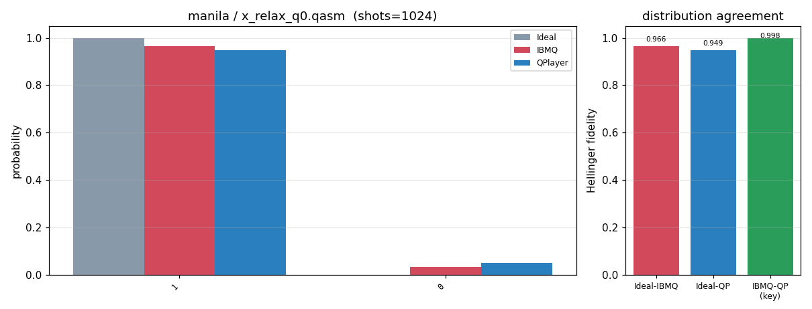


### manila / qaoa_5q.qasm
```text
# Device-noise validation -- device=manila (FakeManilaV2)  circuit=qaoa_5q.qasm
#   device JSON: /home/ksjin/github/QPlayer-II/examples/benchmarks/noise/device_json/fake_manila_v2.json
#   shots=4096  seed=2093836441  max_sim_qubits=14

# Logical circuit: qubits=5 clbits=5 gates=[cxx8, hx5, measurex5, rxx5, rzx4]
# Transpiled circuit: qubits=5 clbits=5 gates=[rzx29, sxx15, cxx8, measurex5]

## Tier 1 -- qubit 0 coherence parameters (ns)
param    |    IBMQ reported |  QPlayer DeviceModel
---------+------------------+---------------------
T1       |        131,528.6 |            131,528.6
T2       |        102,203.9 |            102,203.9
T2*      | N/A (not in snapshot) | N/A (derived T_phi below)
T_phi    |                - |            167,142.8
# readout q0: P(0|1)=0.05479999999999996, P(1|0)=0.0158, symmetric=0.0353

## Tier 1b -- per-qubit T1/T2 round-trip (5 qubits)
# max |IBMQ - QPlayer|: T1=0.000 ns, T2=0.000 ns (0 => DeviceModel loads device coherence exactly)

## Tier 2 -- measured distribution (probabilities)
state |     ideal | FakeBcknd |   QPlayer
-----------------------------------------
01010 |    0.1616 |    0.1255 |    0.1226
10101 |    0.1538 |    0.1177 |    0.1262
01001 |    0.0872 |    0.0745 |    0.0879
10010 |    0.0811 |    0.0801 |    0.0798
10110 |    0.0825 |    0.0781 |    0.0796
01101 |    0.0869 |    0.0740 |    0.0659
00110 |    0.0298 |    0.0293 |    0.0310
10011 |    0.0352 |    0.0271 |    0.0254
11001 |    0.0300 |    0.0300 |    0.0271
00101 |    0.0234 |    0.0310 |    0.0320
01100 |    0.0281 |    0.0269 |    0.0293
11010 |    0.0259 |    0.0254 |    0.0234
10100 |    0.0203 |    0.0271 |    0.0261
01011 |    0.0234 |    0.0259 |    0.0229
10001 |    0.0103 |    0.0283 |    0.0332
01110 |    0.0100 |    0.0298 |    0.0229

## Tier 2 -- distribution agreement
pair                       | Hellinger fidelity |        TVD
---------------------------+--------------------+-----------
ideal      vs FakeBackend  |            0.96302 |    0.11450
ideal      vs QPlayer      |            0.96294 |    0.11182
FakeBackend vs QPlayer (key) |            0.99427 |    0.05103

# QPlayer vs IBM (FakeBackend) agreement: 94.90% distribution overlap (1 - TVD)  |  99.43% Hellinger fidelity
# Higher Hellinger fidelity (-> 1.0) and lower TVD (-> 0.0) on the 'FakeBackend vs QPlayer' row mean QPlayer reproduces the device noise more faithfully. ideal-vs-* rows quantify how far each noisy run departs from the noiseless distribution.
# plot: /home/ksjin/github/QPlayer-II/examples/benchmarks/noise/result/plots-2026-07-22-1749/manila_qaoa_5q.png
```
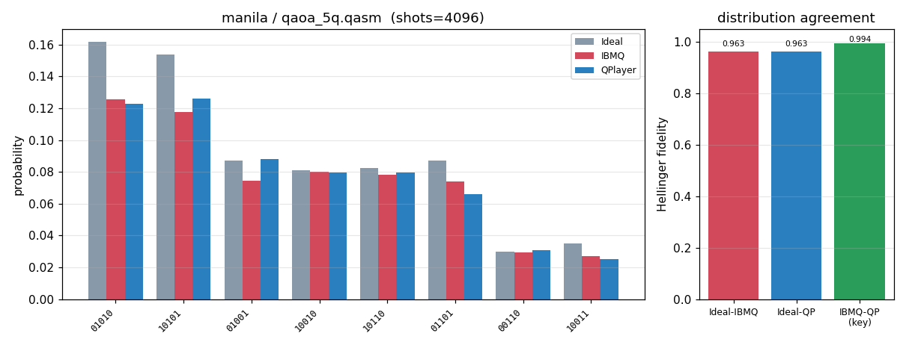


### manila / vqe_5q.qasm
```text
# Device-noise validation -- device=manila (FakeManilaV2)  circuit=vqe_5q.qasm
#   device JSON: /home/ksjin/github/QPlayer-II/examples/benchmarks/noise/device_json/fake_manila_v2.json
#   shots=4096  seed=2093836441  max_sim_qubits=14

# Logical circuit: qubits=5 clbits=5 gates=[ryx15, cxx8, measurex5]
# Transpiled circuit: qubits=5 clbits=5 gates=[rzx30, sxx30, cxx8, measurex5]

## Tier 1 -- qubit 0 coherence parameters (ns)
param    |    IBMQ reported |  QPlayer DeviceModel
---------+------------------+---------------------
T1       |        131,528.6 |            131,528.6
T2       |        102,203.9 |            102,203.9
T2*      | N/A (not in snapshot) | N/A (derived T_phi below)
T_phi    |                - |            167,142.8
# readout q0: P(0|1)=0.05479999999999996, P(1|0)=0.0158, symmetric=0.0353

## Tier 1b -- per-qubit T1/T2 round-trip (5 qubits)
# max |IBMQ - QPlayer|: T1=0.000 ns, T2=0.000 ns (0 => DeviceModel loads device coherence exactly)

## Tier 2 -- measured distribution (probabilities)
state |     ideal | FakeBcknd |   QPlayer
-----------------------------------------
01001 |    0.2219 |    0.1763 |    0.1936
01111 |    0.1858 |    0.1533 |    0.1318
10001 |    0.1296 |    0.1042 |    0.0972
10111 |    0.1277 |    0.1011 |    0.0981
11111 |    0.0938 |    0.0813 |    0.0730
11011 |    0.0603 |    0.0583 |    0.0598
11001 |    0.0415 |    0.0439 |    0.0459
01011 |    0.0303 |    0.0459 |    0.0483
00111 |    0.0305 |    0.0315 |    0.0310
10011 |    0.0134 |    0.0276 |    0.0291
11101 |    0.0176 |    0.0249 |    0.0251
01101 |    0.0059 |    0.0303 |    0.0312
00011 |    0.0171 |    0.0161 |    0.0186
00001 |    0.0115 |    0.0178 |    0.0171
10101 |    0.0015 |    0.0195 |    0.0168
01000 |    0.0007 |    0.0103 |    0.0127

## Tier 2 -- distribution agreement
pair                       | Hellinger fidelity |        TVD
---------------------------+--------------------+-----------
ideal      vs FakeBackend  |            0.93104 |    0.14551
ideal      vs QPlayer      |            0.91675 |    0.16553
FakeBackend vs QPlayer (key) |            0.99402 |    0.05005

# QPlayer vs IBM (FakeBackend) agreement: 95.00% distribution overlap (1 - TVD)  |  99.40% Hellinger fidelity
# Higher Hellinger fidelity (-> 1.0) and lower TVD (-> 0.0) on the 'FakeBackend vs QPlayer' row mean QPlayer reproduces the device noise more faithfully. ideal-vs-* rows quantify how far each noisy run departs from the noiseless distribution.
# plot: /home/ksjin/github/QPlayer-II/examples/benchmarks/noise/result/plots-2026-07-22-1749/manila_vqe_5q.png
```
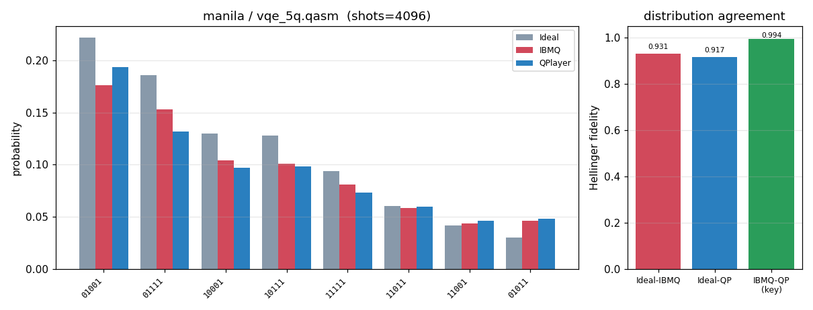


## Device: oslo
### oslo -- q0 T1/T2 relaxation (measured + exp fit)
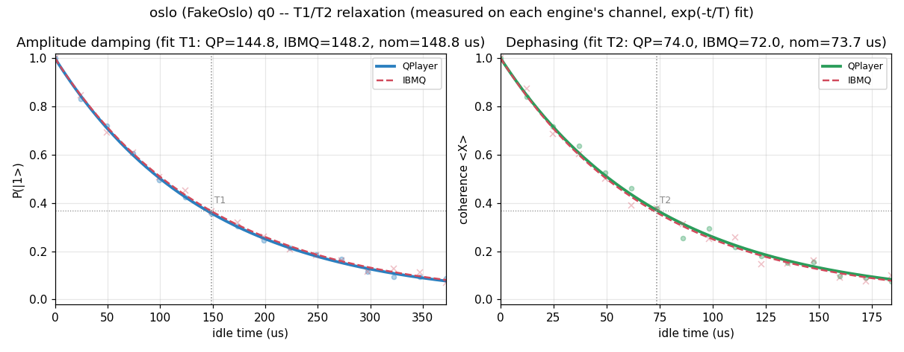


### oslo / bell.qasm
```text
# Device-noise validation -- device=oslo (FakeOslo)  circuit=bell.qasm
#   device JSON: /home/ksjin/github/QPlayer-II/examples/benchmarks/noise/device_json/fake_oslo.json
#   shots=1024  seed=2093836441  max_sim_qubits=14

# Logical circuit: qubits=2 clbits=2 gates=[measurex2, cxx1, hx1]
# Transpiled circuit: qubits=7 clbits=2 gates=[measurex2, rzx2, cxx1, sxx1]

## Tier 1 -- qubit 0 coherence parameters (ns)
param    |    IBMQ reported |  QPlayer DeviceModel
---------+------------------+---------------------
T1       |        148,847.5 |            148,847.5
T2       |         73,693.0 |             73,693.0
T2*      | N/A (not in snapshot) | N/A (derived T_phi below)
T_phi    |                - |             97,936.8
# readout q0: P(0|1)=0.0102, P(1|0)=0.009399999999999964, symmetric=0.009800000000000031

## Tier 1b -- per-qubit T1/T2 round-trip (7 qubits)
# max |IBMQ - QPlayer|: T1=0.000 ns, T2=0.000 ns (0 => DeviceModel loads device coherence exactly)

# T1 fit (us): QPlayer=144.8 IBMQ=148.2  nominal=148.8
# T2 fit (us): QPlayer=74.0 IBMQ=72.0  nominal=73.7
# t1t2_plot: /home/ksjin/github/QPlayer-II/examples/benchmarks/noise/result/plots-2026-07-22-1749/oslo_T1T2.png  (q0 measured decay + exp fit)

# NOTE: active width 7q -> distribution tier uses 2048 shots (>= 16 x 2^7) so the spread distribution is sampled above the statistical floor (requested shots=1024 is the floor).

## Tier 2 -- measured distribution (probabilities)
  state |     ideal | FakeBcknd |   QPlayer
-------------------------------------------
     11 |    0.5005 |    0.4795 |    0.4932
     00 |    0.4995 |    0.4824 |    0.4775
     10 |    0.0000 |    0.0210 |    0.0186
     01 |    0.0000 |    0.0171 |    0.0107

## Tier 2 -- distribution agreement
pair                       | Hellinger fidelity |        TVD
---------------------------+--------------------+-----------
ideal      vs FakeBackend  |            0.96191 |    0.03809
ideal      vs QPlayer      |            0.97065 |    0.02930
FakeBackend vs QPlayer (key) |            0.99908 |    0.01367

# QPlayer vs IBM (FakeBackend) agreement: 98.63% distribution overlap (1 - TVD)  |  99.91% Hellinger fidelity
# Higher Hellinger fidelity (-> 1.0) and lower TVD (-> 0.0) on the 'FakeBackend vs QPlayer' row mean QPlayer reproduces the device noise more faithfully. ideal-vs-* rows quantify how far each noisy run departs from the noiseless distribution.
# plot: /home/ksjin/github/QPlayer-II/examples/benchmarks/noise/result/plots-2026-07-22-1749/oslo_bell.png
```
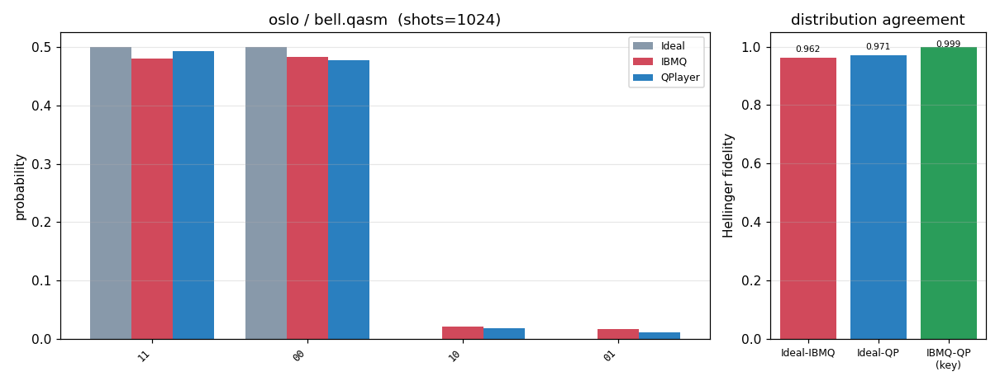


### oslo / ghz3.qasm
```text
# Device-noise validation -- device=oslo (FakeOslo)  circuit=ghz3.qasm
#   device JSON: /home/ksjin/github/QPlayer-II/examples/benchmarks/noise/device_json/fake_oslo.json
#   shots=1024  seed=2093836441  max_sim_qubits=14

# Logical circuit: qubits=3 clbits=3 gates=[measurex3, cxx2, hx1]
# Transpiled circuit: qubits=7 clbits=3 gates=[measurex3, cxx2, rzx2, sxx1]

## Tier 1 -- qubit 0 coherence parameters (ns)
param    |    IBMQ reported |  QPlayer DeviceModel
---------+------------------+---------------------
T1       |        148,847.5 |            148,847.5
T2       |         73,693.0 |             73,693.0
T2*      | N/A (not in snapshot) | N/A (derived T_phi below)
T_phi    |                - |             97,936.8
# readout q0: P(0|1)=0.0102, P(1|0)=0.009399999999999964, symmetric=0.009800000000000031

## Tier 1b -- per-qubit T1/T2 round-trip (7 qubits)
# max |IBMQ - QPlayer|: T1=0.000 ns, T2=0.000 ns (0 => DeviceModel loads device coherence exactly)

# NOTE: active width 7q -> distribution tier uses 2048 shots (>= 16 x 2^7) so the spread distribution is sampled above the statistical floor (requested shots=1024 is the floor).

## Tier 2 -- measured distribution (probabilities)
  state |     ideal | FakeBcknd |   QPlayer
-------------------------------------------
    111 |    0.5005 |    0.4790 |    0.5015
    000 |    0.4995 |    0.4829 |    0.4546
    101 |    0.0000 |    0.0098 |    0.0088
    010 |    0.0000 |    0.0063 |    0.0107
    110 |    0.0000 |    0.0059 |    0.0088
    001 |    0.0000 |    0.0073 |    0.0063
    100 |    0.0000 |    0.0054 |    0.0039
    011 |    0.0000 |    0.0034 |    0.0054

## Tier 2 -- distribution agreement
pair                       | Hellinger fidelity |        TVD
---------------------------+--------------------+-----------
ideal      vs FakeBackend  |            0.96191 |    0.03809
ideal      vs QPlayer      |            0.95550 |    0.04492
FakeBackend vs QPlayer (key) |            0.99805 |    0.03174

# QPlayer vs IBM (FakeBackend) agreement: 96.83% distribution overlap (1 - TVD)  |  99.80% Hellinger fidelity
# Higher Hellinger fidelity (-> 1.0) and lower TVD (-> 0.0) on the 'FakeBackend vs QPlayer' row mean QPlayer reproduces the device noise more faithfully. ideal-vs-* rows quantify how far each noisy run departs from the noiseless distribution.
# plot: /home/ksjin/github/QPlayer-II/examples/benchmarks/noise/result/plots-2026-07-22-1749/oslo_ghz3.png
```
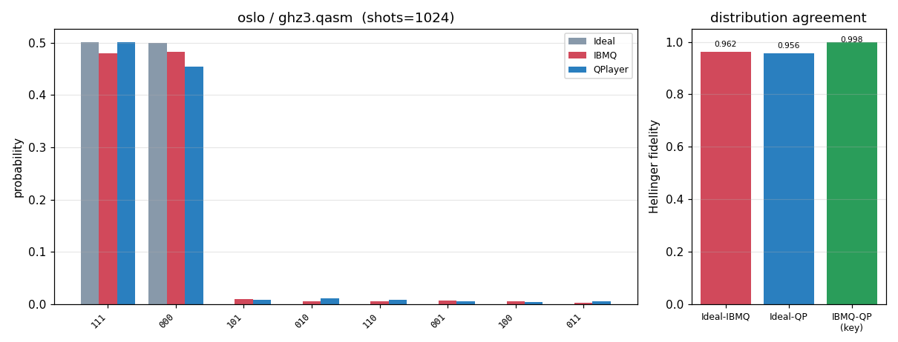


### oslo / ghz5.qasm
```text
# Device-noise validation -- device=oslo (FakeOslo)  circuit=ghz5.qasm
#   device JSON: /home/ksjin/github/QPlayer-II/examples/benchmarks/noise/device_json/fake_oslo.json
#   shots=1024  seed=2093836441  max_sim_qubits=14

# Logical circuit: qubits=5 clbits=5 gates=[measurex5, cxx4, hx1]
# Transpiled circuit: qubits=7 clbits=5 gates=[measurex5, cxx4, rzx2, sxx1]

## Tier 1 -- qubit 0 coherence parameters (ns)
param    |    IBMQ reported |  QPlayer DeviceModel
---------+------------------+---------------------
T1       |        148,847.5 |            148,847.5
T2       |         73,693.0 |             73,693.0
T2*      | N/A (not in snapshot) | N/A (derived T_phi below)
T_phi    |                - |             97,936.8
# readout q0: P(0|1)=0.0102, P(1|0)=0.009399999999999964, symmetric=0.009800000000000031

## Tier 1b -- per-qubit T1/T2 round-trip (7 qubits)
# max |IBMQ - QPlayer|: T1=0.000 ns, T2=0.000 ns (0 => DeviceModel loads device coherence exactly)

# NOTE: active width 7q -> distribution tier uses 2048 shots (>= 16 x 2^7) so the spread distribution is sampled above the statistical floor (requested shots=1024 is the floor).

## Tier 2 -- measured distribution (probabilities)
  state |     ideal | FakeBcknd |   QPlayer
-------------------------------------------
  11111 |    0.5005 |    0.4561 |    0.4824
  00000 |    0.4995 |    0.4678 |    0.4409
  10000 |    0.0000 |    0.0088 |    0.0142
  01111 |    0.0000 |    0.0117 |    0.0083
  11101 |    0.0000 |    0.0107 |    0.0078
  00100 |    0.0000 |    0.0039 |    0.0098
  11011 |    0.0000 |    0.0078 |    0.0059
  00010 |    0.0000 |    0.0063 |    0.0063
  10111 |    0.0000 |    0.0059 |    0.0054
  01000 |    0.0000 |    0.0068 |    0.0044
  11110 |    0.0000 |    0.0029 |    0.0068
  00001 |    0.0000 |    0.0039 |    0.0039
  00011 |    0.0000 |    0.0029 |    0.0005
  00111 |    0.0000 |    0.0015 |    0.0015
  11100 |    0.0000 |    0.0010 |    0.0005
  10100 |    0.0000 |    0.0010 |    0.0000

## Tier 2 -- distribution agreement
pair                       | Hellinger fidelity |        TVD
---------------------------+--------------------+-----------
ideal      vs FakeBackend  |            0.92379 |    0.07617
ideal      vs QPlayer      |            0.92289 |    0.07666
FakeBackend vs QPlayer (key) |            0.99198 |    0.04248

# QPlayer vs IBM (FakeBackend) agreement: 95.75% distribution overlap (1 - TVD)  |  99.20% Hellinger fidelity
# Higher Hellinger fidelity (-> 1.0) and lower TVD (-> 0.0) on the 'FakeBackend vs QPlayer' row mean QPlayer reproduces the device noise more faithfully. ideal-vs-* rows quantify how far each noisy run departs from the noiseless distribution.
# plot: /home/ksjin/github/QPlayer-II/examples/benchmarks/noise/result/plots-2026-07-22-1749/oslo_ghz5.png
```
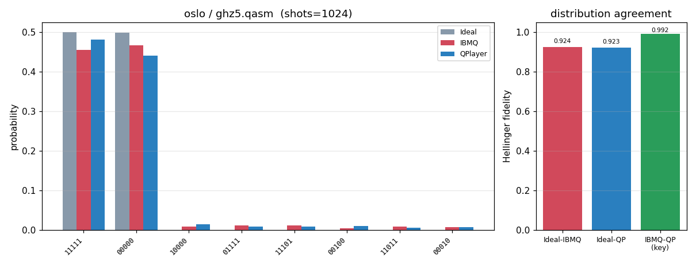


### oslo / x_relax_q0.qasm
```text
# Device-noise validation -- device=oslo (FakeOslo)  circuit=x_relax_q0.qasm
#   device JSON: /home/ksjin/github/QPlayer-II/examples/benchmarks/noise/device_json/fake_oslo.json
#   shots=1024  seed=2093836441  max_sim_qubits=14

# Logical circuit: qubits=1 clbits=1 gates=[measurex1, xx1]
# Transpiled circuit: qubits=7 clbits=1 gates=[measurex1, xx1]

## Tier 1 -- qubit 0 coherence parameters (ns)
param    |    IBMQ reported |  QPlayer DeviceModel
---------+------------------+---------------------
T1       |        148,847.5 |            148,847.5
T2       |         73,693.0 |             73,693.0
T2*      | N/A (not in snapshot) | N/A (derived T_phi below)
T_phi    |                - |             97,936.8
# readout q0: P(0|1)=0.0102, P(1|0)=0.009399999999999964, symmetric=0.009800000000000031

## Tier 1b -- per-qubit T1/T2 round-trip (7 qubits)
# max |IBMQ - QPlayer|: T1=0.000 ns, T2=0.000 ns (0 => DeviceModel loads device coherence exactly)

# NOTE: active width 7q -> distribution tier uses 2048 shots (>= 16 x 2^7) so the spread distribution is sampled above the statistical floor (requested shots=1024 is the floor).

## Tier 2 -- measured distribution (probabilities)
  state |     ideal | FakeBcknd |   QPlayer
-------------------------------------------
      1 |    1.0000 |    0.9888 |    0.9917
      0 |    0.0000 |    0.0112 |    0.0083

## Tier 2 -- distribution agreement
pair                       | Hellinger fidelity |        TVD
---------------------------+--------------------+-----------
ideal      vs FakeBackend  |            0.98877 |    0.01123
ideal      vs QPlayer      |            0.99170 |    0.00830
FakeBackend vs QPlayer (key) |            0.99978 |    0.00293

# QPlayer vs IBM (FakeBackend) agreement: 99.71% distribution overlap (1 - TVD)  |  99.98% Hellinger fidelity
# Higher Hellinger fidelity (-> 1.0) and lower TVD (-> 0.0) on the 'FakeBackend vs QPlayer' row mean QPlayer reproduces the device noise more faithfully. ideal-vs-* rows quantify how far each noisy run departs from the noiseless distribution.
# plot: /home/ksjin/github/QPlayer-II/examples/benchmarks/noise/result/plots-2026-07-22-1749/oslo_x_relax_q0.png
```
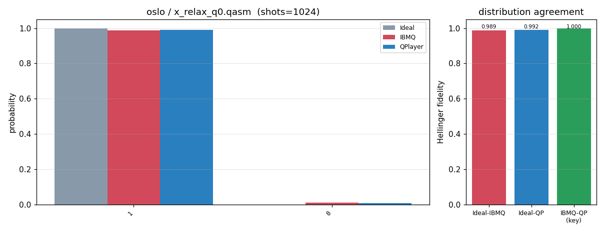


### oslo / qaoa_7q.qasm
```text
# Device-noise validation -- device=oslo (FakeOslo)  circuit=qaoa_7q.qasm
#   device JSON: /home/ksjin/github/QPlayer-II/examples/benchmarks/noise/device_json/fake_oslo.json
#   shots=4096  seed=2093836441  max_sim_qubits=14

# Logical circuit: qubits=7 clbits=7 gates=[cxx12, hx7, measurex7, rxx7, rzx6]
# Transpiled circuit: qubits=7 clbits=7 gates=[rzx41, sxx21, cxx18, measurex7]

## Tier 1 -- qubit 0 coherence parameters (ns)
param    |    IBMQ reported |  QPlayer DeviceModel
---------+------------------+---------------------
T1       |        148,847.5 |            148,847.5
T2       |         73,693.0 |             73,693.0
T2*      | N/A (not in snapshot) | N/A (derived T_phi below)
T_phi    |                - |             97,936.8
# readout q0: P(0|1)=0.0102, P(1|0)=0.009399999999999964, symmetric=0.009800000000000031

## Tier 1b -- per-qubit T1/T2 round-trip (7 qubits)
# max |IBMQ - QPlayer|: T1=0.000 ns, T2=0.000 ns (0 => DeviceModel loads device coherence exactly)

## Tier 2 -- measured distribution (probabilities)
  state |     ideal | FakeBcknd |   QPlayer
-------------------------------------------
0101010 |    0.0791 |    0.0618 |    0.0640
1010101 |    0.0740 |    0.0557 |    0.0647
0101001 |    0.0393 |    0.0342 |    0.0371
1001010 |    0.0435 |    0.0359 |    0.0288
1010110 |    0.0376 |    0.0325 |    0.0354
0110101 |    0.0388 |    0.0315 |    0.0347
0101101 |    0.0325 |    0.0281 |    0.0295
1010010 |    0.0322 |    0.0251 |    0.0322
1011010 |    0.0325 |    0.0310 |    0.0247
0100101 |    0.0312 |    0.0286 |    0.0283
1001101 |    0.0288 |    0.0269 |    0.0251
0100110 |    0.0305 |    0.0271 |    0.0229
0110010 |    0.0281 |    0.0259 |    0.0264
1011001 |    0.0288 |    0.0229 |    0.0271
0110110 |    0.0205 |    0.0181 |    0.0181
1001001 |    0.0217 |    0.0203 |    0.0142

## Tier 2 -- distribution agreement
pair                       | Hellinger fidelity |        TVD
---------------------------+--------------------+-----------
ideal      vs FakeBackend  |            0.95966 |    0.11694
ideal      vs QPlayer      |            0.95629 |    0.12109
FakeBackend vs QPlayer (key) |            0.98006 |    0.09814

# QPlayer vs IBM (FakeBackend) agreement: 90.19% distribution overlap (1 - TVD)  |  98.01% Hellinger fidelity
# Higher Hellinger fidelity (-> 1.0) and lower TVD (-> 0.0) on the 'FakeBackend vs QPlayer' row mean QPlayer reproduces the device noise more faithfully. ideal-vs-* rows quantify how far each noisy run departs from the noiseless distribution.
# plot: /home/ksjin/github/QPlayer-II/examples/benchmarks/noise/result/plots-2026-07-22-1749/oslo_qaoa_7q.png
```
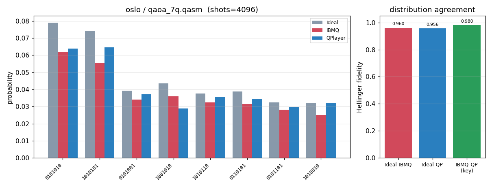


### oslo / vqe_7q.qasm
```text
# Device-noise validation -- device=oslo (FakeOslo)  circuit=vqe_7q.qasm
#   device JSON: /home/ksjin/github/QPlayer-II/examples/benchmarks/noise/device_json/fake_oslo.json
#   shots=4096  seed=2093836441  max_sim_qubits=14

# Logical circuit: qubits=7 clbits=7 gates=[ryx21, cxx12, measurex7]
# Transpiled circuit: qubits=7 clbits=7 gates=[rzx42, sxx42, cxx18, measurex7]

## Tier 1 -- qubit 0 coherence parameters (ns)
param    |    IBMQ reported |  QPlayer DeviceModel
---------+------------------+---------------------
T1       |        148,847.5 |            148,847.5
T2       |         73,693.0 |             73,693.0
T2*      | N/A (not in snapshot) | N/A (derived T_phi below)
T_phi    |                - |             97,936.8
# readout q0: P(0|1)=0.0102, P(1|0)=0.009399999999999964, symmetric=0.009800000000000031

## Tier 1b -- per-qubit T1/T2 round-trip (7 qubits)
# max |IBMQ - QPlayer|: T1=0.000 ns, T2=0.000 ns (0 => DeviceModel loads device coherence exactly)

## Tier 2 -- measured distribution (probabilities)
  state |     ideal | FakeBcknd |   QPlayer
-------------------------------------------
1010001 |    0.0347 |    0.0310 |    0.0269
1110001 |    0.0283 |    0.0293 |    0.0322
0110101 |    0.0317 |    0.0295 |    0.0281
0100101 |    0.0283 |    0.0303 |    0.0261
0000101 |    0.0254 |    0.0239 |    0.0276
1000001 |    0.0269 |    0.0239 |    0.0254
1100001 |    0.0259 |    0.0242 |    0.0256
1001101 |    0.0261 |    0.0239 |    0.0234
1100101 |    0.0247 |    0.0225 |    0.0261
1001001 |    0.0266 |    0.0242 |    0.0222
1101001 |    0.0261 |    0.0227 |    0.0232
0001101 |    0.0237 |    0.0239 |    0.0232
0110001 |    0.0244 |    0.0247 |    0.0210
0101101 |    0.0259 |    0.0215 |    0.0217
1011001 |    0.0220 |    0.0203 |    0.0229
0010101 |    0.0237 |    0.0222 |    0.0186

## Tier 2 -- distribution agreement
pair                       | Hellinger fidelity |        TVD
---------------------------+--------------------+-----------
ideal      vs FakeBackend  |            0.98097 |    0.07837
ideal      vs QPlayer      |            0.97466 |    0.10498
FakeBackend vs QPlayer (key) |            0.98691 |    0.08154

# QPlayer vs IBM (FakeBackend) agreement: 91.85% distribution overlap (1 - TVD)  |  98.69% Hellinger fidelity
# Higher Hellinger fidelity (-> 1.0) and lower TVD (-> 0.0) on the 'FakeBackend vs QPlayer' row mean QPlayer reproduces the device noise more faithfully. ideal-vs-* rows quantify how far each noisy run departs from the noiseless distribution.
# plot: /home/ksjin/github/QPlayer-II/examples/benchmarks/noise/result/plots-2026-07-22-1749/oslo_vqe_7q.png
```
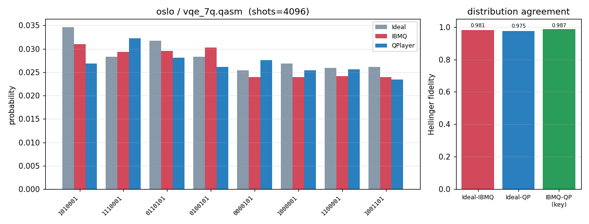


## Device: geneva
### geneva -- q0 T1/T2 relaxation (measured + exp fit)
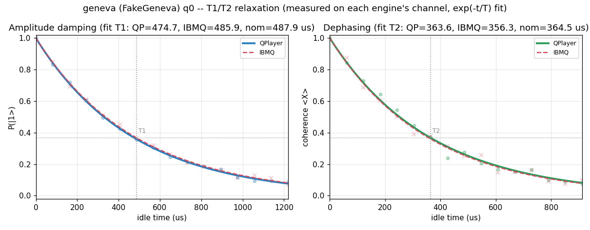


### geneva / bell.qasm
```text
# Device-noise validation -- device=geneva (FakeGeneva)  circuit=bell.qasm
#   device JSON: /home/ksjin/github/QPlayer-II/examples/benchmarks/noise/device_json/fake_geneva.json
#   shots=1024  seed=2093836441  max_sim_qubits=14

# Logical circuit: qubits=2 clbits=2 gates=[measurex2, cxx1, hx1]
# Transpiled circuit: qubits=27 clbits=2 gates=[measurex2, rzx2, cxx1, sxx1]

## Tier 1 -- qubit 0 coherence parameters (ns)
param    |    IBMQ reported |  QPlayer DeviceModel
---------+------------------+---------------------
T1       |        487,907.1 |            487,907.1
T2       |        364,525.6 |            364,525.6
T2*      | N/A (not in snapshot) | N/A (derived T_phi below)
T_phi    |                - |            581,900.7
# readout q0: P(0|1)=0.018000000000000016, P(1|0)=0.0292, symmetric=0.023600000000000065

## Tier 1b -- per-qubit T1/T2 round-trip (27 qubits)
# max |IBMQ - QPlayer|: T1=0.000 ns, T2=0.000 ns (0 => DeviceModel loads device coherence exactly)

# T1 fit (us): QPlayer=474.7 IBMQ=485.9  nominal=487.9
# T2 fit (us): QPlayer=363.6 IBMQ=356.3  nominal=364.5
# t1t2_plot: /home/ksjin/github/QPlayer-II/examples/benchmarks/noise/result/plots-2026-07-22-1749/geneva_T1T2.png  (q0 measured decay + exp fit)

# NOTE: device width 27q exceeds max_sim_qubits 14; QubitTruncationPass compresses the circuit onto its 2 active physical qubits (dense [0,k)), so QPlayer simulates 2^2 and run() projects each qubit's own device noise onto that range. Aer prunes idle qubits itself.

## Tier 2 -- measured distribution (probabilities)
state |     ideal | FakeBcknd |   QPlayer
-----------------------------------------
   11 |    0.5049 |    0.4814 |    0.4668
   00 |    0.4951 |    0.4619 |    0.4727
   01 |    0.0000 |    0.0244 |    0.0352
   10 |    0.0000 |    0.0322 |    0.0254

## Tier 2 -- distribution agreement
pair                       | Hellinger fidelity |        TVD
---------------------------+--------------------+-----------
ideal      vs FakeBackend  |            0.94333 |    0.05664
ideal      vs QPlayer      |            0.93939 |    0.06055
FakeBackend vs QPlayer (key) |            0.99844 |    0.02148

# QPlayer vs IBM (FakeBackend) agreement: 97.85% distribution overlap (1 - TVD)  |  99.84% Hellinger fidelity
# Higher Hellinger fidelity (-> 1.0) and lower TVD (-> 0.0) on the 'FakeBackend vs QPlayer' row mean QPlayer reproduces the device noise more faithfully. ideal-vs-* rows quantify how far each noisy run departs from the noiseless distribution.
# plot: /home/ksjin/github/QPlayer-II/examples/benchmarks/noise/result/plots-2026-07-22-1749/geneva_bell.png
```
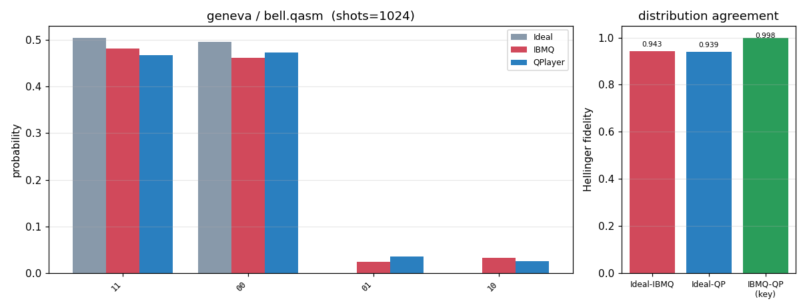


### geneva / ghz3.qasm
```text
# Device-noise validation -- device=geneva (FakeGeneva)  circuit=ghz3.qasm
#   device JSON: /home/ksjin/github/QPlayer-II/examples/benchmarks/noise/device_json/fake_geneva.json
#   shots=1024  seed=2093836441  max_sim_qubits=14

# Logical circuit: qubits=3 clbits=3 gates=[measurex3, cxx2, hx1]
# Transpiled circuit: qubits=27 clbits=3 gates=[measurex3, cxx2, rzx2, sxx1]

## Tier 1 -- qubit 0 coherence parameters (ns)
param    |    IBMQ reported |  QPlayer DeviceModel
---------+------------------+---------------------
T1       |        487,907.1 |            487,907.1
T2       |        364,525.6 |            364,525.6
T2*      | N/A (not in snapshot) | N/A (derived T_phi below)
T_phi    |                - |            581,900.7
# readout q0: P(0|1)=0.018000000000000016, P(1|0)=0.0292, symmetric=0.023600000000000065

## Tier 1b -- per-qubit T1/T2 round-trip (27 qubits)
# max |IBMQ - QPlayer|: T1=0.000 ns, T2=0.000 ns (0 => DeviceModel loads device coherence exactly)

# NOTE: device width 27q exceeds max_sim_qubits 14; QubitTruncationPass compresses the circuit onto its 3 active physical qubits (dense [0,k)), so QPlayer simulates 2^3 and run() projects each qubit's own device noise onto that range. Aer prunes idle qubits itself.

## Tier 2 -- measured distribution (probabilities)
state |     ideal | FakeBcknd |   QPlayer
-----------------------------------------
  111 |    0.5049 |    0.4619 |    0.4756
  000 |    0.4951 |    0.4512 |    0.4199
  100 |    0.0000 |    0.0127 |    0.0215
  101 |    0.0000 |    0.0176 |    0.0156
  001 |    0.0000 |    0.0146 |    0.0176
  011 |    0.0000 |    0.0166 |    0.0156
  010 |    0.0000 |    0.0146 |    0.0166
  110 |    0.0000 |    0.0107 |    0.0176

## Tier 2 -- distribution agreement
pair                       | Hellinger fidelity |        TVD
---------------------------+--------------------+-----------
ideal      vs FakeBackend  |            0.91309 |    0.08691
ideal      vs QPlayer      |            0.89489 |    0.10449
FakeBackend vs QPlayer (key) |            0.99709 |    0.03418

# QPlayer vs IBM (FakeBackend) agreement: 96.58% distribution overlap (1 - TVD)  |  99.71% Hellinger fidelity
# Higher Hellinger fidelity (-> 1.0) and lower TVD (-> 0.0) on the 'FakeBackend vs QPlayer' row mean QPlayer reproduces the device noise more faithfully. ideal-vs-* rows quantify how far each noisy run departs from the noiseless distribution.
# plot: /home/ksjin/github/QPlayer-II/examples/benchmarks/noise/result/plots-2026-07-22-1749/geneva_ghz3.png
```
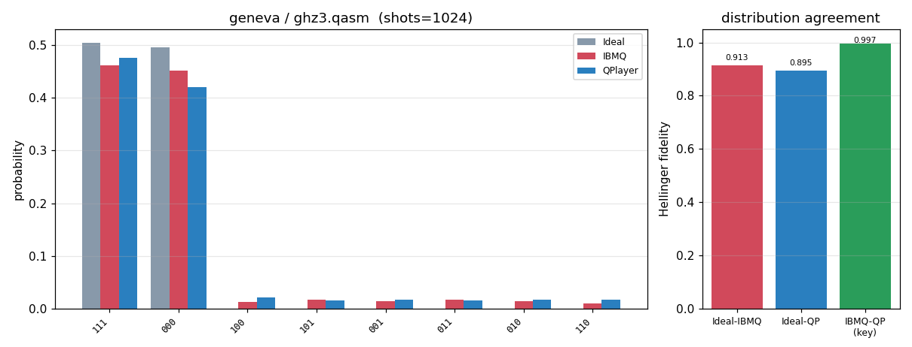


### geneva / ghz5.qasm
```text
# Device-noise validation -- device=geneva (FakeGeneva)  circuit=ghz5.qasm
#   device JSON: /home/ksjin/github/QPlayer-II/examples/benchmarks/noise/device_json/fake_geneva.json
#   shots=1024  seed=2093836441  max_sim_qubits=14

# Logical circuit: qubits=5 clbits=5 gates=[measurex5, cxx4, hx1]
# Transpiled circuit: qubits=27 clbits=5 gates=[measurex5, cxx4, rzx2, sxx1]

## Tier 1 -- qubit 0 coherence parameters (ns)
param    |    IBMQ reported |  QPlayer DeviceModel
---------+------------------+---------------------
T1       |        487,907.1 |            487,907.1
T2       |        364,525.6 |            364,525.6
T2*      | N/A (not in snapshot) | N/A (derived T_phi below)
T_phi    |                - |            581,900.7
# readout q0: P(0|1)=0.018000000000000016, P(1|0)=0.0292, symmetric=0.023600000000000065

## Tier 1b -- per-qubit T1/T2 round-trip (27 qubits)
# max |IBMQ - QPlayer|: T1=0.000 ns, T2=0.000 ns (0 => DeviceModel loads device coherence exactly)

# NOTE: device width 27q exceeds max_sim_qubits 14; QubitTruncationPass compresses the circuit onto its 5 active physical qubits (dense [0,k)), so QPlayer simulates 2^5 and run() projects each qubit's own device noise onto that range. Aer prunes idle qubits itself.

## Tier 2 -- measured distribution (probabilities)
state |     ideal | FakeBcknd |   QPlayer
-----------------------------------------
11111 |    0.5049 |    0.4404 |    0.4229
00000 |    0.4951 |    0.4189 |    0.4277
10000 |    0.0000 |    0.0205 |    0.0176
11011 |    0.0000 |    0.0107 |    0.0186
00100 |    0.0000 |    0.0127 |    0.0166
00010 |    0.0000 |    0.0098 |    0.0166
11101 |    0.0000 |    0.0166 |    0.0098
01111 |    0.0000 |    0.0098 |    0.0146
01000 |    0.0000 |    0.0127 |    0.0117
10111 |    0.0000 |    0.0117 |    0.0117
00001 |    0.0000 |    0.0088 |    0.0117
11110 |    0.0000 |    0.0078 |    0.0039
00011 |    0.0000 |    0.0068 |    0.0020
11100 |    0.0000 |    0.0029 |    0.0039
00111 |    0.0000 |    0.0029 |    0.0029
10010 |    0.0000 |    0.0010 |    0.0010

## Tier 2 -- distribution agreement
pair                       | Hellinger fidelity |        TVD
---------------------------+--------------------+-----------
ideal      vs FakeBackend  |            0.85933 |    0.14062
ideal      vs QPlayer      |            0.85053 |    0.14941
FakeBackend vs QPlayer (key) |            0.98099 |    0.04297

# QPlayer vs IBM (FakeBackend) agreement: 95.70% distribution overlap (1 - TVD)  |  98.10% Hellinger fidelity
# Higher Hellinger fidelity (-> 1.0) and lower TVD (-> 0.0) on the 'FakeBackend vs QPlayer' row mean QPlayer reproduces the device noise more faithfully. ideal-vs-* rows quantify how far each noisy run departs from the noiseless distribution.
# plot: /home/ksjin/github/QPlayer-II/examples/benchmarks/noise/result/plots-2026-07-22-1749/geneva_ghz5.png
```
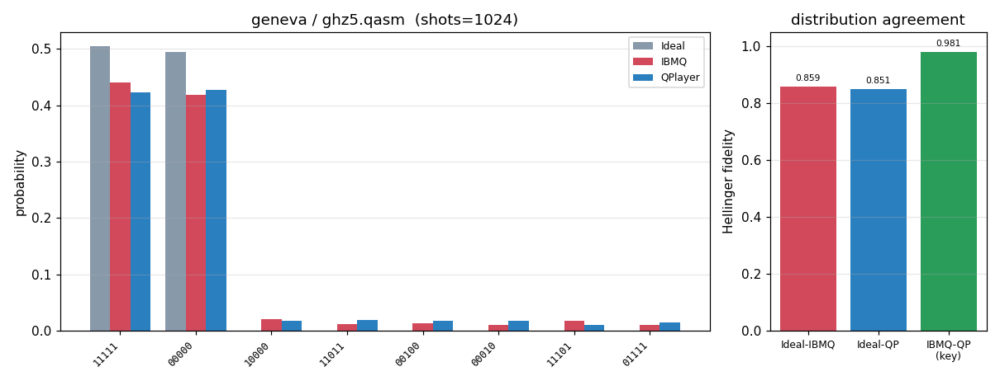


### geneva / x_relax_q0.qasm
```text
# Device-noise validation -- device=geneva (FakeGeneva)  circuit=x_relax_q0.qasm
#   device JSON: /home/ksjin/github/QPlayer-II/examples/benchmarks/noise/device_json/fake_geneva.json
#   shots=1024  seed=2093836441  max_sim_qubits=14

# Logical circuit: qubits=1 clbits=1 gates=[measurex1, xx1]
# Transpiled circuit: qubits=27 clbits=1 gates=[measurex1, xx1]

## Tier 1 -- qubit 0 coherence parameters (ns)
param    |    IBMQ reported |  QPlayer DeviceModel
---------+------------------+---------------------
T1       |        487,907.1 |            487,907.1
T2       |        364,525.6 |            364,525.6
T2*      | N/A (not in snapshot) | N/A (derived T_phi below)
T_phi    |                - |            581,900.7
# readout q0: P(0|1)=0.018000000000000016, P(1|0)=0.0292, symmetric=0.023600000000000065

## Tier 1b -- per-qubit T1/T2 round-trip (27 qubits)
# max |IBMQ - QPlayer|: T1=0.000 ns, T2=0.000 ns (0 => DeviceModel loads device coherence exactly)

# NOTE: device width 27q exceeds max_sim_qubits 14; QubitTruncationPass compresses the circuit onto its 1 active physical qubits (dense [0,k)), so QPlayer simulates 2^1 and run() projects each qubit's own device noise onto that range. Aer prunes idle qubits itself.

## Tier 2 -- measured distribution (probabilities)
state |     ideal | FakeBcknd |   QPlayer
-----------------------------------------
    1 |    1.0000 |    0.9795 |    0.9844
    0 |    0.0000 |    0.0205 |    0.0156

## Tier 2 -- distribution agreement
pair                       | Hellinger fidelity |        TVD
---------------------------+--------------------+-----------
ideal      vs FakeBackend  |            0.97949 |    0.02051
ideal      vs QPlayer      |            0.98438 |    0.01562
FakeBackend vs QPlayer (key) |            0.99966 |    0.00488

# QPlayer vs IBM (FakeBackend) agreement: 99.51% distribution overlap (1 - TVD)  |  99.97% Hellinger fidelity
# Higher Hellinger fidelity (-> 1.0) and lower TVD (-> 0.0) on the 'FakeBackend vs QPlayer' row mean QPlayer reproduces the device noise more faithfully. ideal-vs-* rows quantify how far each noisy run departs from the noiseless distribution.
# plot: /home/ksjin/github/QPlayer-II/examples/benchmarks/noise/result/plots-2026-07-22-1749/geneva_x_relax_q0.png
```
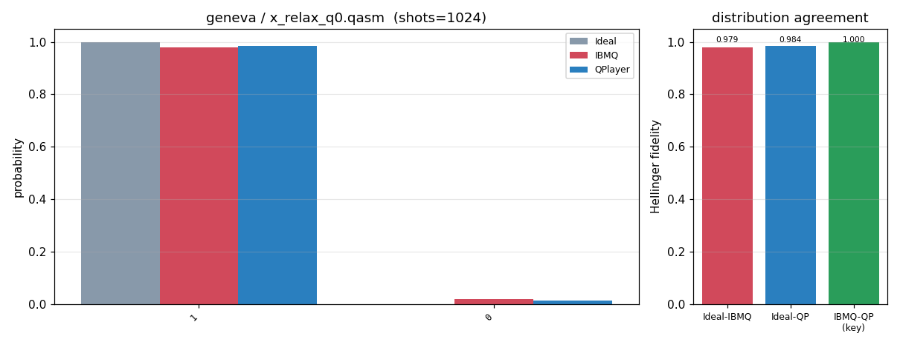


### geneva / qaoa_12q.qasm
```text
# Device-noise validation -- device=geneva (FakeGeneva)  circuit=qaoa_12q.qasm
#   device JSON: /home/ksjin/github/QPlayer-II/examples/benchmarks/noise/device_json/fake_geneva.json
#   shots=4096  seed=2093836441  max_sim_qubits=14

# Logical circuit: qubits=12 clbits=12 gates=[cxx22, hx12, measurex12, rxx12, rzx11]
# Transpiled circuit: qubits=27 clbits=12 gates=[rzx71, sxx36, cxx22, measurex12]

## Tier 1 -- qubit 0 coherence parameters (ns)
param    |    IBMQ reported |  QPlayer DeviceModel
---------+------------------+---------------------
T1       |        487,907.1 |            487,907.1
T2       |        364,525.6 |            364,525.6
T2*      | N/A (not in snapshot) | N/A (derived T_phi below)
T_phi    |                - |            581,900.7
# readout q0: P(0|1)=0.018000000000000016, P(1|0)=0.0292, symmetric=0.023600000000000065

## Tier 1b -- per-qubit T1/T2 round-trip (27 qubits)
# max |IBMQ - QPlayer|: T1=0.000 ns, T2=0.000 ns (0 => DeviceModel loads device coherence exactly)

# NOTE: device width 27q exceeds max_sim_qubits 14; QubitTruncationPass compresses the circuit onto its 12 active physical qubits (dense [0,k)), so QPlayer simulates 2^12 and run() projects each qubit's own device noise onto that range. Aer prunes idle qubits itself.

# NOTE: active width 12q -> distribution tier uses 65536 shots (>= 16 x 2^12) so the spread distribution is sampled above the statistical floor (requested shots=4096 is the floor).

## Tier 2 -- measured distribution (probabilities)
       state |     ideal | FakeBcknd |   QPlayer
------------------------------------------------
010101010101 |    0.0125 |    0.0077 |    0.0074
101010101010 |    0.0131 |    0.0072 |    0.0070
101010101001 |    0.0066 |    0.0042 |    0.0039
010101010110 |    0.0064 |    0.0039 |    0.0039
011010101010 |    0.0064 |    0.0038 |    0.0039
101010101101 |    0.0063 |    0.0041 |    0.0036
100101010101 |    0.0059 |    0.0040 |    0.0038
101101010101 |    0.0057 |    0.0033 |    0.0040
010010101010 |    0.0054 |    0.0040 |    0.0037
010101010010 |    0.0056 |    0.0035 |    0.0037
101010110101 |    0.0057 |    0.0035 |    0.0036
101010010101 |    0.0053 |    0.0033 |    0.0038
010101011010 |    0.0052 |    0.0035 |    0.0036
010101101010 |    0.0055 |    0.0033 |    0.0034
101011010101 |    0.0054 |    0.0035 |    0.0031
010101001010 |    0.0051 |    0.0033 |    0.0035

## Tier 2 -- distribution agreement
pair                       | Hellinger fidelity |        TVD
---------------------------+--------------------+-----------
ideal      vs FakeBackend  |            0.87982 |    0.22701
ideal      vs QPlayer      |            0.87892 |    0.22707
FakeBackend vs QPlayer (key) |            0.95883 |    0.12968

# QPlayer vs IBM (FakeBackend) agreement: 87.03% distribution overlap (1 - TVD)  |  95.88% Hellinger fidelity
# Higher Hellinger fidelity (-> 1.0) and lower TVD (-> 0.0) on the 'FakeBackend vs QPlayer' row mean QPlayer reproduces the device noise more faithfully. ideal-vs-* rows quantify how far each noisy run departs from the noiseless distribution.
# plot: /home/ksjin/github/QPlayer-II/examples/benchmarks/noise/result/plots-2026-07-22-1749/geneva_qaoa_12q.png
```
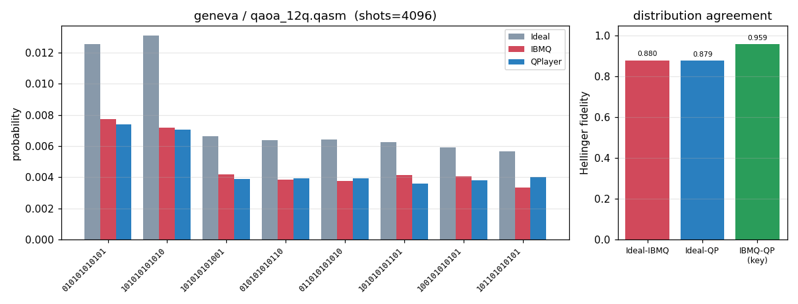


### geneva / vqe_12q.qasm
```text
# Device-noise validation -- device=geneva (FakeGeneva)  circuit=vqe_12q.qasm
#   device JSON: /home/ksjin/github/QPlayer-II/examples/benchmarks/noise/device_json/fake_geneva.json
#   shots=4096  seed=2093836441  max_sim_qubits=14

# Logical circuit: qubits=12 clbits=12 gates=[ryx36, cxx22, measurex12]
# Transpiled circuit: qubits=27 clbits=12 gates=[rzx72, sxx72, cxx22, measurex12]

## Tier 1 -- qubit 0 coherence parameters (ns)
param    |    IBMQ reported |  QPlayer DeviceModel
---------+------------------+---------------------
T1       |        487,907.1 |            487,907.1
T2       |        364,525.6 |            364,525.6
T2*      | N/A (not in snapshot) | N/A (derived T_phi below)
T_phi    |                - |            581,900.7
# readout q0: P(0|1)=0.018000000000000016, P(1|0)=0.0292, symmetric=0.023600000000000065

## Tier 1b -- per-qubit T1/T2 round-trip (27 qubits)
# max |IBMQ - QPlayer|: T1=0.000 ns, T2=0.000 ns (0 => DeviceModel loads device coherence exactly)

# NOTE: device width 27q exceeds max_sim_qubits 14; QubitTruncationPass compresses the circuit onto its 12 active physical qubits (dense [0,k)), so QPlayer simulates 2^12 and run() projects each qubit's own device noise onto that range. Aer prunes idle qubits itself.

# NOTE: active width 12q -> distribution tier uses 65536 shots (>= 16 x 2^12) so the spread distribution is sampled above the statistical floor (requested shots=4096 is the floor).

## Tier 2 -- measured distribution (probabilities)
       state |     ideal | FakeBcknd |   QPlayer
------------------------------------------------
010011001010 |    0.0213 |    0.0131 |    0.0128
010010001010 |    0.0185 |    0.0119 |    0.0109
010011100110 |    0.0135 |    0.0082 |    0.0088
010011011010 |    0.0130 |    0.0081 |    0.0092
001011001010 |    0.0121 |    0.0076 |    0.0068
010000010110 |    0.0110 |    0.0071 |    0.0073
010001010110 |    0.0110 |    0.0068 |    0.0071
000100001010 |    0.0111 |    0.0063 |    0.0065
010010100110 |    0.0106 |    0.0069 |    0.0064
000100010110 |    0.0095 |    0.0064 |    0.0070
000101010110 |    0.0080 |    0.0060 |    0.0055
000111010110 |    0.0084 |    0.0054 |    0.0052
010011010010 |    0.0083 |    0.0053 |    0.0047
000111001010 |    0.0077 |    0.0049 |    0.0055
001000010110 |    0.0078 |    0.0052 |    0.0050
011011001010 |    0.0074 |    0.0051 |    0.0054

## Tier 2 -- distribution agreement
pair                       | Hellinger fidelity |        TVD
---------------------------+--------------------+-----------
ideal      vs FakeBackend  |            0.86352 |    0.22523
ideal      vs QPlayer      |            0.85610 |    0.23376
FakeBackend vs QPlayer (key) |            0.96529 |    0.09352

# QPlayer vs IBM (FakeBackend) agreement: 90.65% distribution overlap (1 - TVD)  |  96.53% Hellinger fidelity
# Higher Hellinger fidelity (-> 1.0) and lower TVD (-> 0.0) on the 'FakeBackend vs QPlayer' row mean QPlayer reproduces the device noise more faithfully. ideal-vs-* rows quantify how far each noisy run departs from the noiseless distribution.
# plot: /home/ksjin/github/QPlayer-II/examples/benchmarks/noise/result/plots-2026-07-22-1749/geneva_vqe_12q.png
```
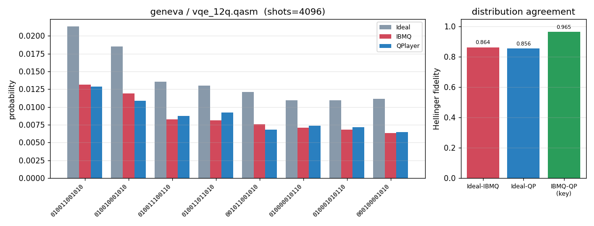
