# Device-noise validation report -- 2026-07-28 17:41

> Tool: `comparison.py`
> Compared per (device, circuit): Ideal (QPlayer, no noise) · FakeBackend (Aer `from_backend`) · QPlayer (`load_device`)
> Devices: manila (5q) · oslo (7q) · geneva (27q; generic-circuit distributions simulated on the active qubits via QubitTruncationPass, )
> Tiers: (1) q0 T1/T2/T2*/T_phi/readout · (1b) per-qubit round-trip · (1b plot) measured T1/T2 decay with exp(-t/T) fit · (2) distribution + Hellinger fidelity / TVD
> Key metric: the `FakeBackend vs QPlayer` Hellinger fidelity (-> 1.0 = QPlayer reproduces the device noise faithfully)
> Agreement: per experiment, `QPlayer vs IBM (FakeBackend) agreement` reports distribution overlap (1 - TVD) and Hellinger fidelity as percentages; the Matrix summary lists Hellinger fidelity and TVD as raw [0, 1] values (see the note under that table).

## Environment
| Item | Value |
|------|-------|
| datetime | 2026-07-28 17:41 |
| host | Linux 6.8.0-136-generic x86_64 |
| cpu | Intel(R) Xeon(R) Platinum 8452Y |
| qiskit | 2.4.2 |
| qiskit-aer | 0.17.2 |
| qiskit-ibm-runtime | 0.47.0 |
| matplotlib | 3.10.1 |
| scipy | 1.18.0 |
| qplayer | 5.5.0 (.so built 2026-07-28 17:39:36) |
| generic shots / ansatz shots | 1024 / 4096 |
| seed | 512513859 |
| max_sim_qubits | 14 |

## Matrix summary
| Device | Circuit | Transpiled width | Tier 2 (distribution) | Effective shots | Hellinger | TVD |
|--------|---------|-----------------:|:---------------------:|----------------:|----------:|----------:|
| manila | bell.qasm | 5 | ✓ | 1024 | 0.9982 | 0.0420 |
| manila | ghz3.qasm | 5 | ✓ | 1024 | 0.9933 | 0.0713 |
| manila | ghz5.qasm | 5 | ✓ | 1024 | 0.9798 | 0.0762 |
| manila | x_relax_q0.qasm | 5 | ✓ | 1024 | 0.9983 | 0.0146 |
| manila | qaoa_5q.qasm | 5 | ✓ | 4096 | 0.9954 | 0.0449 |
| manila | vqe_5q.qasm | 5 | ✓ | 4096 | 0.9939 | 0.0544 |
| oslo | bell.qasm | 7 | ✓ | 2048 ↑ (floor 1024) | 0.9988 | 0.0190 |
| oslo | ghz3.qasm | 7 | ✓ | 2048 ↑ (floor 1024) | 0.9976 | 0.0264 |
| oslo | ghz5.qasm | 7 | ✓ | 2048 ↑ (floor 1024) | 0.9914 | 0.0249 |
| oslo | x_relax_q0.qasm | 7 | ✓ | 2048 ↑ (floor 1024) | 0.9996 | 0.0039 |
| oslo | qaoa_7q.qasm | 7 | ✓ | 4096 | 0.9806 | 0.0889 |
| oslo | vqe_7q.qasm | 7 | ✓ | 4096 | 0.9833 | 0.0896 |
| geneva | bell.qasm | 27 → sim 2 | ✓ | 1024 | 0.9997 | 0.0166 |
| geneva | ghz3.qasm | 27 → sim 3 | ✓ | 1024 | 0.9955 | 0.0352 |
| geneva | ghz5.qasm | 27 → sim 5 | ✓ | 1024 | 0.9784 | 0.0352 |
| geneva | x_relax_q0.qasm | 27 → sim 1 | ✓ | 1024 | 0.9999 | 0.0029 |
| geneva | qaoa_12q.qasm | 27 → sim 12 | ✓ | 65536 ↑ (floor 4096) | 0.9637 | 0.1164 |
| geneva | vqe_12q.qasm | 27 → sim 12 | ✓ | 65536 ↑ (floor 4096) | 0.9640 | 0.0952 |

Both columns compare the **QPlayer noisy run against the FakeBackend** (the IBM device-noise reference), higher/lower being better as noted:

- **Hellinger fidelity** `(sum_o sqrt(p_o * q_o))^2` in [0, 1] -- statistical similarity of the two measurement distributions. **1.0 = identical**; higher is better. Robust but saturates near 1.0, so small differences look compressed.
- **TVD** (total-variation distance) `0.5 * sum_o |p_o - q_o|` in [0, 1] -- how far apart the two distributions are. **0.0 = identical**; lower is better. A true distance, so it shows error changes with more contrast than Hellinger.
- Read both together with *Effective shots*: at a low shot count both metrics are dominated by sampling noise (two samples of the same distribution already disagree), not by model mismatch.

## Results

## Device: manila
### manila -- q0 T1/T2 relaxation (measured + exp fit)
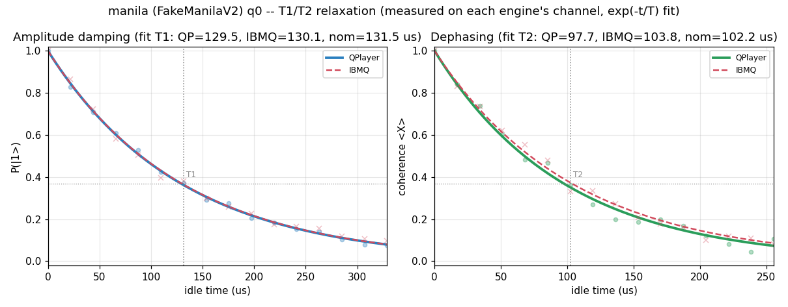


### manila / bell.qasm
```text
# Device-noise validation -- device=manila (FakeManilaV2)  circuit=bell.qasm
#   device JSON: examples/benchmarks/noise/device_json/fake_manila_v2.json
#   shots=1024  seed=512513859  max_sim_qubits=14

# Logical circuit: qubits=2 clbits=2 gates=[measurex2, cxx1, hx1]
# Transpiled circuit: qubits=5 clbits=2 gates=[measurex2, rzx2, cxx1, sxx1]

## Tier 1 -- qubit 0 coherence parameters (ns)
param    |    IBMQ reported |  QPlayer DeviceModel
---------+------------------+---------------------
T1       |        131,528.6 |            131,528.6
T2       |        102,203.9 |            102,203.9
T2*      | N/A (not in snapshot) | N/A (derived T_phi below)
T_phi    |                - |            167,142.8
# readout q0: P(0|1)=0.05479999999999996, P(1|0)=0.0158, symmetric=0.0353

## Tier 1b -- per-qubit T1/T2 round-trip (5 qubits)
# max |IBMQ - QPlayer|: T1=0.000 ns, T2=0.000 ns (0 => DeviceModel loads device coherence exactly)

# T1 fit (us): QPlayer=129.5 IBMQ=130.1  nominal=131.5
# T2 fit (us): QPlayer=97.7 IBMQ=103.8  nominal=102.2
# t1t2_plot: examples/benchmarks/noise/result/plots-2026-07-28-1741/manila_T1T2.png  (q0 measured decay + exp fit)

## Tier 2 -- measured distribution (probabilities)
state |     ideal | FakeBcknd |   QPlayer
-----------------------------------------
   00 |    0.4893 |    0.4590 |    0.5010
   11 |    0.5107 |    0.4844 |    0.4473
   10 |    0.0000 |    0.0303 |    0.0273
   01 |    0.0000 |    0.0264 |    0.0244

## Tier 2 -- distribution agreement
pair                       | Hellinger fidelity |        TVD
---------------------------+--------------------+-----------
ideal      vs FakeBackend  |            0.94335 |    0.05664
ideal      vs QPlayer      |            0.94679 |    0.06348
FakeBackend vs QPlayer (key) |            0.99823 |    0.04199

# QPlayer vs IBM (FakeBackend) agreement: 95.80% distribution overlap (1 - TVD)  |  99.82% Hellinger fidelity
# Higher Hellinger fidelity (-> 1.0) and lower TVD (-> 0.0) on the 'FakeBackend vs QPlayer' row mean QPlayer reproduces the device noise more faithfully. ideal-vs-* rows quantify how far each noisy run departs from the noiseless distribution.
# plot: examples/benchmarks/noise/result/plots-2026-07-28-1741/manila_bell.png
```
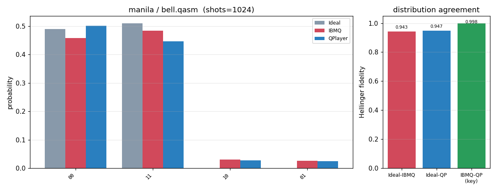


### manila / ghz3.qasm
```text
# Device-noise validation -- device=manila (FakeManilaV2)  circuit=ghz3.qasm
#   device JSON: examples/benchmarks/noise/device_json/fake_manila_v2.json
#   shots=1024  seed=512513859  max_sim_qubits=14

# Logical circuit: qubits=3 clbits=3 gates=[measurex3, cxx2, hx1]
# Transpiled circuit: qubits=5 clbits=3 gates=[measurex3, cxx2, rzx2, sxx1]

## Tier 1 -- qubit 0 coherence parameters (ns)
param    |    IBMQ reported |  QPlayer DeviceModel
---------+------------------+---------------------
T1       |        131,528.6 |            131,528.6
T2       |        102,203.9 |            102,203.9
T2*      | N/A (not in snapshot) | N/A (derived T_phi below)
T_phi    |                - |            167,142.8
# readout q0: P(0|1)=0.05479999999999996, P(1|0)=0.0158, symmetric=0.0353

## Tier 1b -- per-qubit T1/T2 round-trip (5 qubits)
# max |IBMQ - QPlayer|: T1=0.000 ns, T2=0.000 ns (0 => DeviceModel loads device coherence exactly)

## Tier 2 -- measured distribution (probabilities)
state |     ideal | FakeBcknd |   QPlayer
-----------------------------------------
  000 |    0.4893 |    0.4229 |    0.4629
  111 |    0.5107 |    0.4385 |    0.3770
  011 |    0.0000 |    0.0400 |    0.0547
  100 |    0.0000 |    0.0381 |    0.0459
  110 |    0.0000 |    0.0215 |    0.0195
  001 |    0.0000 |    0.0205 |    0.0127
  101 |    0.0000 |    0.0098 |    0.0166
  010 |    0.0000 |    0.0088 |    0.0107

## Tier 2 -- distribution agreement
pair                       | Hellinger fidelity |        TVD
---------------------------+--------------------+-----------
ideal      vs FakeBackend  |            0.86133 |    0.13867
ideal      vs QPlayer      |            0.83662 |    0.16016
FakeBackend vs QPlayer (key) |            0.99330 |    0.07129

# QPlayer vs IBM (FakeBackend) agreement: 92.87% distribution overlap (1 - TVD)  |  99.33% Hellinger fidelity
# Higher Hellinger fidelity (-> 1.0) and lower TVD (-> 0.0) on the 'FakeBackend vs QPlayer' row mean QPlayer reproduces the device noise more faithfully. ideal-vs-* rows quantify how far each noisy run departs from the noiseless distribution.
# plot: examples/benchmarks/noise/result/plots-2026-07-28-1741/manila_ghz3.png
```
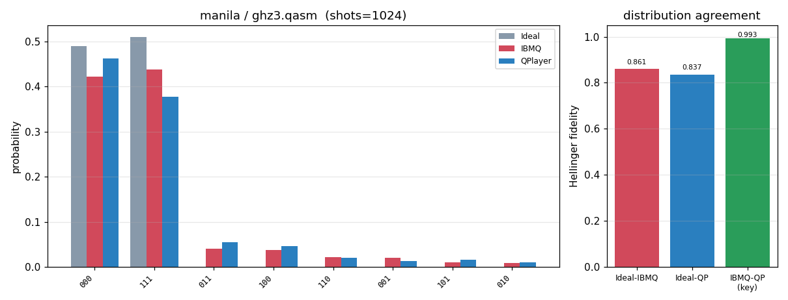


### manila / ghz5.qasm
```text
# Device-noise validation -- device=manila (FakeManilaV2)  circuit=ghz5.qasm
#   device JSON: examples/benchmarks/noise/device_json/fake_manila_v2.json
#   shots=1024  seed=512513859  max_sim_qubits=14

# Logical circuit: qubits=5 clbits=5 gates=[measurex5, cxx4, hx1]
# Transpiled circuit: qubits=5 clbits=5 gates=[measurex5, cxx4, rzx2, sxx1]

## Tier 1 -- qubit 0 coherence parameters (ns)
param    |    IBMQ reported |  QPlayer DeviceModel
---------+------------------+---------------------
T1       |        131,528.6 |            131,528.6
T2       |        102,203.9 |            102,203.9
T2*      | N/A (not in snapshot) | N/A (derived T_phi below)
T_phi    |                - |            167,142.8
# readout q0: P(0|1)=0.05479999999999996, P(1|0)=0.0158, symmetric=0.0353

## Tier 1b -- per-qubit T1/T2 round-trip (5 qubits)
# max |IBMQ - QPlayer|: T1=0.000 ns, T2=0.000 ns (0 => DeviceModel loads device coherence exactly)

## Tier 2 -- measured distribution (probabilities)
state |     ideal | FakeBcknd |   QPlayer
-----------------------------------------
00000 |    0.4893 |    0.4043 |    0.4434
11111 |    0.5107 |    0.4072 |    0.3760
11011 |    0.0000 |    0.0498 |    0.0566
00100 |    0.0000 |    0.0361 |    0.0254
11110 |    0.0000 |    0.0107 |    0.0254
00001 |    0.0000 |    0.0225 |    0.0088
11101 |    0.0000 |    0.0166 |    0.0098
00010 |    0.0000 |    0.0098 |    0.0068
10111 |    0.0000 |    0.0088 |    0.0068
01111 |    0.0000 |    0.0029 |    0.0127
01000 |    0.0000 |    0.0068 |    0.0068
10000 |    0.0000 |    0.0068 |    0.0059
11010 |    0.0000 |    0.0039 |    0.0029
11100 |    0.0000 |    0.0029 |    0.0020
00011 |    0.0000 |    0.0029 |    0.0010
01011 |    0.0000 |    0.0010 |    0.0029

## Tier 2 -- distribution agreement
pair                       | Hellinger fidelity |        TVD
---------------------------+--------------------+-----------
ideal      vs FakeBackend  |            0.81146 |    0.18848
ideal      vs QPlayer      |            0.81713 |    0.18066
FakeBackend vs QPlayer (key) |            0.97981 |    0.07617

# QPlayer vs IBM (FakeBackend) agreement: 92.38% distribution overlap (1 - TVD)  |  97.98% Hellinger fidelity
# Higher Hellinger fidelity (-> 1.0) and lower TVD (-> 0.0) on the 'FakeBackend vs QPlayer' row mean QPlayer reproduces the device noise more faithfully. ideal-vs-* rows quantify how far each noisy run departs from the noiseless distribution.
# plot: examples/benchmarks/noise/result/plots-2026-07-28-1741/manila_ghz5.png
```
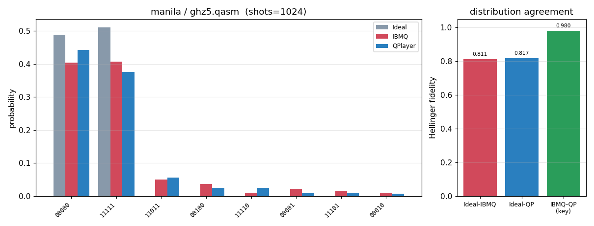


### manila / x_relax_q0.qasm
```text
# Device-noise validation -- device=manila (FakeManilaV2)  circuit=x_relax_q0.qasm
#   device JSON: examples/benchmarks/noise/device_json/fake_manila_v2.json
#   shots=1024  seed=512513859  max_sim_qubits=14

# Logical circuit: qubits=1 clbits=1 gates=[measurex1, xx1]
# Transpiled circuit: qubits=5 clbits=1 gates=[measurex1, xx1]

## Tier 1 -- qubit 0 coherence parameters (ns)
param    |    IBMQ reported |  QPlayer DeviceModel
---------+------------------+---------------------
T1       |        131,528.6 |            131,528.6
T2       |        102,203.9 |            102,203.9
T2*      | N/A (not in snapshot) | N/A (derived T_phi below)
T_phi    |                - |            167,142.8
# readout q0: P(0|1)=0.05479999999999996, P(1|0)=0.0158, symmetric=0.0353

## Tier 1b -- per-qubit T1/T2 round-trip (5 qubits)
# max |IBMQ - QPlayer|: T1=0.000 ns, T2=0.000 ns (0 => DeviceModel loads device coherence exactly)

## Tier 2 -- measured distribution (probabilities)
state |     ideal | FakeBcknd |   QPlayer
-----------------------------------------
    1 |    1.0000 |    0.9736 |    0.9590
    0 |    0.0000 |    0.0264 |    0.0410

## Tier 2 -- distribution agreement
pair                       | Hellinger fidelity |        TVD
---------------------------+--------------------+-----------
ideal      vs FakeBackend  |            0.97363 |    0.02637
ideal      vs QPlayer      |            0.95898 |    0.04102
FakeBackend vs QPlayer (key) |            0.99833 |    0.01465

# QPlayer vs IBM (FakeBackend) agreement: 98.54% distribution overlap (1 - TVD)  |  99.83% Hellinger fidelity
# Higher Hellinger fidelity (-> 1.0) and lower TVD (-> 0.0) on the 'FakeBackend vs QPlayer' row mean QPlayer reproduces the device noise more faithfully. ideal-vs-* rows quantify how far each noisy run departs from the noiseless distribution.
# plot: examples/benchmarks/noise/result/plots-2026-07-28-1741/manila_x_relax_q0.png
```
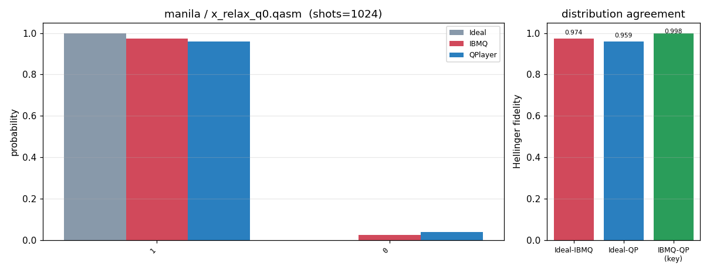


### manila / qaoa_5q.qasm
```text
# Device-noise validation -- device=manila (FakeManilaV2)  circuit=qaoa_5q.qasm
#   device JSON: examples/benchmarks/noise/device_json/fake_manila_v2.json
#   shots=4096  seed=512513859  max_sim_qubits=14

# Logical circuit: qubits=5 clbits=5 gates=[cxx8, hx5, measurex5, rxx5, rzx4]
# Transpiled circuit: qubits=5 clbits=5 gates=[rzx29, sxx15, cxx8, measurex5]

## Tier 1 -- qubit 0 coherence parameters (ns)
param    |    IBMQ reported |  QPlayer DeviceModel
---------+------------------+---------------------
T1       |        131,528.6 |            131,528.6
T2       |        102,203.9 |            102,203.9
T2*      | N/A (not in snapshot) | N/A (derived T_phi below)
T_phi    |                - |            167,142.8
# readout q0: P(0|1)=0.05479999999999996, P(1|0)=0.0158, symmetric=0.0353

## Tier 1b -- per-qubit T1/T2 round-trip (5 qubits)
# max |IBMQ - QPlayer|: T1=0.000 ns, T2=0.000 ns (0 => DeviceModel loads device coherence exactly)

## Tier 2 -- measured distribution (probabilities)
state |     ideal | FakeBcknd |   QPlayer
-----------------------------------------
10101 |    0.1707 |    0.1350 |    0.1267
01010 |    0.1545 |    0.1235 |    0.1272
01001 |    0.0815 |    0.0747 |    0.0818
10010 |    0.0840 |    0.0754 |    0.0764
10110 |    0.0854 |    0.0776 |    0.0703
01101 |    0.0811 |    0.0732 |    0.0735
00110 |    0.0349 |    0.0295 |    0.0332
10011 |    0.0337 |    0.0342 |    0.0295
10100 |    0.0244 |    0.0300 |    0.0308
11001 |    0.0283 |    0.0244 |    0.0271
01011 |    0.0259 |    0.0305 |    0.0227
01100 |    0.0261 |    0.0256 |    0.0259
10001 |    0.0120 |    0.0322 |    0.0330
11010 |    0.0232 |    0.0242 |    0.0261
00101 |    0.0200 |    0.0242 |    0.0276
10000 |    0.0198 |    0.0208 |    0.0227

## Tier 2 -- distribution agreement
pair                       | Hellinger fidelity |        TVD
---------------------------+--------------------+-----------
ideal      vs FakeBackend  |            0.96893 |    0.10742
ideal      vs QPlayer      |            0.96631 |    0.11426
FakeBackend vs QPlayer (key) |            0.99537 |    0.04492

# QPlayer vs IBM (FakeBackend) agreement: 95.51% distribution overlap (1 - TVD)  |  99.54% Hellinger fidelity
# Higher Hellinger fidelity (-> 1.0) and lower TVD (-> 0.0) on the 'FakeBackend vs QPlayer' row mean QPlayer reproduces the device noise more faithfully. ideal-vs-* rows quantify how far each noisy run departs from the noiseless distribution.
# plot: examples/benchmarks/noise/result/plots-2026-07-28-1741/manila_qaoa_5q.png
```
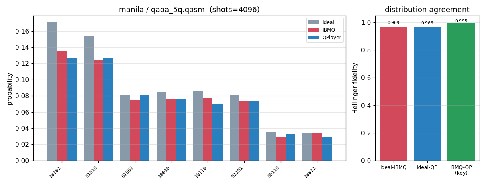


### manila / vqe_5q.qasm
```text
# Device-noise validation -- device=manila (FakeManilaV2)  circuit=vqe_5q.qasm
#   device JSON: examples/benchmarks/noise/device_json/fake_manila_v2.json
#   shots=4096  seed=512513859  max_sim_qubits=14

# Logical circuit: qubits=5 clbits=5 gates=[ryx15, cxx8, measurex5]
# Transpiled circuit: qubits=5 clbits=5 gates=[rzx30, sxx30, cxx8, measurex5]

## Tier 1 -- qubit 0 coherence parameters (ns)
param    |    IBMQ reported |  QPlayer DeviceModel
---------+------------------+---------------------
T1       |        131,528.6 |            131,528.6
T2       |        102,203.9 |            102,203.9
T2*      | N/A (not in snapshot) | N/A (derived T_phi below)
T_phi    |                - |            167,142.8
# readout q0: P(0|1)=0.05479999999999996, P(1|0)=0.0158, symmetric=0.0353

## Tier 1b -- per-qubit T1/T2 round-trip (5 qubits)
# max |IBMQ - QPlayer|: T1=0.000 ns, T2=0.000 ns (0 => DeviceModel loads device coherence exactly)

## Tier 2 -- measured distribution (probabilities)
state |     ideal | FakeBcknd |   QPlayer
-----------------------------------------
01001 |    0.2131 |    0.1719 |    0.1807
01111 |    0.1777 |    0.1416 |    0.1426
10001 |    0.1353 |    0.1143 |    0.1023
10111 |    0.1343 |    0.1091 |    0.0964
11111 |    0.0835 |    0.0801 |    0.0706
11011 |    0.0627 |    0.0566 |    0.0513
11001 |    0.0559 |    0.0571 |    0.0498
01011 |    0.0310 |    0.0479 |    0.0559
00111 |    0.0291 |    0.0312 |    0.0322
10011 |    0.0156 |    0.0295 |    0.0325
11101 |    0.0176 |    0.0239 |    0.0237
01101 |    0.0037 |    0.0293 |    0.0232
00011 |    0.0149 |    0.0173 |    0.0200
00001 |    0.0115 |    0.0168 |    0.0232
10101 |    0.0017 |    0.0146 |    0.0154
01110 |    0.0000 |    0.0078 |    0.0105

## Tier 2 -- distribution agreement
pair                       | Hellinger fidelity |        TVD
---------------------------+--------------------+-----------
ideal      vs FakeBackend  |            0.93959 |    0.13403
ideal      vs QPlayer      |            0.92024 |    0.16895
FakeBackend vs QPlayer (key) |            0.99387 |    0.05444

# QPlayer vs IBM (FakeBackend) agreement: 94.56% distribution overlap (1 - TVD)  |  99.39% Hellinger fidelity
# Higher Hellinger fidelity (-> 1.0) and lower TVD (-> 0.0) on the 'FakeBackend vs QPlayer' row mean QPlayer reproduces the device noise more faithfully. ideal-vs-* rows quantify how far each noisy run departs from the noiseless distribution.
# plot: examples/benchmarks/noise/result/plots-2026-07-28-1741/manila_vqe_5q.png
```
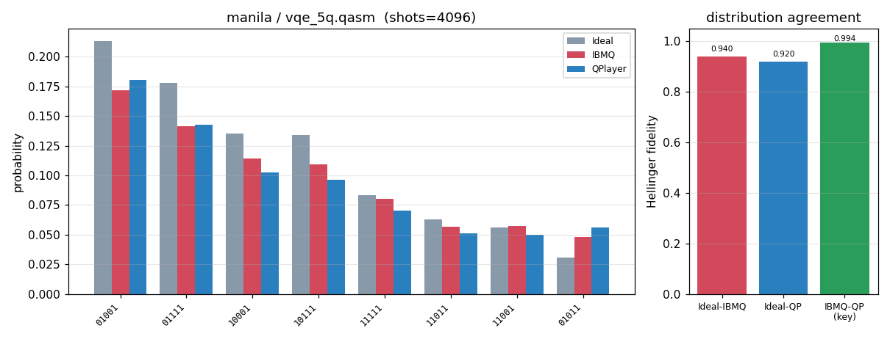


## Device: oslo
### oslo -- q0 T1/T2 relaxation (measured + exp fit)
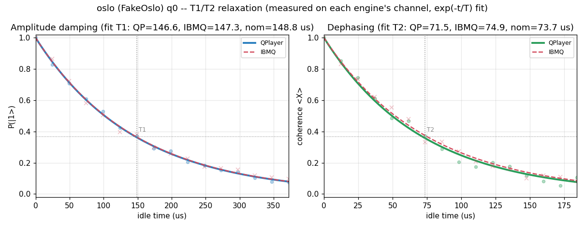


### oslo / bell.qasm
```text
# Device-noise validation -- device=oslo (FakeOslo)  circuit=bell.qasm
#   device JSON: examples/benchmarks/noise/device_json/fake_oslo.json
#   shots=1024  seed=512513859  max_sim_qubits=14

# Logical circuit: qubits=2 clbits=2 gates=[measurex2, cxx1, hx1]
# Transpiled circuit: qubits=7 clbits=2 gates=[measurex2, rzx2, cxx1, sxx1]

## Tier 1 -- qubit 0 coherence parameters (ns)
param    |    IBMQ reported |  QPlayer DeviceModel
---------+------------------+---------------------
T1       |        148,847.5 |            148,847.5
T2       |         73,693.0 |             73,693.0
T2*      | N/A (not in snapshot) | N/A (derived T_phi below)
T_phi    |                - |             97,936.8
# readout q0: P(0|1)=0.0102, P(1|0)=0.009399999999999964, symmetric=0.009800000000000031

## Tier 1b -- per-qubit T1/T2 round-trip (7 qubits)
# max |IBMQ - QPlayer|: T1=0.000 ns, T2=0.000 ns (0 => DeviceModel loads device coherence exactly)

# T1 fit (us): QPlayer=146.6 IBMQ=147.3  nominal=148.8
# T2 fit (us): QPlayer=71.5 IBMQ=74.9  nominal=73.7
# t1t2_plot: examples/benchmarks/noise/result/plots-2026-07-28-1741/oslo_T1T2.png  (q0 measured decay + exp fit)

# NOTE: active width 7q -> distribution tier uses 2048 shots (>= 16 x 2^7) so the spread distribution is sampled above the statistical floor (requested shots=1024 is the floor).

## Tier 2 -- measured distribution (probabilities)
  state |     ideal | FakeBcknd |   QPlayer
-------------------------------------------
     11 |    0.5146 |    0.5010 |    0.4888
     00 |    0.4854 |    0.4683 |    0.4868
     10 |    0.0000 |    0.0151 |    0.0156
     01 |    0.0000 |    0.0156 |    0.0088

## Tier 2 -- distribution agreement
pair                       | Hellinger fidelity |        TVD
---------------------------+--------------------+-----------
ideal      vs FakeBackend  |            0.96923 |    0.03076
ideal      vs QPlayer      |            0.97540 |    0.02588
FakeBackend vs QPlayer (key) |            0.99876 |    0.01904

# QPlayer vs IBM (FakeBackend) agreement: 98.10% distribution overlap (1 - TVD)  |  99.88% Hellinger fidelity
# Higher Hellinger fidelity (-> 1.0) and lower TVD (-> 0.0) on the 'FakeBackend vs QPlayer' row mean QPlayer reproduces the device noise more faithfully. ideal-vs-* rows quantify how far each noisy run departs from the noiseless distribution.
# plot: examples/benchmarks/noise/result/plots-2026-07-28-1741/oslo_bell.png
```


### oslo / ghz3.qasm
```text
# Device-noise validation -- device=oslo (FakeOslo)  circuit=ghz3.qasm
#   device JSON: examples/benchmarks/noise/device_json/fake_oslo.json
#   shots=1024  seed=512513859  max_sim_qubits=14

# Logical circuit: qubits=3 clbits=3 gates=[measurex3, cxx2, hx1]
# Transpiled circuit: qubits=7 clbits=3 gates=[measurex3, cxx2, rzx2, sxx1]

## Tier 1 -- qubit 0 coherence parameters (ns)
param    |    IBMQ reported |  QPlayer DeviceModel
---------+------------------+---------------------
T1       |        148,847.5 |            148,847.5
T2       |         73,693.0 |             73,693.0
T2*      | N/A (not in snapshot) | N/A (derived T_phi below)
T_phi    |                - |             97,936.8
# readout q0: P(0|1)=0.0102, P(1|0)=0.009399999999999964, symmetric=0.009800000000000031

## Tier 1b -- per-qubit T1/T2 round-trip (7 qubits)
# max |IBMQ - QPlayer|: T1=0.000 ns, T2=0.000 ns (0 => DeviceModel loads device coherence exactly)

# NOTE: active width 7q -> distribution tier uses 2048 shots (>= 16 x 2^7) so the spread distribution is sampled above the statistical floor (requested shots=1024 is the floor).

## Tier 2 -- measured distribution (probabilities)
  state |     ideal | FakeBcknd |   QPlayer
-------------------------------------------
    111 |    0.5146 |    0.4946 |    0.4731
    000 |    0.4854 |    0.4722 |    0.4888
    110 |    0.0000 |    0.0068 |    0.0078
    010 |    0.0000 |    0.0049 |    0.0093
    101 |    0.0000 |    0.0078 |    0.0059
    001 |    0.0000 |    0.0044 |    0.0078
    011 |    0.0000 |    0.0044 |    0.0054
    100 |    0.0000 |    0.0049 |    0.0020

## Tier 2 -- distribution agreement
pair                       | Hellinger fidelity |        TVD
---------------------------+--------------------+-----------
ideal      vs FakeBackend  |            0.96679 |    0.03320
ideal      vs QPlayer      |            0.96142 |    0.04150
FakeBackend vs QPlayer (key) |            0.99755 |    0.02637

# QPlayer vs IBM (FakeBackend) agreement: 97.36% distribution overlap (1 - TVD)  |  99.76% Hellinger fidelity
# Higher Hellinger fidelity (-> 1.0) and lower TVD (-> 0.0) on the 'FakeBackend vs QPlayer' row mean QPlayer reproduces the device noise more faithfully. ideal-vs-* rows quantify how far each noisy run departs from the noiseless distribution.
# plot: examples/benchmarks/noise/result/plots-2026-07-28-1741/oslo_ghz3.png
```
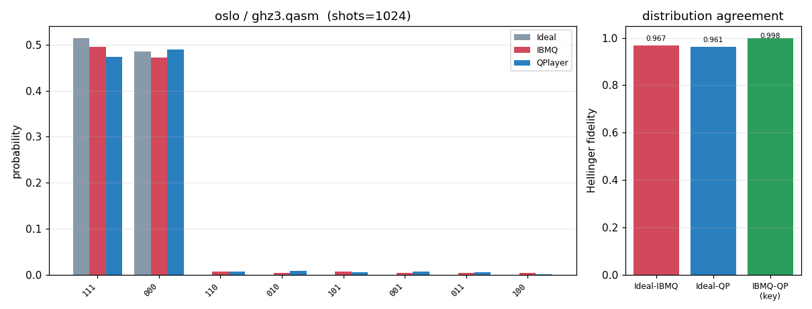


### oslo / ghz5.qasm
```text
# Device-noise validation -- device=oslo (FakeOslo)  circuit=ghz5.qasm
#   device JSON: examples/benchmarks/noise/device_json/fake_oslo.json
#   shots=1024  seed=512513859  max_sim_qubits=14

# Logical circuit: qubits=5 clbits=5 gates=[measurex5, cxx4, hx1]
# Transpiled circuit: qubits=7 clbits=5 gates=[measurex5, cxx4, rzx2, sxx1]

## Tier 1 -- qubit 0 coherence parameters (ns)
param    |    IBMQ reported |  QPlayer DeviceModel
---------+------------------+---------------------
T1       |        148,847.5 |            148,847.5
T2       |         73,693.0 |             73,693.0
T2*      | N/A (not in snapshot) | N/A (derived T_phi below)
T_phi    |                - |             97,936.8
# readout q0: P(0|1)=0.0102, P(1|0)=0.009399999999999964, symmetric=0.009800000000000031

## Tier 1b -- per-qubit T1/T2 round-trip (7 qubits)
# max |IBMQ - QPlayer|: T1=0.000 ns, T2=0.000 ns (0 => DeviceModel loads device coherence exactly)

# NOTE: active width 7q -> distribution tier uses 2048 shots (>= 16 x 2^7) so the spread distribution is sampled above the statistical floor (requested shots=1024 is the floor).

## Tier 2 -- measured distribution (probabilities)
  state |     ideal | FakeBcknd |   QPlayer
-------------------------------------------
  11111 |    0.5146 |    0.4673 |    0.4561
  00000 |    0.4854 |    0.4570 |    0.4619
  10000 |    0.0000 |    0.0093 |    0.0142
  01111 |    0.0000 |    0.0137 |    0.0093
  11011 |    0.0000 |    0.0093 |    0.0098
  00100 |    0.0000 |    0.0063 |    0.0088
  00010 |    0.0000 |    0.0044 |    0.0088
  10111 |    0.0000 |    0.0049 |    0.0078
  11101 |    0.0000 |    0.0054 |    0.0068
  11110 |    0.0000 |    0.0044 |    0.0039
  00001 |    0.0000 |    0.0034 |    0.0044
  01000 |    0.0000 |    0.0049 |    0.0020
  00011 |    0.0000 |    0.0010 |    0.0024
  11100 |    0.0000 |    0.0024 |    0.0005
  11000 |    0.0000 |    0.0015 |    0.0010
  00111 |    0.0000 |    0.0010 |    0.0010

## Tier 2 -- distribution agreement
pair                       | Hellinger fidelity |        TVD
---------------------------+--------------------+-----------
ideal      vs FakeBackend  |            0.92424 |    0.07568
ideal      vs QPlayer      |            0.91768 |    0.08203
FakeBackend vs QPlayer (key) |            0.99135 |    0.02490

# QPlayer vs IBM (FakeBackend) agreement: 97.51% distribution overlap (1 - TVD)  |  99.14% Hellinger fidelity
# Higher Hellinger fidelity (-> 1.0) and lower TVD (-> 0.0) on the 'FakeBackend vs QPlayer' row mean QPlayer reproduces the device noise more faithfully. ideal-vs-* rows quantify how far each noisy run departs from the noiseless distribution.
# plot: examples/benchmarks/noise/result/plots-2026-07-28-1741/oslo_ghz5.png
```
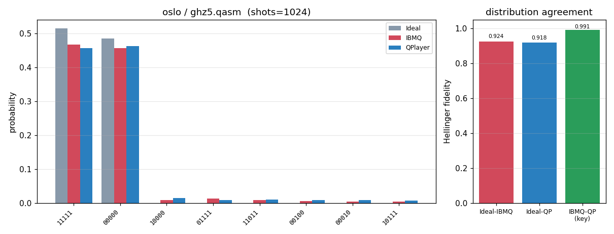


### oslo / x_relax_q0.qasm
```text
# Device-noise validation -- device=oslo (FakeOslo)  circuit=x_relax_q0.qasm
#   device JSON: examples/benchmarks/noise/device_json/fake_oslo.json
#   shots=1024  seed=512513859  max_sim_qubits=14

# Logical circuit: qubits=1 clbits=1 gates=[measurex1, xx1]
# Transpiled circuit: qubits=7 clbits=1 gates=[measurex1, xx1]

## Tier 1 -- qubit 0 coherence parameters (ns)
param    |    IBMQ reported |  QPlayer DeviceModel
---------+------------------+---------------------
T1       |        148,847.5 |            148,847.5
T2       |         73,693.0 |             73,693.0
T2*      | N/A (not in snapshot) | N/A (derived T_phi below)
T_phi    |                - |             97,936.8
# readout q0: P(0|1)=0.0102, P(1|0)=0.009399999999999964, symmetric=0.009800000000000031

## Tier 1b -- per-qubit T1/T2 round-trip (7 qubits)
# max |IBMQ - QPlayer|: T1=0.000 ns, T2=0.000 ns (0 => DeviceModel loads device coherence exactly)

# NOTE: active width 7q -> distribution tier uses 2048 shots (>= 16 x 2^7) so the spread distribution is sampled above the statistical floor (requested shots=1024 is the floor).

## Tier 2 -- measured distribution (probabilities)
  state |     ideal | FakeBcknd |   QPlayer
-------------------------------------------
      1 |    1.0000 |    0.9917 |    0.9878
      0 |    0.0000 |    0.0083 |    0.0122

## Tier 2 -- distribution agreement
pair                       | Hellinger fidelity |        TVD
---------------------------+--------------------+-----------
ideal      vs FakeBackend  |            0.99170 |    0.00830
ideal      vs QPlayer      |            0.98779 |    0.01221
FakeBackend vs QPlayer (key) |            0.99962 |    0.00391

# QPlayer vs IBM (FakeBackend) agreement: 99.61% distribution overlap (1 - TVD)  |  99.96% Hellinger fidelity
# Higher Hellinger fidelity (-> 1.0) and lower TVD (-> 0.0) on the 'FakeBackend vs QPlayer' row mean QPlayer reproduces the device noise more faithfully. ideal-vs-* rows quantify how far each noisy run departs from the noiseless distribution.
# plot: examples/benchmarks/noise/result/plots-2026-07-28-1741/oslo_x_relax_q0.png
```
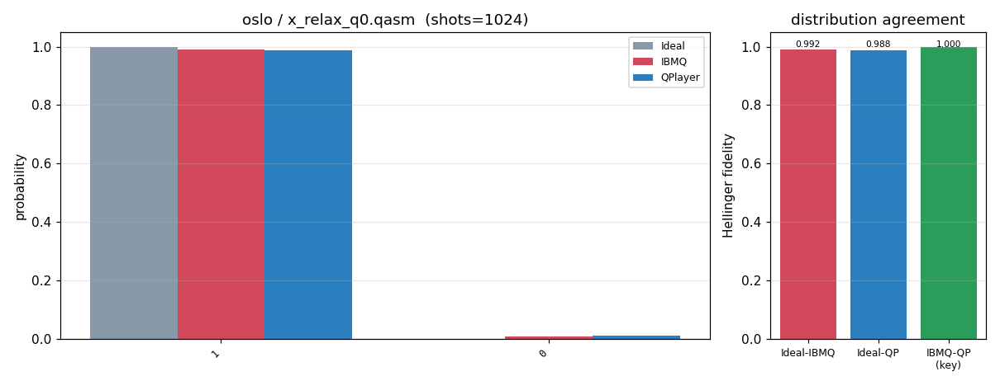


### oslo / qaoa_7q.qasm
```text
# Device-noise validation -- device=oslo (FakeOslo)  circuit=qaoa_7q.qasm
#   device JSON: examples/benchmarks/noise/device_json/fake_oslo.json
#   shots=4096  seed=512513859  max_sim_qubits=14

# Logical circuit: qubits=7 clbits=7 gates=[cxx12, hx7, measurex7, rxx7, rzx6]
# Transpiled circuit: qubits=7 clbits=7 gates=[rzx41, sxx21, cxx18, measurex7]

## Tier 1 -- qubit 0 coherence parameters (ns)
param    |    IBMQ reported |  QPlayer DeviceModel
---------+------------------+---------------------
T1       |        148,847.5 |            148,847.5
T2       |         73,693.0 |             73,693.0
T2*      | N/A (not in snapshot) | N/A (derived T_phi below)
T_phi    |                - |             97,936.8
# readout q0: P(0|1)=0.0102, P(1|0)=0.009399999999999964, symmetric=0.009800000000000031

## Tier 1b -- per-qubit T1/T2 round-trip (7 qubits)
# max |IBMQ - QPlayer|: T1=0.000 ns, T2=0.000 ns (0 => DeviceModel loads device coherence exactly)

## Tier 2 -- measured distribution (probabilities)
  state |     ideal | FakeBcknd |   QPlayer
-------------------------------------------
1010101 |    0.0872 |    0.0684 |    0.0596
0101010 |    0.0752 |    0.0605 |    0.0684
0101001 |    0.0410 |    0.0356 |    0.0371
0110101 |    0.0405 |    0.0366 |    0.0359
1001010 |    0.0369 |    0.0366 |    0.0337
1010110 |    0.0391 |    0.0339 |    0.0337
0100101 |    0.0342 |    0.0322 |    0.0303
0101101 |    0.0337 |    0.0283 |    0.0327
1011010 |    0.0322 |    0.0295 |    0.0298
1010010 |    0.0315 |    0.0312 |    0.0217
0110010 |    0.0312 |    0.0237 |    0.0234
1011001 |    0.0300 |    0.0251 |    0.0212
0100110 |    0.0264 |    0.0249 |    0.0247
1001101 |    0.0261 |    0.0215 |    0.0269
1001001 |    0.0173 |    0.0183 |    0.0166
0110110 |    0.0186 |    0.0171 |    0.0146

## Tier 2 -- distribution agreement
pair                       | Hellinger fidelity |        TVD
---------------------------+--------------------+-----------
ideal      vs FakeBackend  |            0.96628 |    0.10718
ideal      vs QPlayer      |            0.95618 |    0.12573
FakeBackend vs QPlayer (key) |            0.98058 |    0.08887

# QPlayer vs IBM (FakeBackend) agreement: 91.11% distribution overlap (1 - TVD)  |  98.06% Hellinger fidelity
# Higher Hellinger fidelity (-> 1.0) and lower TVD (-> 0.0) on the 'FakeBackend vs QPlayer' row mean QPlayer reproduces the device noise more faithfully. ideal-vs-* rows quantify how far each noisy run departs from the noiseless distribution.
# plot: examples/benchmarks/noise/result/plots-2026-07-28-1741/oslo_qaoa_7q.png
```
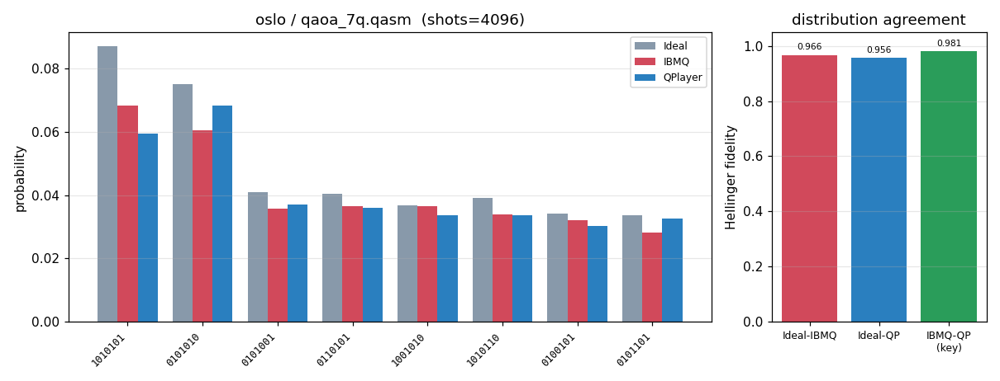


### oslo / vqe_7q.qasm
```text
# Device-noise validation -- device=oslo (FakeOslo)  circuit=vqe_7q.qasm
#   device JSON: examples/benchmarks/noise/device_json/fake_oslo.json
#   shots=4096  seed=512513859  max_sim_qubits=14

# Logical circuit: qubits=7 clbits=7 gates=[ryx21, cxx12, measurex7]
# Transpiled circuit: qubits=7 clbits=7 gates=[rzx42, sxx42, cxx18, measurex7]

## Tier 1 -- qubit 0 coherence parameters (ns)
param    |    IBMQ reported |  QPlayer DeviceModel
---------+------------------+---------------------
T1       |        148,847.5 |            148,847.5
T2       |         73,693.0 |             73,693.0
T2*      | N/A (not in snapshot) | N/A (derived T_phi below)
T_phi    |                - |             97,936.8
# readout q0: P(0|1)=0.0102, P(1|0)=0.009399999999999964, symmetric=0.009800000000000031

## Tier 1b -- per-qubit T1/T2 round-trip (7 qubits)
# max |IBMQ - QPlayer|: T1=0.000 ns, T2=0.000 ns (0 => DeviceModel loads device coherence exactly)

## Tier 2 -- measured distribution (probabilities)
  state |     ideal | FakeBcknd |   QPlayer
-------------------------------------------
1010001 |    0.0366 |    0.0327 |    0.0327
1100101 |    0.0334 |    0.0288 |    0.0295
1100001 |    0.0317 |    0.0315 |    0.0251
1110001 |    0.0286 |    0.0264 |    0.0271
0110101 |    0.0271 |    0.0244 |    0.0254
1101001 |    0.0276 |    0.0237 |    0.0247
0100101 |    0.0259 |    0.0254 |    0.0244
0101101 |    0.0271 |    0.0220 |    0.0256
1000001 |    0.0261 |    0.0239 |    0.0220
0000101 |    0.0242 |    0.0210 |    0.0266
1001001 |    0.0229 |    0.0242 |    0.0244
0110001 |    0.0237 |    0.0232 |    0.0244
1011001 |    0.0225 |    0.0205 |    0.0251
1001101 |    0.0273 |    0.0212 |    0.0193
0001101 |    0.0227 |    0.0227 |    0.0217
0011101 |    0.0215 |    0.0183 |    0.0220

## Tier 2 -- distribution agreement
pair                       | Hellinger fidelity |        TVD
---------------------------+--------------------+-----------
ideal      vs FakeBackend  |            0.98365 |    0.07495
ideal      vs QPlayer      |            0.97435 |    0.10449
FakeBackend vs QPlayer (key) |            0.98325 |    0.08960

# QPlayer vs IBM (FakeBackend) agreement: 91.04% distribution overlap (1 - TVD)  |  98.33% Hellinger fidelity
# Higher Hellinger fidelity (-> 1.0) and lower TVD (-> 0.0) on the 'FakeBackend vs QPlayer' row mean QPlayer reproduces the device noise more faithfully. ideal-vs-* rows quantify how far each noisy run departs from the noiseless distribution.
# plot: examples/benchmarks/noise/result/plots-2026-07-28-1741/oslo_vqe_7q.png
```
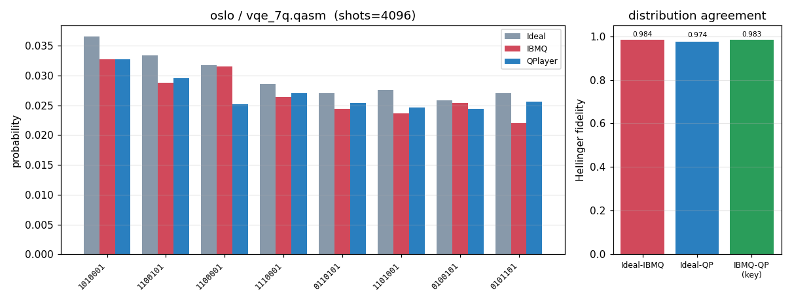


## Device: geneva
### geneva -- q0 T1/T2 relaxation (measured + exp fit)
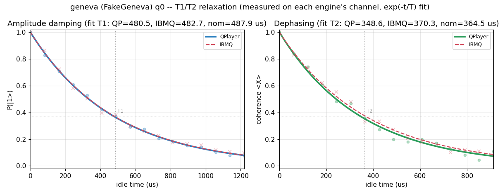


### geneva / bell.qasm
```text
# Device-noise validation -- device=geneva (FakeGeneva)  circuit=bell.qasm
#   device JSON: examples/benchmarks/noise/device_json/fake_geneva.json
#   shots=1024  seed=512513859  max_sim_qubits=14

# Logical circuit: qubits=2 clbits=2 gates=[measurex2, cxx1, hx1]
# Transpiled circuit: qubits=27 clbits=2 gates=[measurex2, rzx2, cxx1, sxx1]

## Tier 1 -- qubit 0 coherence parameters (ns)
param    |    IBMQ reported |  QPlayer DeviceModel
---------+------------------+---------------------
T1       |        487,907.1 |            487,907.1
T2       |        364,525.6 |            364,525.6
T2*      | N/A (not in snapshot) | N/A (derived T_phi below)
T_phi    |                - |            581,900.7
# readout q0: P(0|1)=0.018000000000000016, P(1|0)=0.0292, symmetric=0.023600000000000065

## Tier 1b -- per-qubit T1/T2 round-trip (27 qubits)
# max |IBMQ - QPlayer|: T1=0.000 ns, T2=0.000 ns (0 => DeviceModel loads device coherence exactly)

# T1 fit (us): QPlayer=480.5 IBMQ=482.7  nominal=487.9
# T2 fit (us): QPlayer=348.6 IBMQ=370.3  nominal=364.5
# t1t2_plot: examples/benchmarks/noise/result/plots-2026-07-28-1741/geneva_T1T2.png  (q0 measured decay + exp fit)

# NOTE: device width 27q exceeds max_sim_qubits 14; QubitTruncationPass compresses the circuit onto its 2 active physical qubits (dense [0,k)), so QPlayer simulates 2^2 and run() projects each qubit's own device noise onto that range. Aer prunes idle qubits itself.

## Tier 2 -- measured distribution (probabilities)
state |     ideal | FakeBcknd |   QPlayer
-----------------------------------------
   11 |    0.5107 |    0.4873 |    0.4727
   00 |    0.4893 |    0.4639 |    0.4805
   10 |    0.0000 |    0.0273 |    0.0273
   01 |    0.0000 |    0.0215 |    0.0195

## Tier 2 -- distribution agreement
pair                       | Hellinger fidelity |        TVD
---------------------------+--------------------+-----------
ideal      vs FakeBackend  |            0.95117 |    0.04883
ideal      vs QPlayer      |            0.95292 |    0.04688
FakeBackend vs QPlayer (key) |            0.99970 |    0.01660

# QPlayer vs IBM (FakeBackend) agreement: 98.34% distribution overlap (1 - TVD)  |  99.97% Hellinger fidelity
# Higher Hellinger fidelity (-> 1.0) and lower TVD (-> 0.0) on the 'FakeBackend vs QPlayer' row mean QPlayer reproduces the device noise more faithfully. ideal-vs-* rows quantify how far each noisy run departs from the noiseless distribution.
# plot: examples/benchmarks/noise/result/plots-2026-07-28-1741/geneva_bell.png
```
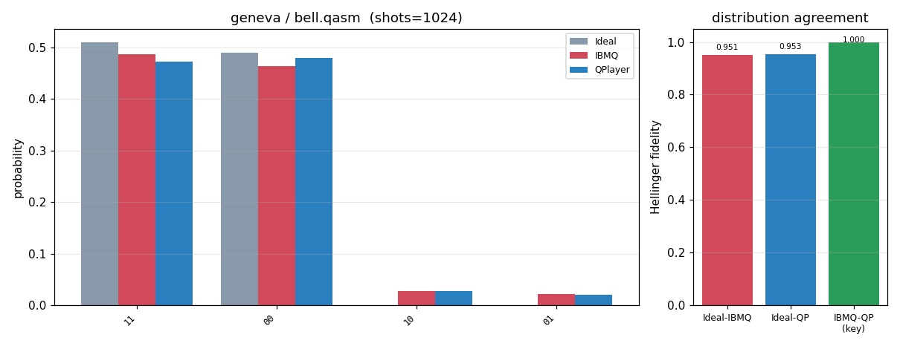


### geneva / ghz3.qasm
```text
# Device-noise validation -- device=geneva (FakeGeneva)  circuit=ghz3.qasm
#   device JSON: examples/benchmarks/noise/device_json/fake_geneva.json
#   shots=1024  seed=512513859  max_sim_qubits=14

# Logical circuit: qubits=3 clbits=3 gates=[measurex3, cxx2, hx1]
# Transpiled circuit: qubits=27 clbits=3 gates=[measurex3, cxx2, rzx2, sxx1]

## Tier 1 -- qubit 0 coherence parameters (ns)
param    |    IBMQ reported |  QPlayer DeviceModel
---------+------------------+---------------------
T1       |        487,907.1 |            487,907.1
T2       |        364,525.6 |            364,525.6
T2*      | N/A (not in snapshot) | N/A (derived T_phi below)
T_phi    |                - |            581,900.7
# readout q0: P(0|1)=0.018000000000000016, P(1|0)=0.0292, symmetric=0.023600000000000065

## Tier 1b -- per-qubit T1/T2 round-trip (27 qubits)
# max |IBMQ - QPlayer|: T1=0.000 ns, T2=0.000 ns (0 => DeviceModel loads device coherence exactly)

# NOTE: device width 27q exceeds max_sim_qubits 14; QubitTruncationPass compresses the circuit onto its 3 active physical qubits (dense [0,k)), so QPlayer simulates 2^3 and run() projects each qubit's own device noise onto that range. Aer prunes idle qubits itself.

## Tier 2 -- measured distribution (probabilities)
state |     ideal | FakeBcknd |   QPlayer
-----------------------------------------
  111 |    0.5107 |    0.4775 |    0.4424
  000 |    0.4893 |    0.4463 |    0.4492
  100 |    0.0000 |    0.0156 |    0.0273
  001 |    0.0000 |    0.0176 |    0.0176
  110 |    0.0000 |    0.0117 |    0.0205
  011 |    0.0000 |    0.0117 |    0.0176
  101 |    0.0000 |    0.0098 |    0.0137
  010 |    0.0000 |    0.0098 |    0.0117

## Tier 2 -- distribution agreement
pair                       | Hellinger fidelity |        TVD
---------------------------+--------------------+-----------
ideal      vs FakeBackend  |            0.92379 |    0.07617
ideal      vs QPlayer      |            0.89141 |    0.10840
FakeBackend vs QPlayer (key) |            0.99547 |    0.03516

# QPlayer vs IBM (FakeBackend) agreement: 96.48% distribution overlap (1 - TVD)  |  99.55% Hellinger fidelity
# Higher Hellinger fidelity (-> 1.0) and lower TVD (-> 0.0) on the 'FakeBackend vs QPlayer' row mean QPlayer reproduces the device noise more faithfully. ideal-vs-* rows quantify how far each noisy run departs from the noiseless distribution.
# plot: examples/benchmarks/noise/result/plots-2026-07-28-1741/geneva_ghz3.png
```
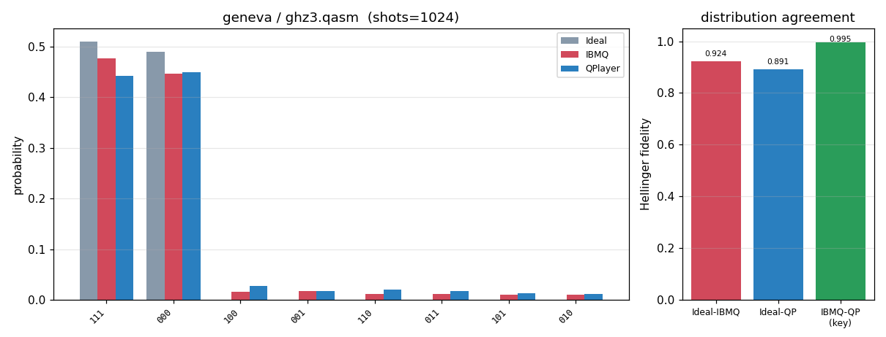


### geneva / ghz5.qasm
```text
# Device-noise validation -- device=geneva (FakeGeneva)  circuit=ghz5.qasm
#   device JSON: examples/benchmarks/noise/device_json/fake_geneva.json
#   shots=1024  seed=512513859  max_sim_qubits=14

# Logical circuit: qubits=5 clbits=5 gates=[measurex5, cxx4, hx1]
# Transpiled circuit: qubits=27 clbits=5 gates=[measurex5, cxx4, rzx2, sxx1]

## Tier 1 -- qubit 0 coherence parameters (ns)
param    |    IBMQ reported |  QPlayer DeviceModel
---------+------------------+---------------------
T1       |        487,907.1 |            487,907.1
T2       |        364,525.6 |            364,525.6
T2*      | N/A (not in snapshot) | N/A (derived T_phi below)
T_phi    |                - |            581,900.7
# readout q0: P(0|1)=0.018000000000000016, P(1|0)=0.0292, symmetric=0.023600000000000065

## Tier 1b -- per-qubit T1/T2 round-trip (27 qubits)
# max |IBMQ - QPlayer|: T1=0.000 ns, T2=0.000 ns (0 => DeviceModel loads device coherence exactly)

# NOTE: device width 27q exceeds max_sim_qubits 14; QubitTruncationPass compresses the circuit onto its 5 active physical qubits (dense [0,k)), so QPlayer simulates 2^5 and run() projects each qubit's own device noise onto that range. Aer prunes idle qubits itself.

## Tier 2 -- measured distribution (probabilities)
state |     ideal | FakeBcknd |   QPlayer
-----------------------------------------
11111 |    0.5107 |    0.4365 |    0.4375
00000 |    0.4893 |    0.4150 |    0.4219
10000 |    0.0000 |    0.0166 |    0.0156
00010 |    0.0000 |    0.0117 |    0.0195
11101 |    0.0000 |    0.0166 |    0.0127
01000 |    0.0000 |    0.0137 |    0.0156
11011 |    0.0000 |    0.0107 |    0.0156
01111 |    0.0000 |    0.0117 |    0.0127
00100 |    0.0000 |    0.0156 |    0.0068
00001 |    0.0000 |    0.0127 |    0.0078
10111 |    0.0000 |    0.0127 |    0.0068
11110 |    0.0000 |    0.0088 |    0.0068
00111 |    0.0000 |    0.0059 |    0.0029
00011 |    0.0000 |    0.0020 |    0.0020
11100 |    0.0000 |    0.0020 |    0.0020
01011 |    0.0000 |    0.0020 |    0.0010

## Tier 2 -- distribution agreement
pair                       | Hellinger fidelity |        TVD
---------------------------+--------------------+-----------
ideal      vs FakeBackend  |            0.85156 |    0.14844
ideal      vs QPlayer      |            0.85937 |    0.14062
FakeBackend vs QPlayer (key) |            0.97841 |    0.03516

# QPlayer vs IBM (FakeBackend) agreement: 96.48% distribution overlap (1 - TVD)  |  97.84% Hellinger fidelity
# Higher Hellinger fidelity (-> 1.0) and lower TVD (-> 0.0) on the 'FakeBackend vs QPlayer' row mean QPlayer reproduces the device noise more faithfully. ideal-vs-* rows quantify how far each noisy run departs from the noiseless distribution.
# plot: examples/benchmarks/noise/result/plots-2026-07-28-1741/geneva_ghz5.png
```
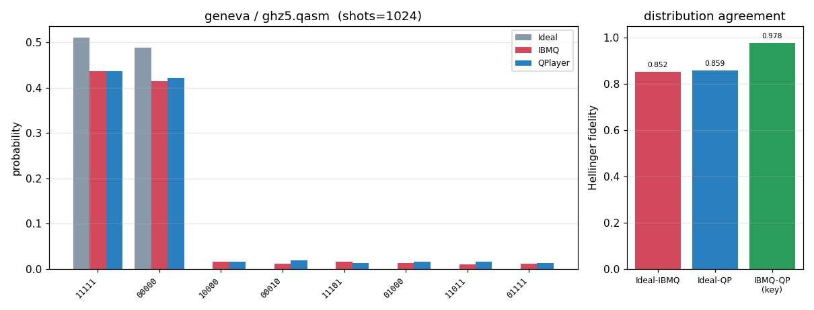


### geneva / x_relax_q0.qasm
```text
# Device-noise validation -- device=geneva (FakeGeneva)  circuit=x_relax_q0.qasm
#   device JSON: examples/benchmarks/noise/device_json/fake_geneva.json
#   shots=1024  seed=512513859  max_sim_qubits=14

# Logical circuit: qubits=1 clbits=1 gates=[measurex1, xx1]
# Transpiled circuit: qubits=27 clbits=1 gates=[measurex1, xx1]

## Tier 1 -- qubit 0 coherence parameters (ns)
param    |    IBMQ reported |  QPlayer DeviceModel
---------+------------------+---------------------
T1       |        487,907.1 |            487,907.1
T2       |        364,525.6 |            364,525.6
T2*      | N/A (not in snapshot) | N/A (derived T_phi below)
T_phi    |                - |            581,900.7
# readout q0: P(0|1)=0.018000000000000016, P(1|0)=0.0292, symmetric=0.023600000000000065

## Tier 1b -- per-qubit T1/T2 round-trip (27 qubits)
# max |IBMQ - QPlayer|: T1=0.000 ns, T2=0.000 ns (0 => DeviceModel loads device coherence exactly)

# NOTE: device width 27q exceeds max_sim_qubits 14; QubitTruncationPass compresses the circuit onto its 1 active physical qubits (dense [0,k)), so QPlayer simulates 2^1 and run() projects each qubit's own device noise onto that range. Aer prunes idle qubits itself.

## Tier 2 -- measured distribution (probabilities)
state |     ideal | FakeBcknd |   QPlayer
-----------------------------------------
    1 |    1.0000 |    0.9805 |    0.9834
    0 |    0.0000 |    0.0195 |    0.0166

## Tier 2 -- distribution agreement
pair                       | Hellinger fidelity |        TVD
---------------------------+--------------------+-----------
ideal      vs FakeBackend  |            0.98047 |    0.01953
ideal      vs QPlayer      |            0.98340 |    0.01660
FakeBackend vs QPlayer (key) |            0.99988 |    0.00293

# QPlayer vs IBM (FakeBackend) agreement: 99.71% distribution overlap (1 - TVD)  |  99.99% Hellinger fidelity
# Higher Hellinger fidelity (-> 1.0) and lower TVD (-> 0.0) on the 'FakeBackend vs QPlayer' row mean QPlayer reproduces the device noise more faithfully. ideal-vs-* rows quantify how far each noisy run departs from the noiseless distribution.
# plot: examples/benchmarks/noise/result/plots-2026-07-28-1741/geneva_x_relax_q0.png
```
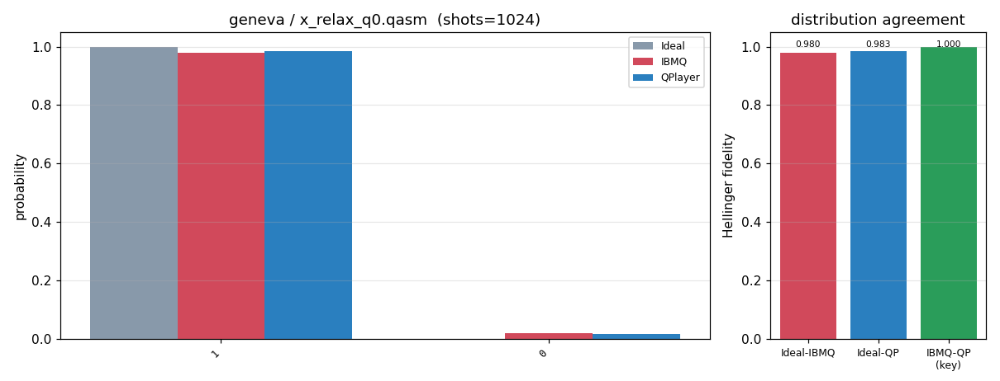


### geneva / qaoa_12q.qasm
```text
# Device-noise validation -- device=geneva (FakeGeneva)  circuit=qaoa_12q.qasm
#   device JSON: examples/benchmarks/noise/device_json/fake_geneva.json
#   shots=4096  seed=512513859  max_sim_qubits=14

# Logical circuit: qubits=12 clbits=12 gates=[cxx22, hx12, measurex12, rxx12, rzx11]
# Transpiled circuit: qubits=27 clbits=12 gates=[rzx71, sxx36, cxx22, measurex12]

## Tier 1 -- qubit 0 coherence parameters (ns)
param    |    IBMQ reported |  QPlayer DeviceModel
---------+------------------+---------------------
T1       |        487,907.1 |            487,907.1
T2       |        364,525.6 |            364,525.6
T2*      | N/A (not in snapshot) | N/A (derived T_phi below)
T_phi    |                - |            581,900.7
# readout q0: P(0|1)=0.018000000000000016, P(1|0)=0.0292, symmetric=0.023600000000000065

## Tier 1b -- per-qubit T1/T2 round-trip (27 qubits)
# max |IBMQ - QPlayer|: T1=0.000 ns, T2=0.000 ns (0 => DeviceModel loads device coherence exactly)

# NOTE: device width 27q exceeds max_sim_qubits 14; QubitTruncationPass compresses the circuit onto its 12 active physical qubits (dense [0,k)), so QPlayer simulates 2^12 and run() projects each qubit's own device noise onto that range. Aer prunes idle qubits itself.

# NOTE: active width 12q -> distribution tier uses 65536 shots (>= 16 x 2^12) so the spread distribution is sampled above the statistical floor (requested shots=4096 is the floor).

## Tier 2 -- measured distribution (probabilities)
       state |     ideal | FakeBcknd |   QPlayer
------------------------------------------------
101010101010 |    0.0125 |    0.0071 |    0.0075
010101010101 |    0.0127 |    0.0070 |    0.0068
100101010101 |    0.0069 |    0.0041 |    0.0044
011010101010 |    0.0067 |    0.0042 |    0.0042
010101010110 |    0.0067 |    0.0043 |    0.0034
101010101001 |    0.0062 |    0.0038 |    0.0035
101010101101 |    0.0055 |    0.0037 |    0.0040
010010101010 |    0.0058 |    0.0033 |    0.0038
101010110101 |    0.0057 |    0.0034 |    0.0035
010101010010 |    0.0057 |    0.0034 |    0.0034
101101010101 |    0.0056 |    0.0032 |    0.0036
010101001010 |    0.0053 |    0.0035 |    0.0034
010101101010 |    0.0050 |    0.0033 |    0.0037
101001010101 |    0.0047 |    0.0034 |    0.0036
101010010101 |    0.0052 |    0.0029 |    0.0036
101011010101 |    0.0051 |    0.0034 |    0.0031

## Tier 2 -- distribution agreement
pair                       | Hellinger fidelity |        TVD
---------------------------+--------------------+-----------
ideal      vs FakeBackend  |            0.88117 |    0.22534
ideal      vs QPlayer      |            0.88212 |    0.22610
FakeBackend vs QPlayer (key) |            0.96368 |    0.11641

# QPlayer vs IBM (FakeBackend) agreement: 88.36% distribution overlap (1 - TVD)  |  96.37% Hellinger fidelity
# Higher Hellinger fidelity (-> 1.0) and lower TVD (-> 0.0) on the 'FakeBackend vs QPlayer' row mean QPlayer reproduces the device noise more faithfully. ideal-vs-* rows quantify how far each noisy run departs from the noiseless distribution.
# plot: examples/benchmarks/noise/result/plots-2026-07-28-1741/geneva_qaoa_12q.png
```
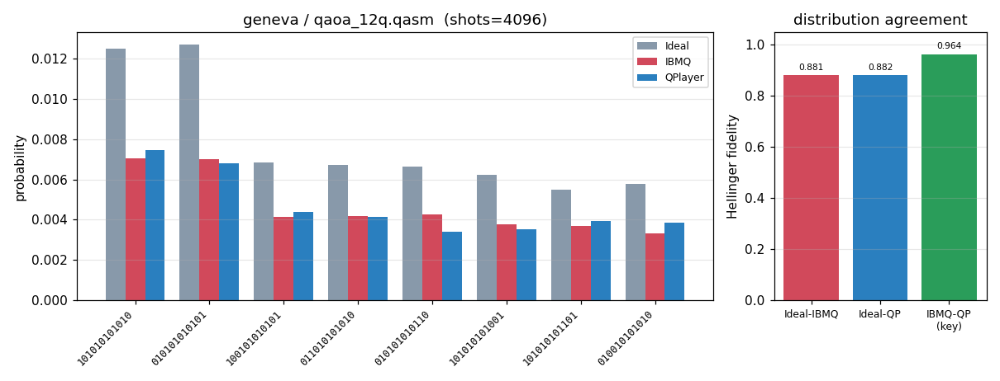


### geneva / vqe_12q.qasm
```text
# Device-noise validation -- device=geneva (FakeGeneva)  circuit=vqe_12q.qasm
#   device JSON: examples/benchmarks/noise/device_json/fake_geneva.json
#   shots=4096  seed=512513859  max_sim_qubits=14

# Logical circuit: qubits=12 clbits=12 gates=[ryx36, cxx22, measurex12]
# Transpiled circuit: qubits=27 clbits=12 gates=[rzx72, sxx72, cxx22, measurex12]

## Tier 1 -- qubit 0 coherence parameters (ns)
param    |    IBMQ reported |  QPlayer DeviceModel
---------+------------------+---------------------
T1       |        487,907.1 |            487,907.1
T2       |        364,525.6 |            364,525.6
T2*      | N/A (not in snapshot) | N/A (derived T_phi below)
T_phi    |                - |            581,900.7
# readout q0: P(0|1)=0.018000000000000016, P(1|0)=0.0292, symmetric=0.023600000000000065

## Tier 1b -- per-qubit T1/T2 round-trip (27 qubits)
# max |IBMQ - QPlayer|: T1=0.000 ns, T2=0.000 ns (0 => DeviceModel loads device coherence exactly)

# NOTE: device width 27q exceeds max_sim_qubits 14; QubitTruncationPass compresses the circuit onto its 12 active physical qubits (dense [0,k)), so QPlayer simulates 2^12 and run() projects each qubit's own device noise onto that range. Aer prunes idle qubits itself.

# NOTE: active width 12q -> distribution tier uses 65536 shots (>= 16 x 2^12) so the spread distribution is sampled above the statistical floor (requested shots=4096 is the floor).

## Tier 2 -- measured distribution (probabilities)
       state |     ideal | FakeBcknd |   QPlayer
------------------------------------------------
010011001010 |    0.0206 |    0.0126 |    0.0131
010010001010 |    0.0174 |    0.0115 |    0.0109
010011100110 |    0.0142 |    0.0081 |    0.0084
010011011010 |    0.0126 |    0.0081 |    0.0077
010000010110 |    0.0125 |    0.0078 |    0.0070
001011001010 |    0.0108 |    0.0067 |    0.0074
010010100110 |    0.0112 |    0.0068 |    0.0069
010001010110 |    0.0110 |    0.0066 |    0.0070
000100010110 |    0.0105 |    0.0071 |    0.0069
000100001010 |    0.0109 |    0.0063 |    0.0059
000101010110 |    0.0083 |    0.0056 |    0.0059
000111001010 |    0.0083 |    0.0052 |    0.0051
010011010010 |    0.0080 |    0.0052 |    0.0054
000111010110 |    0.0079 |    0.0049 |    0.0055
011011001010 |    0.0072 |    0.0049 |    0.0053
010010011010 |    0.0071 |    0.0047 |    0.0053

## Tier 2 -- distribution agreement
pair                       | Hellinger fidelity |        TVD
---------------------------+--------------------+-----------
ideal      vs FakeBackend  |            0.85899 |    0.23239
ideal      vs QPlayer      |            0.85547 |    0.23494
FakeBackend vs QPlayer (key) |            0.96401 |    0.09517

# QPlayer vs IBM (FakeBackend) agreement: 90.48% distribution overlap (1 - TVD)  |  96.40% Hellinger fidelity
# Higher Hellinger fidelity (-> 1.0) and lower TVD (-> 0.0) on the 'FakeBackend vs QPlayer' row mean QPlayer reproduces the device noise more faithfully. ideal-vs-* rows quantify how far each noisy run departs from the noiseless distribution.
# plot: examples/benchmarks/noise/result/plots-2026-07-28-1741/geneva_vqe_12q.png
```
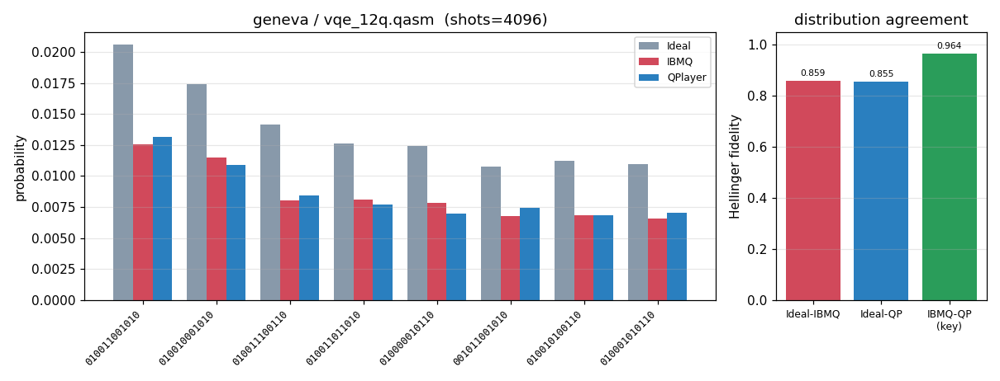
