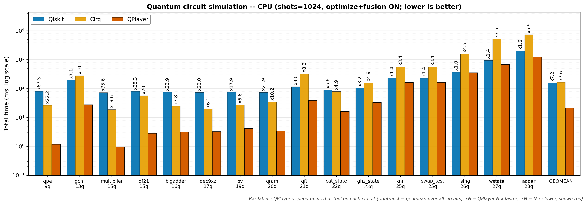
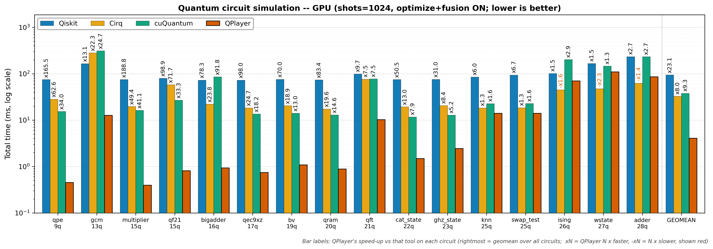

# Performance comparison report -- 2026-07-14 19:09

> Tool: `comparison.py`
> Compared: Qiskit (statevector) · Cirq (qsim) · cuQuantum (cuStateVec, GPU only) · QPlayer
> Matrix: processor (CPU · GPU) × tool (4); optimize and fusion always ON
> Metric: 4 sections (compile · execute · sampling · total) median ms -- cross-tool comparison uses TOTAL
> Circuits under test: `examples/benchmarks/performance/qasm` (16 of 16 measured)

## Environment
| Item | Value |
|------|-------|
| datetime | 2026-07-14 19:09 |
| host | Linux 6.8.0-124-generic x86_64 |
| cpu | Intel(R) Xeon(R) Platinum 8452Y |
| gpu | NVIDIA H100 NVL ×2 |
| qiskit | 2.4.2 |
| cirq / qsimcirq | 1.5.0 / 0.22.0 |
| cupy / cuquantum | 13.6.0 / 26.3.2 (cuStateVec, GPU only) |
| qplayer | 5.4.0 (.so built 2026-07-14 14:51:32) |
| shots / repeats | 1024 / 5 (warm-up discarded, median reported) |

## Circuit summary
| Circuit | Qubits | Clbits | Gate ops | measure | Top gates | Tested |
|---------|-------:|-------:|---------:|--------:|-----------|:------:|
| q09_qpe.qasm | 9 | 6 | 33 | 6 | cu1×15, h×12, x×3, ccx×2, cz×1 | ✓ |
| q13_gcm.qasm | 13 | 1 | 3148 | 1 | rz×1522, sx×858, cx×762, x×6 | ✓ |
| q15_multiplier.qasm | 15 | 3 | 70 | 3 | ccx×36, cx×30, x×4 | ✓ |
| q15_qf21.qasm | 15 | 10 | 73 | 10 | cu1×45, h×20, ccx×4, x×3, cz×1 | ✓ |
| q17_qec9xz.qasm | 17 | 8 | 53 | 8 | cx×32, h×21 | ✓ |
| q18_bigadder.qasm | 16 | 9 | 17 | 9 | cx×4, unmaj×4, majority×3, x×3, add4×2 | ✓ |
| q19_bv.qasm | 19 | 18 | 56 | 18 | h×37, cx×18, x×1 | ✓ |
| q20_qram.qasm | 20 | 4 | 41 | 4 | ccx×20, cx×16, x×5 | ✓ |
| q21_qft.qasm | 21 | 21 | 661 | 1 | cx×420, rz×210, h×21, swap×10 | ✓ |
| q22_cat_state.qasm | 22 | 22 | 22 | 22 | cx×21, h×1 | ✓ |
| q23_ghz_state.qasm | 23 | 23 | 23 | 23 | cx×22, h×1 | ✓ |
| q25_knn.qasm | 25 | 25 | 38 | 1 | ry×24, cswap×12, h×2 | ✓ |
| q25_swap_test.qasm | 25 | 1 | 38 | 1 | rx×24, cswap×12, h×2 | ✓ |
| q26_ising.qasm | 26 | 26 | 280 | 26 | rz×152, h×78, cx×50 | ✓ |
| q27_wstate.qasm | 27 | 27 | 105 | 27 | ry×52, cx×26, cz×26, x×1 | ✓ |
| q28_adder.qasm | 28 | 28 | 88 | 28 | cx×51, ccx×24, x×13 | ✓ |

## Per-circuit results

### q09_qpe.qasm
- circuit: qubits 9 · clbits 6 · gate ops 33 · measure 6 · gate types cu1×15, h×12, x×3, ccx×2, cz×1
- command: `python comparison.py qasm/q09_qpe.qasm --shots 1024 --repeats 5 --procs cpu gpu`
```text
Available backends: Qiskit, Cirq, cuQuantum, QPlayer

# Circuit info -- examples/benchmarks/performance/qasm/q09_qpe.qasm
  qubits=9  clbits=6  gate ops=33  measure=6  barrier=3  reset=0
  gate types: cu1×15, h×12, x×3, ccx×2, cz×1

# QPlayer performance comparison -- examples/benchmarks/performance/qasm/q09_qpe.qasm (shots=1024, repeats=5, optimize=ON, fusion=ON)
# per-section median ms; '-' = not available; compare across tools on TOTAL (sections asymmetric, see docstring)

proc                     Qiskit                                   Cirq                                 cuQuantum                                QPlayer
           compile   execute  sampling     total   compile   execute  sampling     total   compile   execute  sampling     total   compile   execute  sampling     total
------------------------------------------------------------------------------------------------------------------------------------------------------------------------
cpu         67.215    12.894     0.168    79.982     9.941    14.573     1.839    26.417         -         -         -         -     0.157     0.845     0.191     1.188
gpu         67.487     7.387     0.168    74.985    10.030    16.336     1.848    28.349    13.786     1.049     0.575    15.420     0.135     0.150     0.170     0.453

# Skipped / unavailable
  cuQuantum/cpu: skip -- cuStateVec is GPU-only

# [1] Relative speedup on TOTAL time (QPlayer total / other total; <1 = QPlayer faster, >1 = slower)

proc           vs Qiskit       vs Cirq  vs cuQuantum
----------------------------------------------------
cpu                0.01x         0.04x             -
gpu                0.01x         0.02x         0.03x

# [2] Relative performance on TOTAL time (QPlayer's perspective; xN = QPlayer N x faster, -xN = N x slower)

proc           vs Qiskit       vs Cirq  vs cuQuantum
----------------------------------------------------
cpu               x67.30        x22.23             -
gpu              x165.53        x62.58        x34.04
```

### q13_gcm.qasm
- circuit: qubits 13 · clbits 1 · gate ops 3148 · measure 1 · gate types rz×1522, sx×858, cx×762, x×6
- command: `python comparison.py qasm/q13_gcm.qasm --shots 1024 --repeats 5 --procs cpu gpu`
```text
Available backends: Qiskit, Cirq, cuQuantum, QPlayer

# Circuit info -- examples/benchmarks/performance/qasm/q13_gcm.qasm
  qubits=13  clbits=1  gate ops=3148  measure=1  barrier=0  reset=0
  gate types: rz×1522, sx×858, cx×762, x×6

# QPlayer performance comparison -- examples/benchmarks/performance/qasm/q13_gcm.qasm (shots=1024, repeats=5, optimize=ON, fusion=ON)
# per-section median ms; '-' = not available; compare across tools on TOTAL (sections asymmetric, see docstring)

proc                     Qiskit                                   Cirq                                 cuQuantum                                QPlayer
           compile   execute  sampling     total   compile   execute  sampling     total   compile   execute  sampling     total   compile   execute  sampling     total
------------------------------------------------------------------------------------------------------------------------------------------------------------------------
cpu        141.372    54.163     0.039   195.954   209.345    67.907     1.172   278.427         -         -         -         -     8.951    18.321     0.203    27.437
gpu        140.326    24.855     0.039   164.994   209.906    69.796     1.095   280.972   242.579    68.486     0.572   311.638     7.103     5.379     0.133    12.627

# Skipped / unavailable
  cuQuantum/cpu: skip -- cuStateVec is GPU-only

# [1] Relative speedup on TOTAL time (QPlayer total / other total; <1 = QPlayer faster, >1 = slower)

proc           vs Qiskit       vs Cirq  vs cuQuantum
----------------------------------------------------
cpu                0.14x         0.10x             -
gpu                0.08x         0.04x         0.04x

# [2] Relative performance on TOTAL time (QPlayer's perspective; xN = QPlayer N x faster, -xN = N x slower)

proc           vs Qiskit       vs Cirq  vs cuQuantum
----------------------------------------------------
cpu                x7.14        x10.15             -
gpu               x13.07        x22.25        x24.68
```

### q15_multiplier.qasm
- circuit: qubits 15 · clbits 3 · gate ops 70 · measure 3 · gate types ccx×36, cx×30, x×4
- command: `python comparison.py qasm/q15_multiplier.qasm --shots 1024 --repeats 5 --procs cpu gpu`
```text
Available backends: Qiskit, Cirq, cuQuantum, QPlayer

# Circuit info -- examples/benchmarks/performance/qasm/q15_multiplier.qasm
  qubits=15  clbits=3  gate ops=70  measure=3  barrier=0  reset=0
  gate types: ccx×36, cx×30, x×4

# QPlayer performance comparison -- examples/benchmarks/performance/qasm/q15_multiplier.qasm (shots=1024, repeats=5, optimize=ON, fusion=ON)
# per-section median ms; '-' = not available; compare across tools on TOTAL (sections asymmetric, see docstring)

proc                     Qiskit                                   Cirq                                 cuQuantum                                QPlayer
           compile   execute  sampling     total   compile   execute  sampling     total   compile   execute  sampling     total   compile   execute  sampling     total
------------------------------------------------------------------------------------------------------------------------------------------------------------------------
cpu         67.626     5.572     0.040    72.994    12.393     5.016     1.532    18.940         -         -         -         -     0.217     0.390     0.324     0.965
gpu         67.458     6.723     0.041    74.989    12.418     5.789     1.389    19.622    13.885     1.839     0.572    16.305     0.188     0.094     0.106     0.397

# Skipped / unavailable
  cuQuantum/cpu: skip -- cuStateVec is GPU-only

# [1] Relative speedup on TOTAL time (QPlayer total / other total; <1 = QPlayer faster, >1 = slower)

proc           vs Qiskit       vs Cirq  vs cuQuantum
----------------------------------------------------
cpu                0.01x         0.05x             -
gpu                0.01x         0.02x         0.02x

# [2] Relative performance on TOTAL time (QPlayer's perspective; xN = QPlayer N x faster, -xN = N x slower)

proc           vs Qiskit       vs Cirq  vs cuQuantum
----------------------------------------------------
cpu               x75.64        x19.63             -
gpu              x188.84        x49.42        x41.06
```

### q15_qf21.qasm
- circuit: qubits 15 · clbits 10 · gate ops 73 · measure 10 · gate types cu1×45, h×20, ccx×4, x×3, cz×1
- command: `python comparison.py qasm/q15_qf21.qasm --shots 1024 --repeats 5 --procs cpu gpu`
```text
Available backends: Qiskit, Cirq, cuQuantum, QPlayer

# Circuit info -- examples/benchmarks/performance/qasm/q15_qf21.qasm
  qubits=15  clbits=10  gate ops=73  measure=10  barrier=0  reset=0
  gate types: cu1×45, h×20, ccx×4, x×3, cz×1

# QPlayer performance comparison -- examples/benchmarks/performance/qasm/q15_qf21.qasm (shots=1024, repeats=5, optimize=ON, fusion=ON)
# per-section median ms; '-' = not available; compare across tools on TOTAL (sections asymmetric, see docstring)

proc                     Qiskit                                   Cirq                                 cuQuantum                                QPlayer
           compile   execute  sampling     total   compile   execute  sampling     total   compile   execute  sampling     total   compile   execute  sampling     total
------------------------------------------------------------------------------------------------------------------------------------------------------------------------
cpu         69.854     7.621     0.789    79.981    14.239    40.098     2.675    56.975         -         -         -         -     0.304     2.002     0.535     2.829
gpu         68.979    10.601     0.796    79.974    13.964    41.473     2.545    57.988    24.314     1.924     0.628    26.890     0.261     0.274     0.269     0.808

# Skipped / unavailable
  cuQuantum/cpu: skip -- cuStateVec is GPU-only

# [1] Relative speedup on TOTAL time (QPlayer total / other total; <1 = QPlayer faster, >1 = slower)

proc           vs Qiskit       vs Cirq  vs cuQuantum
----------------------------------------------------
cpu                0.04x         0.05x             -
gpu                0.01x         0.01x         0.03x

# [2] Relative performance on TOTAL time (QPlayer's perspective; xN = QPlayer N x faster, -xN = N x slower)

proc           vs Qiskit       vs Cirq  vs cuQuantum
----------------------------------------------------
cpu               x28.27        x20.14             -
gpu               x98.93        x71.73        x33.26
```

### q17_qec9xz.qasm
- circuit: qubits 17 · clbits 8 · gate ops 53 · measure 8 · gate types cx×32, h×21
- command: `python comparison.py qasm/q17_qec9xz.qasm --shots 1024 --repeats 5 --procs cpu gpu`
```text
Available backends: Qiskit, Cirq, cuQuantum, QPlayer

# Circuit info -- examples/benchmarks/performance/qasm/q17_qec9xz.qasm
  qubits=17  clbits=8  gate ops=53  measure=8  barrier=0  reset=0
  gate types: cx×32, h×21

# QPlayer performance comparison -- examples/benchmarks/performance/qasm/q17_qec9xz.qasm (shots=1024, repeats=5, optimize=ON, fusion=ON)
# per-section median ms; '-' = not available; compare across tools on TOTAL (sections asymmetric, see docstring)

proc                     Qiskit                                   Cirq                                 cuQuantum                                QPlayer
           compile   execute  sampling     total   compile   execute  sampling     total   compile   execute  sampling     total   compile   execute  sampling     total
------------------------------------------------------------------------------------------------------------------------------------------------------------------------
cpu         67.941     5.215     0.033    73.985    10.541     6.890     2.153    19.622         -         -         -         -     0.200     2.173     0.823     3.215
gpu         66.244     7.078     0.033    72.994    10.527     5.673     2.108    18.407    11.531     1.450     0.563    13.568     0.161     0.355     0.222     0.745

# Skipped / unavailable
  cuQuantum/cpu: skip -- cuStateVec is GPU-only

# [1] Relative speedup on TOTAL time (QPlayer total / other total; <1 = QPlayer faster, >1 = slower)

proc           vs Qiskit       vs Cirq  vs cuQuantum
----------------------------------------------------
cpu                0.04x         0.16x             -
gpu                0.01x         0.04x         0.05x

# [2] Relative performance on TOTAL time (QPlayer's perspective; xN = QPlayer N x faster, -xN = N x slower)

proc           vs Qiskit       vs Cirq  vs cuQuantum
----------------------------------------------------
cpu               x23.01         x6.10             -
gpu               x97.97        x24.71        x18.21
```

### q18_bigadder.qasm
- circuit: qubits 16 · clbits 9 · gate ops 17 · measure 9 · gate types cx×4, unmaj×4, majority×3, x×3, add4×2
- command: `python comparison.py qasm/q18_bigadder.qasm --shots 1024 --repeats 5 --procs cpu gpu`
```text
Available backends: Qiskit, Cirq, cuQuantum, QPlayer

# Circuit info -- examples/benchmarks/performance/qasm/q18_bigadder.qasm
  qubits=16  clbits=9  gate ops=17  measure=9  barrier=0  reset=0
  gate types: cx×4, unmaj×4, majority×3, x×3, add4×2, ccx×1

# QPlayer performance comparison -- examples/benchmarks/performance/qasm/q18_bigadder.qasm (shots=1024, repeats=5, optimize=ON, fusion=ON)
# per-section median ms; '-' = not available; compare across tools on TOTAL (sections asymmetric, see docstring)

proc                     Qiskit                                   Cirq                                 cuQuantum                                QPlayer
           compile   execute  sampling     total   compile   execute  sampling     total   compile   execute  sampling     total   compile   execute  sampling     total
------------------------------------------------------------------------------------------------------------------------------------------------------------------------
cpu         68.326     5.653     0.036    74.534     9.523    12.406     2.298    24.367         -         -         -         -     0.255     1.637     1.322     3.116
gpu         66.496     7.457     0.037    72.989     9.314    10.285     2.306    22.153    80.660     4.266     0.684    85.612     0.200     0.396     0.333     0.932

# Skipped / unavailable
  cuQuantum/cpu: skip -- cuStateVec is GPU-only

# [1] Relative speedup on TOTAL time (QPlayer total / other total; <1 = QPlayer faster, >1 = slower)

proc           vs Qiskit       vs Cirq  vs cuQuantum
----------------------------------------------------
cpu                0.04x         0.13x             -
gpu                0.01x         0.04x         0.01x

# [2] Relative performance on TOTAL time (QPlayer's perspective; xN = QPlayer N x faster, -xN = N x slower)

proc           vs Qiskit       vs Cirq  vs cuQuantum
----------------------------------------------------
cpu               x23.92         x7.82             -
gpu               x78.29        x23.76        x91.83
```

### q19_bv.qasm
- circuit: qubits 19 · clbits 18 · gate ops 56 · measure 18 · gate types h×37, cx×18, x×1
- command: `python comparison.py qasm/q19_bv.qasm --shots 1024 --repeats 5 --procs cpu gpu`
```text
Available backends: Qiskit, Cirq, cuQuantum, QPlayer

# Circuit info -- examples/benchmarks/performance/qasm/q19_bv.qasm
  qubits=19  clbits=18  gate ops=56  measure=18  barrier=0  reset=0
  gate types: h×37, cx×18, x×1

# QPlayer performance comparison -- examples/benchmarks/performance/qasm/q19_bv.qasm (shots=1024, repeats=5, optimize=ON, fusion=ON)
# per-section median ms; '-' = not available; compare across tools on TOTAL (sections asymmetric, see docstring)

proc                     Qiskit                                   Cirq                                 cuQuantum                                QPlayer
           compile   execute  sampling     total   compile   execute  sampling     total   compile   execute  sampling     total   compile   execute  sampling     total
------------------------------------------------------------------------------------------------------------------------------------------------------------------------
cpu         68.787     5.312     0.042    74.552    10.803    13.294     3.477    27.543         -         -         -         -     0.229     3.397     0.548     4.175
gpu         66.940     8.621     0.033    75.994    10.868     6.112     3.490    20.482    11.959     1.539     0.597    14.108     0.176     0.556     0.359     1.086

# Skipped / unavailable
  cuQuantum/cpu: skip -- cuStateVec is GPU-only

# [1] Relative speedup on TOTAL time (QPlayer total / other total; <1 = QPlayer faster, >1 = slower)

proc           vs Qiskit       vs Cirq  vs cuQuantum
----------------------------------------------------
cpu                0.06x         0.15x             -
gpu                0.01x         0.05x         0.08x

# [2] Relative performance on TOTAL time (QPlayer's perspective; xN = QPlayer N x faster, -xN = N x slower)

proc           vs Qiskit       vs Cirq  vs cuQuantum
----------------------------------------------------
cpu               x17.86         x6.60             -
gpu               x69.96        x18.86        x12.99
```

### q20_qram.qasm
- circuit: qubits 20 · clbits 4 · gate ops 41 · measure 4 · gate types ccx×20, cx×16, x×5
- command: `python comparison.py qasm/q20_qram.qasm --shots 1024 --repeats 5 --procs cpu gpu`
```text
Available backends: Qiskit, Cirq, cuQuantum, QPlayer

# Circuit info -- examples/benchmarks/performance/qasm/q20_qram.qasm
  qubits=20  clbits=4  gate ops=41  measure=4  barrier=0  reset=0
  gate types: ccx×20, cx×16, x×5

# QPlayer performance comparison -- examples/benchmarks/performance/qasm/q20_qram.qasm (shots=1024, repeats=5, optimize=ON, fusion=ON)
# per-section median ms; '-' = not available; compare across tools on TOTAL (sections asymmetric, see docstring)

proc                     Qiskit                                   Cirq                                 cuQuantum                                QPlayer
           compile   execute  sampling     total   compile   execute  sampling     total   compile   execute  sampling     total   compile   execute  sampling     total
------------------------------------------------------------------------------------------------------------------------------------------------------------------------
cpu         67.476     7.475     0.038    74.031    10.045    22.746     1.546    34.589         -         -         -         -     0.208     2.706     0.467     3.384
gpu         67.979     6.432     0.034    73.988    10.152     5.603     1.535    17.397    11.196     1.200     0.567    12.974     0.174     0.389     0.324     0.888

# Skipped / unavailable
  cuQuantum/cpu: skip -- cuStateVec is GPU-only

# [1] Relative speedup on TOTAL time (QPlayer total / other total; <1 = QPlayer faster, >1 = slower)

proc           vs Qiskit       vs Cirq  vs cuQuantum
----------------------------------------------------
cpu                0.05x         0.10x             -
gpu                0.01x         0.05x         0.07x

# [2] Relative performance on TOTAL time (QPlayer's perspective; xN = QPlayer N x faster, -xN = N x slower)

proc           vs Qiskit       vs Cirq  vs cuQuantum
----------------------------------------------------
cpu               x21.87        x10.22             -
gpu               x83.36        x19.60        x14.62
```

### q21_qft.qasm
- circuit: qubits 21 · clbits 21 · gate ops 661 · measure 1 · gate types cx×420, rz×210, h×21, swap×10
- command: `python comparison.py qasm/q21_qft.qasm --shots 1024 --repeats 5 --procs cpu gpu`
```text
Available backends: Qiskit, Cirq, cuQuantum, QPlayer

# Circuit info -- examples/benchmarks/performance/qasm/q21_qft.qasm
  qubits=21  clbits=21  gate ops=661  measure=1  barrier=0  reset=0
  gate types: cx×420, rz×210, h×21, swap×10

# QPlayer performance comparison -- examples/benchmarks/performance/qasm/q21_qft.qasm (shots=1024, repeats=5, optimize=ON, fusion=ON)
# per-section median ms; '-' = not available; compare across tools on TOTAL (sections asymmetric, see docstring)

proc                     Qiskit                                   Cirq                                 cuQuantum                                QPlayer
           compile   execute  sampling     total   compile   execute  sampling     total   compile   execute  sampling     total   compile   execute  sampling     total
------------------------------------------------------------------------------------------------------------------------------------------------------------------------
cpu         72.734    41.927     2.010   116.395    52.033   270.330     4.054   326.382         -         -         -         -     1.625    36.463     0.965    39.194
gpu         74.519    23.308     2.122    99.118    51.735    20.287     3.994    76.502    61.518    15.052     0.711    77.276     1.376     8.104     0.753    10.236

# Skipped / unavailable
  cuQuantum/cpu: skip -- cuStateVec is GPU-only

# [1] Relative speedup on TOTAL time (QPlayer total / other total; <1 = QPlayer faster, >1 = slower)

proc           vs Qiskit       vs Cirq  vs cuQuantum
----------------------------------------------------
cpu                0.34x         0.12x             -
gpu                0.10x         0.13x         0.13x

# [2] Relative performance on TOTAL time (QPlayer's perspective; xN = QPlayer N x faster, -xN = N x slower)

proc           vs Qiskit       vs Cirq  vs cuQuantum
----------------------------------------------------
cpu                x2.97         x8.33             -
gpu                x9.68         x7.47         x7.55
```

### q22_cat_state.qasm
- circuit: qubits 22 · clbits 22 · gate ops 22 · measure 22 · gate types cx×21, h×1
- command: `python comparison.py qasm/q22_cat_state.qasm --shots 1024 --repeats 5 --procs cpu gpu`
```text
Available backends: Qiskit, Cirq, cuQuantum, QPlayer

# Circuit info -- examples/benchmarks/performance/qasm/q22_cat_state.qasm
  qubits=22  clbits=22  gate ops=22  measure=22  barrier=0  reset=0
  gate types: cx×21, h×1

# QPlayer performance comparison -- examples/benchmarks/performance/qasm/q22_cat_state.qasm (shots=1024, repeats=5, optimize=ON, fusion=ON)
# per-section median ms; '-' = not available; compare across tools on TOTAL (sections asymmetric, see docstring)

proc                     Qiskit                                   Cirq                                 cuQuantum                                QPlayer
           compile   execute  sampling     total   compile   execute  sampling     total   compile   execute  sampling     total   compile   execute  sampling     total
------------------------------------------------------------------------------------------------------------------------------------------------------------------------
cpu         66.406    24.370     0.034    90.671     9.403    66.024     3.895    79.537         -         -         -         -     0.155    15.246     0.699    16.095
gpu         67.729     7.082     0.037    74.991     9.382     6.074     3.890    19.364     9.988     0.786     0.953    11.734     0.124     0.867     0.484     1.486

# Skipped / unavailable
  cuQuantum/cpu: skip -- cuStateVec is GPU-only

# [1] Relative speedup on TOTAL time (QPlayer total / other total; <1 = QPlayer faster, >1 = slower)

proc           vs Qiskit       vs Cirq  vs cuQuantum
----------------------------------------------------
cpu                0.18x         0.20x             -
gpu                0.02x         0.08x         0.13x

# [2] Relative performance on TOTAL time (QPlayer's perspective; xN = QPlayer N x faster, -xN = N x slower)

proc           vs Qiskit       vs Cirq  vs cuQuantum
----------------------------------------------------
cpu                x5.63         x4.94             -
gpu               x50.48        x13.04         x7.90
```

### q23_ghz_state.qasm
- circuit: qubits 23 · clbits 23 · gate ops 23 · measure 23 · gate types cx×22, h×1
- command: `python comparison.py qasm/q23_ghz_state.qasm --shots 1024 --repeats 5 --procs cpu gpu`
```text
Available backends: Qiskit, Cirq, cuQuantum, QPlayer

# Circuit info -- examples/benchmarks/performance/qasm/q23_ghz_state.qasm
  qubits=23  clbits=23  gate ops=23  measure=23  barrier=0  reset=0
  gate types: cx×22, h×1

# QPlayer performance comparison -- examples/benchmarks/performance/qasm/q23_ghz_state.qasm (shots=1024, repeats=5, optimize=ON, fusion=ON)
# per-section median ms; '-' = not available; compare across tools on TOTAL (sections asymmetric, see docstring)

proc                     Qiskit                                   Cirq                                 cuQuantum                                QPlayer
           compile   execute  sampling     total   compile   execute  sampling     total   compile   execute  sampling     total   compile   execute  sampling     total
------------------------------------------------------------------------------------------------------------------------------------------------------------------------
cpu         65.828    39.222     0.063   105.904     9.918   145.308     4.082   159.483         -         -         -         -     0.201    31.538     1.086    32.818
gpu         67.280     8.645     0.037    75.989     9.498     7.019     4.044    20.573    10.138     0.814     1.888    12.833     0.127     1.574     0.742     2.447

# Skipped / unavailable
  cuQuantum/cpu: skip -- cuStateVec is GPU-only

# [1] Relative speedup on TOTAL time (QPlayer total / other total; <1 = QPlayer faster, >1 = slower)

proc           vs Qiskit       vs Cirq  vs cuQuantum
----------------------------------------------------
cpu                0.31x         0.21x             -
gpu                0.03x         0.12x         0.19x

# [2] Relative performance on TOTAL time (QPlayer's perspective; xN = QPlayer N x faster, -xN = N x slower)

proc           vs Qiskit       vs Cirq  vs cuQuantum
----------------------------------------------------
cpu                x3.23         x4.86             -
gpu               x31.05         x8.41         x5.24
```

### q25_knn.qasm
- circuit: qubits 25 · clbits 25 · gate ops 38 · measure 1 · gate types ry×24, cswap×12, h×2
- command: `python comparison.py qasm/q25_knn.qasm --shots 1024 --repeats 5 --procs cpu gpu`
```text
Available backends: Qiskit, Cirq, cuQuantum, QPlayer

# Circuit info -- examples/benchmarks/performance/qasm/q25_knn.qasm
  qubits=25  clbits=25  gate ops=38  measure=1  barrier=0  reset=0
  gate types: ry×24, cswap×12, h×2

# QPlayer performance comparison -- examples/benchmarks/performance/qasm/q25_knn.qasm (shots=1024, repeats=5, optimize=ON, fusion=ON)
# per-section median ms; '-' = not available; compare across tools on TOTAL (sections asymmetric, see docstring)

proc                     Qiskit                                   Cirq                                 cuQuantum                                QPlayer
           compile   execute  sampling     total   compile   execute  sampling     total   compile   execute  sampling     total   compile   execute  sampling     total
------------------------------------------------------------------------------------------------------------------------------------------------------------------------
cpu         66.773   162.708     0.086   230.292     9.723   548.626     1.113   559.476         -         -         -         -     0.301   159.999     2.544   162.861
gpu         67.103    17.562     0.039    84.983     9.363     7.908     1.095    18.394    10.059     1.211    11.495    22.774     0.162    11.818     2.067    14.048

# Skipped / unavailable
  cuQuantum/cpu: skip -- cuStateVec is GPU-only

# [1] Relative speedup on TOTAL time (QPlayer total / other total; <1 = QPlayer faster, >1 = slower)

proc           vs Qiskit       vs Cirq  vs cuQuantum
----------------------------------------------------
cpu                0.71x         0.29x             -
gpu                0.17x         0.76x         0.62x

# [2] Relative performance on TOTAL time (QPlayer's perspective; xN = QPlayer N x faster, -xN = N x slower)

proc           vs Qiskit       vs Cirq  vs cuQuantum
----------------------------------------------------
cpu                x1.41         x3.44             -
gpu                x6.05         x1.31         x1.62
```

### q25_swap_test.qasm
- circuit: qubits 25 · clbits 1 · gate ops 38 · measure 1 · gate types rx×24, cswap×12, h×2
- command: `python comparison.py qasm/q25_swap_test.qasm --shots 1024 --repeats 5 --procs cpu gpu`
```text
Available backends: Qiskit, Cirq, cuQuantum, QPlayer

# Circuit info -- examples/benchmarks/performance/qasm/q25_swap_test.qasm
  qubits=25  clbits=1  gate ops=38  measure=1  barrier=0  reset=0
  gate types: rx×24, cswap×12, h×2

# QPlayer performance comparison -- examples/benchmarks/performance/qasm/q25_swap_test.qasm (shots=1024, repeats=5, optimize=ON, fusion=ON)
# per-section median ms; '-' = not available; compare across tools on TOTAL (sections asymmetric, see docstring)

proc                     Qiskit                                   Cirq                                 cuQuantum                                QPlayer
           compile   execute  sampling     total   compile   execute  sampling     total   compile   execute  sampling     total   compile   execute  sampling     total
------------------------------------------------------------------------------------------------------------------------------------------------------------------------
cpu         65.745   161.829     0.080   227.928     9.796   547.903     1.125   558.805         -         -         -         -     0.309   161.460     2.574   164.393
gpu         66.365    27.151     0.036    93.961     9.467     7.958     1.084    18.534    10.024     1.209    11.636    22.861     0.163    11.830     2.039    14.036

# Skipped / unavailable
  cuQuantum/cpu: skip -- cuStateVec is GPU-only

# [1] Relative speedup on TOTAL time (QPlayer total / other total; <1 = QPlayer faster, >1 = slower)

proc           vs Qiskit       vs Cirq  vs cuQuantum
----------------------------------------------------
cpu                0.72x         0.29x             -
gpu                0.15x         0.76x         0.61x

# [2] Relative performance on TOTAL time (QPlayer's perspective; xN = QPlayer N x faster, -xN = N x slower)

proc           vs Qiskit       vs Cirq  vs cuQuantum
----------------------------------------------------
cpu                x1.39         x3.40             -
gpu                x6.69         x1.32         x1.63
```

### q26_ising.qasm
- circuit: qubits 26 · clbits 26 · gate ops 280 · measure 26 · gate types rz×152, h×78, cx×50
- command: `python comparison.py qasm/q26_ising.qasm --shots 1024 --repeats 5 --procs cpu gpu`
```text
Available backends: Qiskit, Cirq, cuQuantum, QPlayer

# Circuit info -- examples/benchmarks/performance/qasm/q26_ising.qasm
  qubits=26  clbits=26  gate ops=280  measure=26  barrier=0  reset=0
  gate types: rz×152, h×78, cx×50

# QPlayer performance comparison -- examples/benchmarks/performance/qasm/q26_ising.qasm (shots=1024, repeats=5, optimize=ON, fusion=ON)
# per-section median ms; '-' = not available; compare across tools on TOTAL (sections asymmetric, see docstring)

proc                     Qiskit                                   Cirq                                 cuQuantum                                QPlayer
           compile   execute  sampling     total   compile   execute  sampling     total   compile   execute  sampling     total   compile   execute  sampling     total
------------------------------------------------------------------------------------------------------------------------------------------------------------------------
cpu         67.418   296.757     1.590   367.088    26.747  1544.883     4.673  1575.079         -         -         -         -     1.131   345.300     5.569   352.020
gpu         68.592    30.901     2.085   101.537    25.035    15.271     4.662    45.096    28.948     7.000   167.057   202.920     0.775    65.328     3.771    69.901

# Skipped / unavailable
  cuQuantum/cpu: skip -- cuStateVec is GPU-only

# [1] Relative speedup on TOTAL time (QPlayer total / other total; <1 = QPlayer faster, >1 = slower)

proc           vs Qiskit       vs Cirq  vs cuQuantum
----------------------------------------------------
cpu                0.96x         0.22x             -
gpu                0.69x         1.55x         0.34x

# [2] Relative performance on TOTAL time (QPlayer's perspective; xN = QPlayer N x faster, -xN = N x slower)

proc           vs Qiskit       vs Cirq  vs cuQuantum
----------------------------------------------------
cpu                x1.04         x4.47             -
gpu                x1.45        -x1.55         x2.90
```

### q27_wstate.qasm
- circuit: qubits 27 · clbits 27 · gate ops 105 · measure 27 · gate types ry×52, cx×26, cz×26, x×1
- command: `python comparison.py qasm/q27_wstate.qasm --shots 1024 --repeats 5 --procs cpu gpu`
```text
Available backends: Qiskit, Cirq, cuQuantum, QPlayer

# Circuit info -- examples/benchmarks/performance/qasm/q27_wstate.qasm
  qubits=27  clbits=27  gate ops=105  measure=27  barrier=0  reset=0
  gate types: ry×52, cx×26, cz×26, x×1

# QPlayer performance comparison -- examples/benchmarks/performance/qasm/q27_wstate.qasm (shots=1024, repeats=5, optimize=ON, fusion=ON)
# per-section median ms; '-' = not available; compare across tools on TOTAL (sections asymmetric, see docstring)

proc                     Qiskit                                   Cirq                                 cuQuantum                                QPlayer
           compile   execute  sampling     total   compile   execute  sampling     total   compile   execute  sampling     total   compile   execute  sampling     total
------------------------------------------------------------------------------------------------------------------------------------------------------------------------
cpu         65.955   881.977     0.190   948.308    17.068  5100.467     4.625  5121.847         -         -         -         -     0.512   676.069     9.254   685.824
gpu         67.941    98.917     0.130   167.025    15.656    27.267     4.494    47.458    17.049     2.827   126.864   146.732     0.351   104.658     4.602   109.604

# Skipped / unavailable
  cuQuantum/cpu: skip -- cuStateVec is GPU-only

# [1] Relative speedup on TOTAL time (QPlayer total / other total; <1 = QPlayer faster, >1 = slower)

proc           vs Qiskit       vs Cirq  vs cuQuantum
----------------------------------------------------
cpu                0.72x         0.13x             -
gpu                0.66x         2.31x         0.75x

# [2] Relative performance on TOTAL time (QPlayer's perspective; xN = QPlayer N x faster, -xN = N x slower)

proc           vs Qiskit       vs Cirq  vs cuQuantum
----------------------------------------------------
cpu                x1.38         x7.47             -
gpu                x1.52        -x2.31         x1.34
```

### q28_adder.qasm
- circuit: qubits 28 · clbits 28 · gate ops 88 · measure 28 · gate types cx×51, ccx×24, x×13
- command: `python comparison.py qasm/q28_adder.qasm --shots 1024 --repeats 5 --procs cpu gpu`
```text
Available backends: Qiskit, Cirq, cuQuantum, QPlayer

# Circuit info -- examples/benchmarks/performance/qasm/q28_adder.qasm
  qubits=28  clbits=28  gate ops=88  measure=28  barrier=0  reset=0
  gate types: cx×51, ccx×24, x×13

# QPlayer performance comparison -- examples/benchmarks/performance/qasm/q28_adder.qasm (shots=1024, repeats=5, optimize=ON, fusion=ON)
# per-section median ms; '-' = not available; compare across tools on TOTAL (sections asymmetric, see docstring)

proc                     Qiskit                                   Cirq                                 cuQuantum                                QPlayer
           compile   execute  sampling     total   compile   execute  sampling     total   compile   execute  sampling     total   compile   execute  sampling     total
------------------------------------------------------------------------------------------------------------------------------------------------------------------------
cpu         67.617  1927.479     0.082  1995.317    15.753  7298.939     4.727  7319.321         -         -         -         -     0.463  1220.994    18.596  1241.731
gpu         67.100   166.858     0.033   233.990    14.621    43.405     4.664    62.793    16.449     2.317   214.572   233.333     0.304    78.721     6.862    85.906

# Skipped / unavailable
  cuQuantum/cpu: skip -- cuStateVec is GPU-only

# [1] Relative speedup on TOTAL time (QPlayer total / other total; <1 = QPlayer faster, >1 = slower)

proc           vs Qiskit       vs Cirq  vs cuQuantum
----------------------------------------------------
cpu                0.62x         0.17x             -
gpu                0.37x         1.37x         0.37x

# [2] Relative performance on TOTAL time (QPlayer's perspective; xN = QPlayer N x faster, -xN = N x slower)

proc           vs Qiskit       vs Cirq  vs cuQuantum
----------------------------------------------------
cpu                x1.61         x5.89             -
gpu                x2.72        -x1.37         x2.72
```

## Plots
### CPU


### GPU


