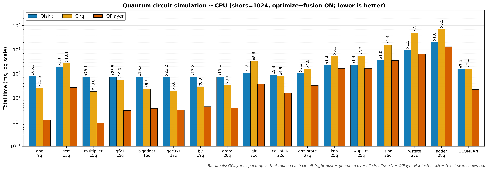
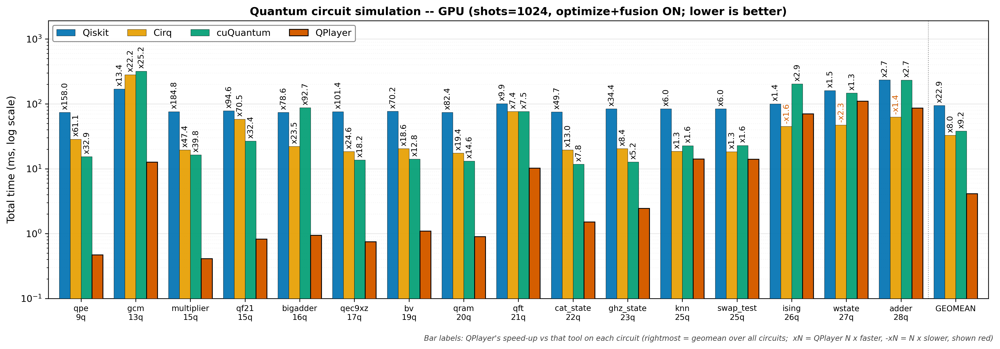

# Performance comparison report -- 2026-07-22 17:31

> Tool: `comparison.py`
> Compared: Qiskit (statevector) · Cirq (qsim) · cuQuantum (cuStateVec, GPU only) · QPlayer
> Matrix: processor (CPU · GPU) × tool (4); optimize and fusion always ON
> Metric: 4 sections (compile · execute · sampling · total) median ms -- cross-tool comparison uses TOTAL
> Circuits under test: `/home/ksjin/github/QPlayer-II/examples/benchmarks/performance/qasm` (16 of 16 measured)

## Environment
| Item | Value |
|------|-------|
| datetime | 2026-07-22 17:31 |
| host | Linux 6.8.0-124-generic x86_64 |
| cpu | Intel(R) Xeon(R) Platinum 8452Y |
| gpu | NVIDIA H100 NVL ×2 |
| qiskit | 2.4.2 |
| cirq / qsimcirq | 1.5.0 / 0.22.0 |
| cupy / cuquantum | 13.6.0 / 26.3.2 (cuStateVec, GPU only) |
| qplayer | 5.5.0 (.so built 2026-07-22 17:31:48) |
| shots / repeats | 1024 / 5 (warm-up discarded, median reported) |

## Circuit summary
| Circuit | Qubits | Clbits | Gate ops | measure | Top gates | Tested |
|---------|-------:|-------:|---------:|--------:|-----------|:------:|
| q09_qpe.qasm | 9 | 6 | 33 | 6 | cu1×15, h×12, x×3, ccx×2, cz×1 | ✓ |
| q13_gcm.qasm | 13 | 1 | 3148 | 1 | rz×1522, sx×858, cx×762, x×6 | ✓ |
| q15_multiplier.qasm | 15 | 3 | 70 | 3 | ccx×36, cx×30, x×4 | ✓ |
| q15_qf21.qasm | 15 | 10 | 73 | 10 | cu1×45, h×20, ccx×4, x×3, cz×1 | ✓ |
| q17_qec9xz.qasm | 17 | 8 | 53 | 8 | cx×32, h×21 | ✓ |
| q18_bigadder.qasm | 16 | 9 | 17 | 9 | cx×4, unmaj×4, majority×3, x×3, add4×2 | ✓ |
| q19_bv.qasm | 19 | 18 | 56 | 18 | h×37, cx×18, x×1 | ✓ |
| q20_qram.qasm | 20 | 4 | 41 | 4 | ccx×20, cx×16, x×5 | ✓ |
| q21_qft.qasm | 21 | 21 | 661 | 1 | cx×420, rz×210, h×21, swap×10 | ✓ |
| q22_cat_state.qasm | 22 | 22 | 22 | 22 | cx×21, h×1 | ✓ |
| q23_ghz_state.qasm | 23 | 23 | 23 | 23 | cx×22, h×1 | ✓ |
| q25_knn.qasm | 25 | 25 | 38 | 1 | ry×24, cswap×12, h×2 | ✓ |
| q25_swap_test.qasm | 25 | 1 | 38 | 1 | rx×24, cswap×12, h×2 | ✓ |
| q26_ising.qasm | 26 | 26 | 280 | 26 | rz×152, h×78, cx×50 | ✓ |
| q27_wstate.qasm | 27 | 27 | 105 | 27 | ry×52, cx×26, cz×26, x×1 | ✓ |
| q28_adder.qasm | 28 | 28 | 88 | 28 | cx×51, ccx×24, x×13 | ✓ |

## Per-circuit results

### q09_qpe.qasm
- circuit: qubits 9 · clbits 6 · gate ops 33 · measure 6 · gate types cu1×15, h×12, x×3, ccx×2, cz×1
- command: `python comparison.py qasm/q09_qpe.qasm --shots 1024 --repeats 5 --procs cpu gpu`
```text
Available backends: Qiskit, Cirq, cuQuantum, QPlayer

# Circuit info -- /home/ksjin/github/QPlayer-II/examples/benchmarks/performance/qasm/q09_qpe.qasm
  qubits=9  clbits=6  gate ops=33  measure=6  barrier=3  reset=0
  gate types: cu1×15, h×12, x×3, ccx×2, cz×1

# QPlayer performance comparison -- /home/ksjin/github/QPlayer-II/examples/benchmarks/performance/qasm/q09_qpe.qasm (shots=1024, repeats=5, optimize=ON, fusion=ON)
# per-section median ms; '-' = not available; compare across tools on TOTAL (sections asymmetric, see docstring)

proc                     Qiskit                                   Cirq                                 cuQuantum                                QPlayer
           compile   execute  sampling     total   compile   execute  sampling     total   compile   execute  sampling     total   compile   execute  sampling     total
------------------------------------------------------------------------------------------------------------------------------------------------------------------------
cpu         67.598    13.073     0.167    79.995     9.925    14.485     1.833    26.222         -         -         -         -     0.151     0.875     0.194     1.221
gpu         66.522     7.679     0.167    73.998     9.953    16.796     1.850    28.596    13.735     1.076     0.575    15.393     0.139     0.153     0.175     0.468

# Skipped / unavailable
  cuQuantum/cpu: skip -- cuStateVec is GPU-only

# [1] Relative speedup on TOTAL time (QPlayer total / other total; <1 = QPlayer faster, >1 = slower)

proc           vs Qiskit       vs Cirq  vs cuQuantum
----------------------------------------------------
cpu                0.02x         0.05x             -
gpu                0.01x         0.02x         0.03x

# [2] Relative performance on TOTAL time (QPlayer's perspective; xN = QPlayer N x faster, -xN = N x slower)

proc           vs Qiskit       vs Cirq  vs cuQuantum
----------------------------------------------------
cpu               x65.52        x21.48             -
gpu              x158.03        x61.07        x32.87
```

### q13_gcm.qasm
- circuit: qubits 13 · clbits 1 · gate ops 3148 · measure 1 · gate types rz×1522, sx×858, cx×762, x×6
- command: `python comparison.py qasm/q13_gcm.qasm --shots 1024 --repeats 5 --procs cpu gpu`
```text
Available backends: Qiskit, Cirq, cuQuantum, QPlayer

# Circuit info -- /home/ksjin/github/QPlayer-II/examples/benchmarks/performance/qasm/q13_gcm.qasm
  qubits=13  clbits=1  gate ops=3148  measure=1  barrier=0  reset=0
  gate types: rz×1522, sx×858, cx×762, x×6

# QPlayer performance comparison -- /home/ksjin/github/QPlayer-II/examples/benchmarks/performance/qasm/q13_gcm.qasm (shots=1024, repeats=5, optimize=ON, fusion=ON)
# per-section median ms; '-' = not available; compare across tools on TOTAL (sections asymmetric, see docstring)

proc                     Qiskit                                   Cirq                                 cuQuantum                                QPlayer
           compile   execute  sampling     total   compile   execute  sampling     total   compile   execute  sampling     total   compile   execute  sampling     total
------------------------------------------------------------------------------------------------------------------------------------------------------------------------
cpu        141.578    54.359     0.059   196.008   208.017    68.325     1.159   278.140         -         -         -         -     8.877    18.247     0.195    27.450
gpu        141.261    29.614     0.049   169.985   208.946    70.090     1.096   281.851   244.896    74.745     0.589   319.774     7.127     5.394     0.137    12.677

# Skipped / unavailable
  cuQuantum/cpu: skip -- cuStateVec is GPU-only

# [1] Relative speedup on TOTAL time (QPlayer total / other total; <1 = QPlayer faster, >1 = slower)

proc           vs Qiskit       vs Cirq  vs cuQuantum
----------------------------------------------------
cpu                0.14x         0.10x             -
gpu                0.07x         0.04x         0.04x

# [2] Relative performance on TOTAL time (QPlayer's perspective; xN = QPlayer N x faster, -xN = N x slower)

proc           vs Qiskit       vs Cirq  vs cuQuantum
----------------------------------------------------
cpu                x7.14        x10.13             -
gpu               x13.41        x22.23        x25.22
```

### q15_multiplier.qasm
- circuit: qubits 15 · clbits 3 · gate ops 70 · measure 3 · gate types ccx×36, cx×30, x×4
- command: `python comparison.py qasm/q15_multiplier.qasm --shots 1024 --repeats 5 --procs cpu gpu`
```text
Available backends: Qiskit, Cirq, cuQuantum, QPlayer

# Circuit info -- /home/ksjin/github/QPlayer-II/examples/benchmarks/performance/qasm/q15_multiplier.qasm
  qubits=15  clbits=3  gate ops=70  measure=3  barrier=0  reset=0
  gate types: ccx×36, cx×30, x×4

# QPlayer performance comparison -- /home/ksjin/github/QPlayer-II/examples/benchmarks/performance/qasm/q15_multiplier.qasm (shots=1024, repeats=5, optimize=ON, fusion=ON)
# per-section median ms; '-' = not available; compare across tools on TOTAL (sections asymmetric, see docstring)

proc                     Qiskit                                   Cirq                                 cuQuantum                                QPlayer
           compile   execute  sampling     total   compile   execute  sampling     total   compile   execute  sampling     total   compile   execute  sampling     total
------------------------------------------------------------------------------------------------------------------------------------------------------------------------
cpu         67.466     5.454     0.034    72.995    12.159     5.068     1.513    18.723         -         -         -         -     0.221     0.427     0.298     0.935
gpu         68.660     7.293     0.034    75.987    12.243     5.799     1.391    19.493    13.834     1.934     0.580    16.380     0.200     0.101     0.111     0.411

# Skipped / unavailable
  cuQuantum/cpu: skip -- cuStateVec is GPU-only

# [1] Relative speedup on TOTAL time (QPlayer total / other total; <1 = QPlayer faster, >1 = slower)

proc           vs Qiskit       vs Cirq  vs cuQuantum
----------------------------------------------------
cpu                0.01x         0.05x             -
gpu                0.01x         0.02x         0.03x

# [2] Relative performance on TOTAL time (QPlayer's perspective; xN = QPlayer N x faster, -xN = N x slower)

proc           vs Qiskit       vs Cirq  vs cuQuantum
----------------------------------------------------
cpu               x78.08        x20.03             -
gpu              x184.76        x47.40        x39.83
```

### q15_qf21.qasm
- circuit: qubits 15 · clbits 10 · gate ops 73 · measure 10 · gate types cu1×45, h×20, ccx×4, x×3, cz×1
- command: `python comparison.py qasm/q15_qf21.qasm --shots 1024 --repeats 5 --procs cpu gpu`
```text
Available backends: Qiskit, Cirq, cuQuantum, QPlayer

# Circuit info -- /home/ksjin/github/QPlayer-II/examples/benchmarks/performance/qasm/q15_qf21.qasm
  qubits=15  clbits=10  gate ops=73  measure=10  barrier=0  reset=0
  gate types: cu1×45, h×20, ccx×4, x×3, cz×1

# QPlayer performance comparison -- /home/ksjin/github/QPlayer-II/examples/benchmarks/performance/qasm/q15_qf21.qasm (shots=1024, repeats=5, optimize=ON, fusion=ON)
# per-section median ms; '-' = not available; compare across tools on TOTAL (sections asymmetric, see docstring)

proc                     Qiskit                                   Cirq                                 cuQuantum                                QPlayer
           compile   execute  sampling     total   compile   execute  sampling     total   compile   execute  sampling     total   compile   execute  sampling     total
------------------------------------------------------------------------------------------------------------------------------------------------------------------------
cpu         68.848     7.269     0.848    76.979    13.945    40.287     2.657    57.337         -         -         -         -     0.312     2.032     0.683     3.015
gpu         67.652     9.713     0.857    77.994    13.993    41.641     2.501    58.128    24.076     2.000     0.635    26.707     0.262     0.277     0.275     0.824

# Skipped / unavailable
  cuQuantum/cpu: skip -- cuStateVec is GPU-only

# [1] Relative speedup on TOTAL time (QPlayer total / other total; <1 = QPlayer faster, >1 = slower)

proc           vs Qiskit       vs Cirq  vs cuQuantum
----------------------------------------------------
cpu                0.04x         0.05x             -
gpu                0.01x         0.01x         0.03x

# [2] Relative performance on TOTAL time (QPlayer's perspective; xN = QPlayer N x faster, -xN = N x slower)

proc           vs Qiskit       vs Cirq  vs cuQuantum
----------------------------------------------------
cpu               x25.53        x19.01             -
gpu               x94.64        x70.53        x32.41
```

### q17_qec9xz.qasm
- circuit: qubits 17 · clbits 8 · gate ops 53 · measure 8 · gate types cx×32, h×21
- command: `python comparison.py qasm/q17_qec9xz.qasm --shots 1024 --repeats 5 --procs cpu gpu`
```text
Available backends: Qiskit, Cirq, cuQuantum, QPlayer

# Circuit info -- /home/ksjin/github/QPlayer-II/examples/benchmarks/performance/qasm/q17_qec9xz.qasm
  qubits=17  clbits=8  gate ops=53  measure=8  barrier=0  reset=0
  gate types: cx×32, h×21

# QPlayer performance comparison -- /home/ksjin/github/QPlayer-II/examples/benchmarks/performance/qasm/q17_qec9xz.qasm (shots=1024, repeats=5, optimize=ON, fusion=ON)
# per-section median ms; '-' = not available; compare across tools on TOTAL (sections asymmetric, see docstring)

proc                     Qiskit                                   Cirq                                 cuQuantum                                QPlayer
           compile   execute  sampling     total   compile   execute  sampling     total   compile   execute  sampling     total   compile   execute  sampling     total
------------------------------------------------------------------------------------------------------------------------------------------------------------------------
cpu         69.566     5.335     0.042    74.980    10.407     6.928     2.120    19.509         -         -         -         -     0.202     2.239     0.769     3.229
gpu         68.680     7.160     0.037    75.989    10.443     5.636     2.138    18.452    11.628     1.422     0.568    13.624     0.164     0.359     0.228     0.749

# Skipped / unavailable
  cuQuantum/cpu: skip -- cuStateVec is GPU-only

# [1] Relative speedup on TOTAL time (QPlayer total / other total; <1 = QPlayer faster, >1 = slower)

proc           vs Qiskit       vs Cirq  vs cuQuantum
----------------------------------------------------
cpu                0.04x         0.17x             -
gpu                0.01x         0.04x         0.05x

# [2] Relative performance on TOTAL time (QPlayer's perspective; xN = QPlayer N x faster, -xN = N x slower)

proc           vs Qiskit       vs Cirq  vs cuQuantum
----------------------------------------------------
cpu               x23.22         x6.04             -
gpu              x101.43        x24.63        x18.18
```

### q18_bigadder.qasm
- circuit: qubits 16 · clbits 9 · gate ops 17 · measure 9 · gate types cx×4, unmaj×4, majority×3, x×3, add4×2
- command: `python comparison.py qasm/q18_bigadder.qasm --shots 1024 --repeats 5 --procs cpu gpu`
```text
Available backends: Qiskit, Cirq, cuQuantum, QPlayer

# Circuit info -- /home/ksjin/github/QPlayer-II/examples/benchmarks/performance/qasm/q18_bigadder.qasm
  qubits=16  clbits=9  gate ops=17  measure=9  barrier=0  reset=0
  gate types: cx×4, unmaj×4, majority×3, x×3, add4×2, ccx×1

# QPlayer performance comparison -- /home/ksjin/github/QPlayer-II/examples/benchmarks/performance/qasm/q18_bigadder.qasm (shots=1024, repeats=5, optimize=ON, fusion=ON)
# per-section median ms; '-' = not available; compare across tools on TOTAL (sections asymmetric, see docstring)

proc                     Qiskit                                   Cirq                                 cuQuantum                                QPlayer
           compile   execute  sampling     total   compile   execute  sampling     total   compile   execute  sampling     total   compile   execute  sampling     total
------------------------------------------------------------------------------------------------------------------------------------------------------------------------
cpu         66.437     5.558     0.035    72.026     9.487    12.481     2.295    24.290         -         -         -         -     0.262     1.741     1.430     3.738
gpu         67.053     7.188     0.037    73.988     9.301    10.310     2.302    22.141    82.222     4.350     0.704    87.276     0.208     0.400     0.335     0.942

# Skipped / unavailable
  cuQuantum/cpu: skip -- cuStateVec is GPU-only

# [1] Relative speedup on TOTAL time (QPlayer total / other total; <1 = QPlayer faster, >1 = slower)

proc           vs Qiskit       vs Cirq  vs cuQuantum
----------------------------------------------------
cpu                0.05x         0.15x             -
gpu                0.01x         0.04x         0.01x

# [2] Relative performance on TOTAL time (QPlayer's perspective; xN = QPlayer N x faster, -xN = N x slower)

proc           vs Qiskit       vs Cirq  vs cuQuantum
----------------------------------------------------
cpu               x19.27         x6.50             -
gpu               x78.58        x23.52        x92.69
```

### q19_bv.qasm
- circuit: qubits 19 · clbits 18 · gate ops 56 · measure 18 · gate types h×37, cx×18, x×1
- command: `python comparison.py qasm/q19_bv.qasm --shots 1024 --repeats 5 --procs cpu gpu`
```text
Available backends: Qiskit, Cirq, cuQuantum, QPlayer

# Circuit info -- /home/ksjin/github/QPlayer-II/examples/benchmarks/performance/qasm/q19_bv.qasm
  qubits=19  clbits=18  gate ops=56  measure=18  barrier=0  reset=0
  gate types: h×37, cx×18, x×1

# QPlayer performance comparison -- /home/ksjin/github/QPlayer-II/examples/benchmarks/performance/qasm/q19_bv.qasm (shots=1024, repeats=5, optimize=ON, fusion=ON)
# per-section median ms; '-' = not available; compare across tools on TOTAL (sections asymmetric, see docstring)

proc                     Qiskit                                   Cirq                                 cuQuantum                                QPlayer
           compile   execute  sampling     total   compile   execute  sampling     total   compile   execute  sampling     total   compile   execute  sampling     total
------------------------------------------------------------------------------------------------------------------------------------------------------------------------
cpu         69.572     5.482     0.035    74.984    10.734    13.279     3.456    27.609         -         -         -         -     0.240     3.568     0.555     4.369
gpu         69.134     8.296     0.034    76.987    10.803     6.128     3.482    20.431    11.943     1.504     0.594    14.061     0.177     0.563     0.350     1.096

# Skipped / unavailable
  cuQuantum/cpu: skip -- cuStateVec is GPU-only

# [1] Relative speedup on TOTAL time (QPlayer total / other total; <1 = QPlayer faster, >1 = slower)

proc           vs Qiskit       vs Cirq  vs cuQuantum
----------------------------------------------------
cpu                0.06x         0.16x             -
gpu                0.01x         0.05x         0.08x

# [2] Relative performance on TOTAL time (QPlayer's perspective; xN = QPlayer N x faster, -xN = N x slower)

proc           vs Qiskit       vs Cirq  vs cuQuantum
----------------------------------------------------
cpu               x17.16         x6.32             -
gpu               x70.24        x18.64        x12.83
```

### q20_qram.qasm
- circuit: qubits 20 · clbits 4 · gate ops 41 · measure 4 · gate types ccx×20, cx×16, x×5
- command: `python comparison.py qasm/q20_qram.qasm --shots 1024 --repeats 5 --procs cpu gpu`
```text
Available backends: Qiskit, Cirq, cuQuantum, QPlayer

# Circuit info -- /home/ksjin/github/QPlayer-II/examples/benchmarks/performance/qasm/q20_qram.qasm
  qubits=20  clbits=4  gate ops=41  measure=4  barrier=0  reset=0
  gate types: ccx×20, cx×16, x×5

# QPlayer performance comparison -- /home/ksjin/github/QPlayer-II/examples/benchmarks/performance/qasm/q20_qram.qasm (shots=1024, repeats=5, optimize=ON, fusion=ON)
# per-section median ms; '-' = not available; compare across tools on TOTAL (sections asymmetric, see docstring)

proc                     Qiskit                                   Cirq                                 cuQuantum                                QPlayer
           compile   execute  sampling     total   compile   execute  sampling     total   compile   execute  sampling     total   compile   execute  sampling     total
------------------------------------------------------------------------------------------------------------------------------------------------------------------------
cpu         66.672     7.589     0.036    74.008    10.065    22.958     1.547    34.606         -         -         -         -     0.221     3.112     0.464     3.814
gpu         66.547     6.920     0.035    73.985    10.128     5.637     1.543    17.445    11.295     1.242     0.567    13.107     0.176     0.385     0.332     0.898

# Skipped / unavailable
  cuQuantum/cpu: skip -- cuStateVec is GPU-only

# [1] Relative speedup on TOTAL time (QPlayer total / other total; <1 = QPlayer faster, >1 = slower)

proc           vs Qiskit       vs Cirq  vs cuQuantum
----------------------------------------------------
cpu                0.05x         0.11x             -
gpu                0.01x         0.05x         0.07x

# [2] Relative performance on TOTAL time (QPlayer's perspective; xN = QPlayer N x faster, -xN = N x slower)

proc           vs Qiskit       vs Cirq  vs cuQuantum
----------------------------------------------------
cpu               x19.41         x9.07             -
gpu               x82.42        x19.43        x14.60
```

### q21_qft.qasm
- circuit: qubits 21 · clbits 21 · gate ops 661 · measure 1 · gate types cx×420, rz×210, h×21, swap×10
- command: `python comparison.py qasm/q21_qft.qasm --shots 1024 --repeats 5 --procs cpu gpu`
```text
Available backends: Qiskit, Cirq, cuQuantum, QPlayer

# Circuit info -- /home/ksjin/github/QPlayer-II/examples/benchmarks/performance/qasm/q21_qft.qasm
  qubits=21  clbits=21  gate ops=661  measure=1  barrier=0  reset=0
  gate types: cx×420, rz×210, h×21, swap×10

# QPlayer performance comparison -- /home/ksjin/github/QPlayer-II/examples/benchmarks/performance/qasm/q21_qft.qasm (shots=1024, repeats=5, optimize=ON, fusion=ON)
# per-section median ms; '-' = not available; compare across tools on TOTAL (sections asymmetric, see docstring)

proc                     Qiskit                                   Cirq                                 cuQuantum                                QPlayer
           compile   execute  sampling     total   compile   execute  sampling     total   compile   execute  sampling     total   compile   execute  sampling     total
------------------------------------------------------------------------------------------------------------------------------------------------------------------------
cpu         71.567    35.969     2.018   109.866    51.997   274.178     3.998   330.155         -         -         -         -     1.632    35.792     0.956    38.367
gpu         74.802    25.844     2.018   100.982    51.811    20.441     4.031    76.196    60.209    15.428     0.710    76.387     1.371     8.137     0.732    10.246

# Skipped / unavailable
  cuQuantum/cpu: skip -- cuStateVec is GPU-only

# [1] Relative speedup on TOTAL time (QPlayer total / other total; <1 = QPlayer faster, >1 = slower)

proc           vs Qiskit       vs Cirq  vs cuQuantum
----------------------------------------------------
cpu                0.35x         0.12x             -
gpu                0.10x         0.13x         0.13x

# [2] Relative performance on TOTAL time (QPlayer's perspective; xN = QPlayer N x faster, -xN = N x slower)

proc           vs Qiskit       vs Cirq  vs cuQuantum
----------------------------------------------------
cpu                x2.86         x8.61             -
gpu                x9.86         x7.44         x7.46
```

### q22_cat_state.qasm
- circuit: qubits 22 · clbits 22 · gate ops 22 · measure 22 · gate types cx×21, h×1
- command: `python comparison.py qasm/q22_cat_state.qasm --shots 1024 --repeats 5 --procs cpu gpu`
```text
Available backends: Qiskit, Cirq, cuQuantum, QPlayer

# Circuit info -- /home/ksjin/github/QPlayer-II/examples/benchmarks/performance/qasm/q22_cat_state.qasm
  qubits=22  clbits=22  gate ops=22  measure=22  barrier=0  reset=0
  gate types: cx×21, h×1

# QPlayer performance comparison -- /home/ksjin/github/QPlayer-II/examples/benchmarks/performance/qasm/q22_cat_state.qasm (shots=1024, repeats=5, optimize=ON, fusion=ON)
# per-section median ms; '-' = not available; compare across tools on TOTAL (sections asymmetric, see docstring)

proc                     Qiskit                                   Cirq                                 cuQuantum                                QPlayer
           compile   execute  sampling     total   compile   execute  sampling     total   compile   execute  sampling     total   compile   execute  sampling     total
------------------------------------------------------------------------------------------------------------------------------------------------------------------------
cpu         64.714    20.772     0.043    86.703     9.482    66.369     3.939    79.810         -         -         -         -     0.157    15.460     0.692    16.309
gpu         66.581     7.427     0.037    74.988     9.421     6.061     3.915    19.547    10.004     0.812     0.924    11.733     0.125     0.883     0.497     1.508

# Skipped / unavailable
  cuQuantum/cpu: skip -- cuStateVec is GPU-only

# [1] Relative speedup on TOTAL time (QPlayer total / other total; <1 = QPlayer faster, >1 = slower)

proc           vs Qiskit       vs Cirq  vs cuQuantum
----------------------------------------------------
cpu                0.19x         0.20x             -
gpu                0.02x         0.08x         0.13x

# [2] Relative performance on TOTAL time (QPlayer's perspective; xN = QPlayer N x faster, -xN = N x slower)

proc           vs Qiskit       vs Cirq  vs cuQuantum
----------------------------------------------------
cpu                x5.32         x4.89             -
gpu               x49.73        x12.96         x7.78
```

### q23_ghz_state.qasm
- circuit: qubits 23 · clbits 23 · gate ops 23 · measure 23 · gate types cx×22, h×1
- command: `python comparison.py qasm/q23_ghz_state.qasm --shots 1024 --repeats 5 --procs cpu gpu`
```text
Available backends: Qiskit, Cirq, cuQuantum, QPlayer

# Circuit info -- /home/ksjin/github/QPlayer-II/examples/benchmarks/performance/qasm/q23_ghz_state.qasm
  qubits=23  clbits=23  gate ops=23  measure=23  barrier=0  reset=0
  gate types: cx×22, h×1

# QPlayer performance comparison -- /home/ksjin/github/QPlayer-II/examples/benchmarks/performance/qasm/q23_ghz_state.qasm (shots=1024, repeats=5, optimize=ON, fusion=ON)
# per-section median ms; '-' = not available; compare across tools on TOTAL (sections asymmetric, see docstring)

proc                     Qiskit                                   Cirq                                 cuQuantum                                QPlayer
           compile   execute  sampling     total   compile   execute  sampling     total   compile   execute  sampling     total   compile   execute  sampling     total
------------------------------------------------------------------------------------------------------------------------------------------------------------------------
cpu         64.788    42.180     0.057   107.120     9.784   145.796     4.059   159.833         -         -         -         -     0.213    31.979     1.037    33.200
gpu         66.576    17.368     0.038    83.982     9.458     6.914     3.979    20.463    10.050     0.839     1.860    12.751     0.128     1.575     0.735     2.442

# Skipped / unavailable
  cuQuantum/cpu: skip -- cuStateVec is GPU-only

# [1] Relative speedup on TOTAL time (QPlayer total / other total; <1 = QPlayer faster, >1 = slower)

proc           vs Qiskit       vs Cirq  vs cuQuantum
----------------------------------------------------
cpu                0.31x         0.21x             -
gpu                0.03x         0.12x         0.19x

# [2] Relative performance on TOTAL time (QPlayer's perspective; xN = QPlayer N x faster, -xN = N x slower)

proc           vs Qiskit       vs Cirq  vs cuQuantum
----------------------------------------------------
cpu                x3.23         x4.81             -
gpu               x34.39         x8.38         x5.22
```

### q25_knn.qasm
- circuit: qubits 25 · clbits 25 · gate ops 38 · measure 1 · gate types ry×24, cswap×12, h×2
- command: `python comparison.py qasm/q25_knn.qasm --shots 1024 --repeats 5 --procs cpu gpu`
```text
Available backends: Qiskit, Cirq, cuQuantum, QPlayer

# Circuit info -- /home/ksjin/github/QPlayer-II/examples/benchmarks/performance/qasm/q25_knn.qasm
  qubits=25  clbits=25  gate ops=38  measure=1  barrier=0  reset=0
  gate types: ry×24, cswap×12, h×2

# QPlayer performance comparison -- /home/ksjin/github/QPlayer-II/examples/benchmarks/performance/qasm/q25_knn.qasm (shots=1024, repeats=5, optimize=ON, fusion=ON)
# per-section median ms; '-' = not available; compare across tools on TOTAL (sections asymmetric, see docstring)

proc                     Qiskit                                   Cirq                                 cuQuantum                                QPlayer
           compile   execute  sampling     total   compile   execute  sampling     total   compile   execute  sampling     total   compile   execute  sampling     total
------------------------------------------------------------------------------------------------------------------------------------------------------------------------
cpu         66.248   163.098     0.080   230.850     9.745   534.436     1.114   549.443         -         -         -         -     0.300   166.071     2.525   168.904
gpu         66.673    17.285     0.039    83.987     9.436     8.018     1.104    18.550    10.048     1.208    11.491    22.743     0.165    11.804     2.077    14.068

# Skipped / unavailable
  cuQuantum/cpu: skip -- cuStateVec is GPU-only

# [1] Relative speedup on TOTAL time (QPlayer total / other total; <1 = QPlayer faster, >1 = slower)

proc           vs Qiskit       vs Cirq  vs cuQuantum
----------------------------------------------------
cpu                0.73x         0.31x             -
gpu                0.17x         0.76x         0.62x

# [2] Relative performance on TOTAL time (QPlayer's perspective; xN = QPlayer N x faster, -xN = N x slower)

proc           vs Qiskit       vs Cirq  vs cuQuantum
----------------------------------------------------
cpu                x1.37         x3.25             -
gpu                x5.97         x1.32         x1.62
```

### q25_swap_test.qasm
- circuit: qubits 25 · clbits 1 · gate ops 38 · measure 1 · gate types rx×24, cswap×12, h×2
- command: `python comparison.py qasm/q25_swap_test.qasm --shots 1024 --repeats 5 --procs cpu gpu`
```text
Available backends: Qiskit, Cirq, cuQuantum, QPlayer

# Circuit info -- /home/ksjin/github/QPlayer-II/examples/benchmarks/performance/qasm/q25_swap_test.qasm
  qubits=25  clbits=1  gate ops=38  measure=1  barrier=0  reset=0
  gate types: rx×24, cswap×12, h×2

# QPlayer performance comparison -- /home/ksjin/github/QPlayer-II/examples/benchmarks/performance/qasm/q25_swap_test.qasm (shots=1024, repeats=5, optimize=ON, fusion=ON)
# per-section median ms; '-' = not available; compare across tools on TOTAL (sections asymmetric, see docstring)

proc                     Qiskit                                   Cirq                                 cuQuantum                                QPlayer
           compile   execute  sampling     total   compile   execute  sampling     total   compile   execute  sampling     total   compile   execute  sampling     total
------------------------------------------------------------------------------------------------------------------------------------------------------------------------
cpu         65.280   164.870     0.098   231.166     9.965   538.321     1.110   550.120         -         -         -         -     0.302   163.402     2.576   168.147
gpu         66.647    17.434     0.044    83.986     9.405     7.935     1.083    18.373    10.008     1.201    11.652    22.879     0.163    11.856     2.036    14.047

# Skipped / unavailable
  cuQuantum/cpu: skip -- cuStateVec is GPU-only

# [1] Relative speedup on TOTAL time (QPlayer total / other total; <1 = QPlayer faster, >1 = slower)

proc           vs Qiskit       vs Cirq  vs cuQuantum
----------------------------------------------------
cpu                0.73x         0.31x             -
gpu                0.17x         0.76x         0.61x

# [2] Relative performance on TOTAL time (QPlayer's perspective; xN = QPlayer N x faster, -xN = N x slower)

proc           vs Qiskit       vs Cirq  vs cuQuantum
----------------------------------------------------
cpu                x1.37         x3.27             -
gpu                x5.98         x1.31         x1.63
```

### q26_ising.qasm
- circuit: qubits 26 · clbits 26 · gate ops 280 · measure 26 · gate types rz×152, h×78, cx×50
- command: `python comparison.py qasm/q26_ising.qasm --shots 1024 --repeats 5 --procs cpu gpu`
```text
Available backends: Qiskit, Cirq, cuQuantum, QPlayer

# Circuit info -- /home/ksjin/github/QPlayer-II/examples/benchmarks/performance/qasm/q26_ising.qasm
  qubits=26  clbits=26  gate ops=280  measure=26  barrier=0  reset=0
  gate types: rz×152, h×78, cx×50

# QPlayer performance comparison -- /home/ksjin/github/QPlayer-II/examples/benchmarks/performance/qasm/q26_ising.qasm (shots=1024, repeats=5, optimize=ON, fusion=ON)
# per-section median ms; '-' = not available; compare across tools on TOTAL (sections asymmetric, see docstring)

proc                     Qiskit                                   Cirq                                 cuQuantum                                QPlayer
           compile   execute  sampling     total   compile   execute  sampling     total   compile   execute  sampling     total   compile   execute  sampling     total
------------------------------------------------------------------------------------------------------------------------------------------------------------------------
cpu         67.331   303.223     1.593   371.608    26.368  1540.962     4.626  1572.386         -         -         -         -     1.122   349.311     5.506   355.986
gpu         68.139    29.734     2.259   100.161    25.018    15.217     4.514    45.079    28.876     6.980   167.184   203.056     0.782    65.342     3.802    69.932

# Skipped / unavailable
  cuQuantum/cpu: skip -- cuStateVec is GPU-only

# [1] Relative speedup on TOTAL time (QPlayer total / other total; <1 = QPlayer faster, >1 = slower)

proc           vs Qiskit       vs Cirq  vs cuQuantum
----------------------------------------------------
cpu                0.96x         0.23x             -
gpu                0.70x         1.55x         0.34x

# [2] Relative performance on TOTAL time (QPlayer's perspective; xN = QPlayer N x faster, -xN = N x slower)

proc           vs Qiskit       vs Cirq  vs cuQuantum
----------------------------------------------------
cpu                x1.04         x4.42             -
gpu                x1.43        -x1.55         x2.90
```

### q27_wstate.qasm
- circuit: qubits 27 · clbits 27 · gate ops 105 · measure 27 · gate types ry×52, cx×26, cz×26, x×1
- command: `python comparison.py qasm/q27_wstate.qasm --shots 1024 --repeats 5 --procs cpu gpu`
```text
Available backends: Qiskit, Cirq, cuQuantum, QPlayer

# Circuit info -- /home/ksjin/github/QPlayer-II/examples/benchmarks/performance/qasm/q27_wstate.qasm
  qubits=27  clbits=27  gate ops=105  measure=27  barrier=0  reset=0
  gate types: ry×52, cx×26, cz×26, x×1

# QPlayer performance comparison -- /home/ksjin/github/QPlayer-II/examples/benchmarks/performance/qasm/q27_wstate.qasm (shots=1024, repeats=5, optimize=ON, fusion=ON)
# per-section median ms; '-' = not available; compare across tools on TOTAL (sections asymmetric, see docstring)

proc                     Qiskit                                   Cirq                                 cuQuantum                                QPlayer
           compile   execute  sampling     total   compile   execute  sampling     total   compile   execute  sampling     total   compile   execute  sampling     total
------------------------------------------------------------------------------------------------------------------------------------------------------------------------
cpu         66.509   916.601     0.189   983.263    16.800  5051.662     4.602  5072.791         -         -         -         -     0.517   657.736     9.325   672.515
gpu         69.001    90.786     0.220   161.029    15.452    27.347     4.498    47.236    17.022     2.794   126.922   146.743     0.357   104.649     4.623   109.618

# Skipped / unavailable
  cuQuantum/cpu: skip -- cuStateVec is GPU-only

# [1] Relative speedup on TOTAL time (QPlayer total / other total; <1 = QPlayer faster, >1 = slower)

proc           vs Qiskit       vs Cirq  vs cuQuantum
----------------------------------------------------
cpu                0.68x         0.13x             -
gpu                0.68x         2.32x         0.75x

# [2] Relative performance on TOTAL time (QPlayer's perspective; xN = QPlayer N x faster, -xN = N x slower)

proc           vs Qiskit       vs Cirq  vs cuQuantum
----------------------------------------------------
cpu                x1.46         x7.54             -
gpu                x1.47        -x2.32         x1.34
```

### q28_adder.qasm
- circuit: qubits 28 · clbits 28 · gate ops 88 · measure 28 · gate types cx×51, ccx×24, x×13
- command: `python comparison.py qasm/q28_adder.qasm --shots 1024 --repeats 5 --procs cpu gpu`
```text
Available backends: Qiskit, Cirq, cuQuantum, QPlayer

# Circuit info -- /home/ksjin/github/QPlayer-II/examples/benchmarks/performance/qasm/q28_adder.qasm
  qubits=28  clbits=28  gate ops=88  measure=28  barrier=0  reset=0
  gate types: cx×51, ccx×24, x×13

# QPlayer performance comparison -- /home/ksjin/github/QPlayer-II/examples/benchmarks/performance/qasm/q28_adder.qasm (shots=1024, repeats=5, optimize=ON, fusion=ON)
# per-section median ms; '-' = not available; compare across tools on TOTAL (sections asymmetric, see docstring)

proc                     Qiskit                                   Cirq                                 cuQuantum                                QPlayer
           compile   execute  sampling     total   compile   execute  sampling     total   compile   execute  sampling     total   compile   execute  sampling     total
------------------------------------------------------------------------------------------------------------------------------------------------------------------------
cpu         67.496  2024.106     0.088  2091.490    15.791  7220.670     4.738  7264.360         -         -         -         -     0.514  1311.008    18.099  1328.909
gpu         66.636   167.304     0.037   233.983    14.536    43.455     4.620    62.755    16.537     2.337   214.568   233.473     0.304    78.567     7.457    86.034

# Skipped / unavailable
  cuQuantum/cpu: skip -- cuStateVec is GPU-only

# [1] Relative speedup on TOTAL time (QPlayer total / other total; <1 = QPlayer faster, >1 = slower)

proc           vs Qiskit       vs Cirq  vs cuQuantum
----------------------------------------------------
cpu                0.64x         0.18x             -
gpu                0.37x         1.37x         0.37x

# [2] Relative performance on TOTAL time (QPlayer's perspective; xN = QPlayer N x faster, -xN = N x slower)

proc           vs Qiskit       vs Cirq  vs cuQuantum
----------------------------------------------------
cpu                x1.57         x5.47             -
gpu                x2.72        -x1.37         x2.71
```

## Plots
### CPU


### GPU


