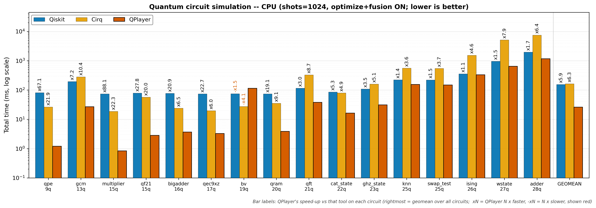
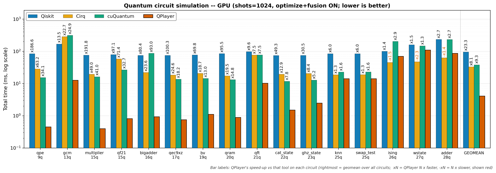

# Performance comparison report -- 2026-07-28 17:42

> Tool: `comparison.py`
> Compared: Qiskit (statevector) · Cirq (qsim) · cuQuantum (cuStateVec, GPU only) · QPlayer
> Matrix: processor (CPU · GPU) × tool (4); optimize and fusion always ON
> Metric: 4 sections (compile · execute · sampling · total) median ms -- cross-tool comparison uses TOTAL
> Circuits under test: `/home/ksjin/github/qrens/QPlayer-Caracal-5.5.0/examples/benchmarks/performance/qasm` (16 of 16 measured)

## Environment
| Item | Value |
|------|-------|
| datetime | 2026-07-28 17:42 |
| host | Linux 6.8.0-136-generic x86_64 |
| cpu | Intel(R) Xeon(R) Platinum 8452Y |
| gpu | NVIDIA H100 NVL ×2 |
| qiskit | 2.4.2 |
| cirq / qsimcirq | 1.5.0 / 0.22.0 |
| cupy / cuquantum | 13.6.0 / 26.3.2 (cuStateVec, GPU only) |
| qplayer | 5.5.0 (.so built 2026-07-28 17:39:36) |
| shots / repeats | 1024 / 5 (warm-up discarded, median reported) |

## Circuit summary
| Circuit | Qubits | Clbits | Gate ops | measure | Top gates | Tested |
|---------|-------:|-------:|---------:|--------:|-----------|:------:|
| q09_qpe.qasm | 9 | 6 | 33 | 6 | cu1×15, h×12, x×3, ccx×2, cz×1 | ✓ |
| q13_gcm.qasm | 13 | 1 | 3148 | 1 | rz×1522, sx×858, cx×762, x×6 | ✓ |
| q15_multiplier.qasm | 15 | 3 | 70 | 3 | ccx×36, cx×30, x×4 | ✓ |
| q15_qf21.qasm | 15 | 10 | 73 | 10 | cu1×45, h×20, ccx×4, x×3, cz×1 | ✓ |
| q17_qec9xz.qasm | 17 | 8 | 53 | 8 | cx×32, h×21 | ✓ |
| q18_bigadder.qasm | 16 | 9 | 17 | 9 | cx×4, unmaj×4, majority×3, x×3, add4×2 | ✓ |
| q19_bv.qasm | 19 | 18 | 56 | 18 | h×37, cx×18, x×1 | ✓ |
| q20_qram.qasm | 20 | 4 | 41 | 4 | ccx×20, cx×16, x×5 | ✓ |
| q21_qft.qasm | 21 | 21 | 661 | 1 | cx×420, rz×210, h×21, swap×10 | ✓ |
| q22_cat_state.qasm | 22 | 22 | 22 | 22 | cx×21, h×1 | ✓ |
| q23_ghz_state.qasm | 23 | 23 | 23 | 23 | cx×22, h×1 | ✓ |
| q25_knn.qasm | 25 | 25 | 38 | 1 | ry×24, cswap×12, h×2 | ✓ |
| q25_swap_test.qasm | 25 | 1 | 38 | 1 | rx×24, cswap×12, h×2 | ✓ |
| q26_ising.qasm | 26 | 26 | 280 | 26 | rz×152, h×78, cx×50 | ✓ |
| q27_wstate.qasm | 27 | 27 | 105 | 27 | ry×52, cx×26, cz×26, x×1 | ✓ |
| q28_adder.qasm | 28 | 28 | 88 | 28 | cx×51, ccx×24, x×13 | ✓ |

## Per-circuit results

### q09_qpe.qasm
- circuit: qubits 9 · clbits 6 · gate ops 33 · measure 6 · gate types cu1×15, h×12, x×3, ccx×2, cz×1
- command: `python comparison.py qasm/q09_qpe.qasm --shots 1024 --repeats 5 --procs cpu gpu`
```text
Available backends: Qiskit, Cirq, cuQuantum, QPlayer

# Circuit info -- /home/ksjin/github/qrens/QPlayer-Caracal-5.5.0/examples/benchmarks/performance/qasm/q09_qpe.qasm
  qubits=9  clbits=6  gate ops=33  measure=6  barrier=3  reset=0
  gate types: cu1×15, h×12, x×3, ccx×2, cz×1

# QPlayer performance comparison -- /home/ksjin/github/qrens/QPlayer-Caracal-5.5.0/examples/benchmarks/performance/qasm/q09_qpe.qasm (shots=1024, repeats=5, optimize=ON, fusion=ON)
# per-section median ms; '-' = not available; compare across tools on TOTAL (sections asymmetric, see docstring)

proc                     Qiskit                                   Cirq                                 cuQuantum                                QPlayer                 
           compile   execute  sampling     total   compile   execute  sampling     total   compile   execute  sampling     total   compile   execute  sampling     total
------------------------------------------------------------------------------------------------------------------------------------------------------------------------
cpu         67.313    13.351     0.161    80.976    10.011    14.517     1.854    26.394         -         -         -         -     0.153     0.862     0.201     1.207
gpu         66.896    16.933     0.163    83.989    10.064    16.441     1.847    28.448    13.720     1.058     0.574    15.357     0.132     0.152     0.171     0.450

# Skipped / unavailable
  cuQuantum/cpu: skip -- cuStateVec is GPU-only

# [1] Relative speedup on TOTAL time (QPlayer total / other total; <1 = QPlayer faster, >1 = slower)

proc           vs Qiskit       vs Cirq  vs cuQuantum
----------------------------------------------------
cpu                0.01x         0.05x             -
gpu                0.01x         0.02x         0.03x

# [2] Relative performance on TOTAL time (QPlayer's perspective; xN = QPlayer N x faster, -xN = N x slower)

proc           vs Qiskit       vs Cirq  vs cuQuantum
----------------------------------------------------
cpu               x67.06        x21.86             -
gpu              x186.61        x63.21        x34.12
```

### q13_gcm.qasm
- circuit: qubits 13 · clbits 1 · gate ops 3148 · measure 1 · gate types rz×1522, sx×858, cx×762, x×6
- command: `python comparison.py qasm/q13_gcm.qasm --shots 1024 --repeats 5 --procs cpu gpu`
```text
Available backends: Qiskit, Cirq, cuQuantum, QPlayer

# Circuit info -- /home/ksjin/github/qrens/QPlayer-Caracal-5.5.0/examples/benchmarks/performance/qasm/q13_gcm.qasm
  qubits=13  clbits=1  gate ops=3148  measure=1  barrier=0  reset=0
  gate types: rz×1522, sx×858, cx×762, x×6

# QPlayer performance comparison -- /home/ksjin/github/qrens/QPlayer-Caracal-5.5.0/examples/benchmarks/performance/qasm/q13_gcm.qasm (shots=1024, repeats=5, optimize=ON, fusion=ON)
# per-section median ms; '-' = not available; compare across tools on TOTAL (sections asymmetric, see docstring)

proc                     Qiskit                                   Cirq                                 cuQuantum                                QPlayer                 
           compile   execute  sampling     total   compile   execute  sampling     total   compile   execute  sampling     total   compile   execute  sampling     total
------------------------------------------------------------------------------------------------------------------------------------------------------------------------
cpu        141.059    53.267     0.039   193.988   211.600    67.471     1.166   280.888         -         -         -         -     8.856    17.974     0.184    27.024
gpu        140.432    27.849     0.052   168.993   211.747    70.111     1.099   285.469   243.937    68.665     0.574   313.202     7.032     5.384     0.133    12.559

# Skipped / unavailable
  cuQuantum/cpu: skip -- cuStateVec is GPU-only

# [1] Relative speedup on TOTAL time (QPlayer total / other total; <1 = QPlayer faster, >1 = slower)

proc           vs Qiskit       vs Cirq  vs cuQuantum
----------------------------------------------------
cpu                0.14x         0.10x             -
gpu                0.07x         0.04x         0.04x

# [2] Relative performance on TOTAL time (QPlayer's perspective; xN = QPlayer N x faster, -xN = N x slower)

proc           vs Qiskit       vs Cirq  vs cuQuantum
----------------------------------------------------
cpu                x7.18        x10.39             -
gpu               x13.46        x22.73        x24.94
```

### q15_multiplier.qasm
- circuit: qubits 15 · clbits 3 · gate ops 70 · measure 3 · gate types ccx×36, cx×30, x×4
- command: `python comparison.py qasm/q15_multiplier.qasm --shots 1024 --repeats 5 --procs cpu gpu`
```text
Available backends: Qiskit, Cirq, cuQuantum, QPlayer

# Circuit info -- /home/ksjin/github/qrens/QPlayer-Caracal-5.5.0/examples/benchmarks/performance/qasm/q15_multiplier.qasm
  qubits=15  clbits=3  gate ops=70  measure=3  barrier=0  reset=0
  gate types: ccx×36, cx×30, x×4

# QPlayer performance comparison -- /home/ksjin/github/qrens/QPlayer-Caracal-5.5.0/examples/benchmarks/performance/qasm/q15_multiplier.qasm (shots=1024, repeats=5, optimize=ON, fusion=ON)
# per-section median ms; '-' = not available; compare across tools on TOTAL (sections asymmetric, see docstring)

proc                     Qiskit                                   Cirq                                 cuQuantum                                QPlayer                 
           compile   execute  sampling     total   compile   execute  sampling     total   compile   execute  sampling     total   compile   execute  sampling     total
------------------------------------------------------------------------------------------------------------------------------------------------------------------------
cpu         68.633     5.063     0.035    73.985    12.116     5.015     1.526    18.706         -         -         -         -     0.212     0.321     0.308     0.840
gpu         67.888     7.569     0.035    75.988    12.206     5.752     1.406    19.410    13.830     1.845     0.572    16.248     0.191     0.098     0.106     0.396

# Skipped / unavailable
  cuQuantum/cpu: skip -- cuStateVec is GPU-only

# [1] Relative speedup on TOTAL time (QPlayer total / other total; <1 = QPlayer faster, >1 = slower)

proc           vs Qiskit       vs Cirq  vs cuQuantum
----------------------------------------------------
cpu                0.01x         0.04x             -
gpu                0.01x         0.02x         0.02x

# [2] Relative performance on TOTAL time (QPlayer's perspective; xN = QPlayer N x faster, -xN = N x slower)

proc           vs Qiskit       vs Cirq  vs cuQuantum
----------------------------------------------------
cpu               x88.07        x22.27             -
gpu              x191.84        x49.00        x41.02
```

### q15_qf21.qasm
- circuit: qubits 15 · clbits 10 · gate ops 73 · measure 10 · gate types cu1×45, h×20, ccx×4, x×3, cz×1
- command: `python comparison.py qasm/q15_qf21.qasm --shots 1024 --repeats 5 --procs cpu gpu`
```text
Available backends: Qiskit, Cirq, cuQuantum, QPlayer

# Circuit info -- /home/ksjin/github/qrens/QPlayer-Caracal-5.5.0/examples/benchmarks/performance/qasm/q15_qf21.qasm
  qubits=15  clbits=10  gate ops=73  measure=10  barrier=0  reset=0
  gate types: cu1×45, h×20, ccx×4, x×3, cz×1

# QPlayer performance comparison -- /home/ksjin/github/qrens/QPlayer-Caracal-5.5.0/examples/benchmarks/performance/qasm/q15_qf21.qasm (shots=1024, repeats=5, optimize=ON, fusion=ON)
# per-section median ms; '-' = not available; compare across tools on TOTAL (sections asymmetric, see docstring)

proc                     Qiskit                                   Cirq                                 cuQuantum                                QPlayer                 
           compile   execute  sampling     total   compile   execute  sampling     total   compile   execute  sampling     total   compile   execute  sampling     total
------------------------------------------------------------------------------------------------------------------------------------------------------------------------
cpu         70.231     6.938     0.856    79.055    14.264    40.140     2.657    56.871         -         -         -         -     0.313     1.934     0.540     2.841
gpu         68.597     9.535     0.793    78.987    14.031    41.553     2.498    58.050    24.055     1.948     0.630    26.636     0.261     0.274     0.269     0.813

# Skipped / unavailable
  cuQuantum/cpu: skip -- cuStateVec is GPU-only

# [1] Relative speedup on TOTAL time (QPlayer total / other total; <1 = QPlayer faster, >1 = slower)

proc           vs Qiskit       vs Cirq  vs cuQuantum
----------------------------------------------------
cpu                0.04x         0.05x             -
gpu                0.01x         0.01x         0.03x

# [2] Relative performance on TOTAL time (QPlayer's perspective; xN = QPlayer N x faster, -xN = N x slower)

proc           vs Qiskit       vs Cirq  vs cuQuantum
----------------------------------------------------
cpu               x27.83        x20.02             -
gpu               x97.11        x71.37        x32.75
```

### q17_qec9xz.qasm
- circuit: qubits 17 · clbits 8 · gate ops 53 · measure 8 · gate types cx×32, h×21
- command: `python comparison.py qasm/q17_qec9xz.qasm --shots 1024 --repeats 5 --procs cpu gpu`
```text
Available backends: Qiskit, Cirq, cuQuantum, QPlayer

# Circuit info -- /home/ksjin/github/qrens/QPlayer-Caracal-5.5.0/examples/benchmarks/performance/qasm/q17_qec9xz.qasm
  qubits=17  clbits=8  gate ops=53  measure=8  barrier=0  reset=0
  gate types: cx×32, h×21

# QPlayer performance comparison -- /home/ksjin/github/qrens/QPlayer-Caracal-5.5.0/examples/benchmarks/performance/qasm/q17_qec9xz.qasm (shots=1024, repeats=5, optimize=ON, fusion=ON)
# per-section median ms; '-' = not available; compare across tools on TOTAL (sections asymmetric, see docstring)

proc                     Qiskit                                   Cirq                                 cuQuantum                                QPlayer                 
           compile   execute  sampling     total   compile   execute  sampling     total   compile   execute  sampling     total   compile   execute  sampling     total
------------------------------------------------------------------------------------------------------------------------------------------------------------------------
cpu         69.041     5.259     0.034    73.987    10.453     6.944     2.122    19.636         -         -         -         -     0.201     2.186     0.814     3.266
gpu         67.825     6.526     0.034    74.994    10.514     5.665     2.140    18.433    11.551     1.512     0.563    13.623     0.160     0.364     0.224     0.748

# Skipped / unavailable
  cuQuantum/cpu: skip -- cuStateVec is GPU-only

# [1] Relative speedup on TOTAL time (QPlayer total / other total; <1 = QPlayer faster, >1 = slower)

proc           vs Qiskit       vs Cirq  vs cuQuantum
----------------------------------------------------
cpu                0.04x         0.17x             -
gpu                0.01x         0.04x         0.05x

# [2] Relative performance on TOTAL time (QPlayer's perspective; xN = QPlayer N x faster, -xN = N x slower)

proc           vs Qiskit       vs Cirq  vs cuQuantum
----------------------------------------------------
cpu               x22.65         x6.01             -
gpu              x100.28        x24.65        x18.22
```

### q18_bigadder.qasm
- circuit: qubits 16 · clbits 9 · gate ops 17 · measure 9 · gate types cx×4, unmaj×4, majority×3, x×3, add4×2
- command: `python comparison.py qasm/q18_bigadder.qasm --shots 1024 --repeats 5 --procs cpu gpu`
```text
Available backends: Qiskit, Cirq, cuQuantum, QPlayer

# Circuit info -- /home/ksjin/github/qrens/QPlayer-Caracal-5.5.0/examples/benchmarks/performance/qasm/q18_bigadder.qasm
  qubits=16  clbits=9  gate ops=17  measure=9  barrier=0  reset=0
  gate types: cx×4, unmaj×4, majority×3, x×3, add4×2, ccx×1

# QPlayer performance comparison -- /home/ksjin/github/qrens/QPlayer-Caracal-5.5.0/examples/benchmarks/performance/qasm/q18_bigadder.qasm (shots=1024, repeats=5, optimize=ON, fusion=ON)
# per-section median ms; '-' = not available; compare across tools on TOTAL (sections asymmetric, see docstring)

proc                     Qiskit                                   Cirq                                 cuQuantum                                QPlayer                 
           compile   execute  sampling     total   compile   execute  sampling     total   compile   execute  sampling     total   compile   execute  sampling     total
------------------------------------------------------------------------------------------------------------------------------------------------------------------------
cpu         67.404     9.812     0.039    76.980     9.174    12.454     2.294    23.936         -         -         -         -     0.252     1.689     1.341     3.678
gpu         66.910     8.453     0.038    74.989     9.224    10.297     2.283    22.039    81.705     4.349     0.679    86.730     0.196     0.402     0.329     0.932

# Skipped / unavailable
  cuQuantum/cpu: skip -- cuStateVec is GPU-only

# [1] Relative speedup on TOTAL time (QPlayer total / other total; <1 = QPlayer faster, >1 = slower)

proc           vs Qiskit       vs Cirq  vs cuQuantum
----------------------------------------------------
cpu                0.05x         0.15x             -
gpu                0.01x         0.04x         0.01x

# [2] Relative performance on TOTAL time (QPlayer's perspective; xN = QPlayer N x faster, -xN = N x slower)

proc           vs Qiskit       vs Cirq  vs cuQuantum
----------------------------------------------------
cpu               x20.93         x6.51             -
gpu               x80.45        x23.64        x93.04
```

### q19_bv.qasm
- circuit: qubits 19 · clbits 18 · gate ops 56 · measure 18 · gate types h×37, cx×18, x×1
- command: `python comparison.py qasm/q19_bv.qasm --shots 1024 --repeats 5 --procs cpu gpu`
```text
Available backends: Qiskit, Cirq, cuQuantum, QPlayer

# Circuit info -- /home/ksjin/github/qrens/QPlayer-Caracal-5.5.0/examples/benchmarks/performance/qasm/q19_bv.qasm
  qubits=19  clbits=18  gate ops=56  measure=18  barrier=0  reset=0
  gate types: h×37, cx×18, x×1

# QPlayer performance comparison -- /home/ksjin/github/qrens/QPlayer-Caracal-5.5.0/examples/benchmarks/performance/qasm/q19_bv.qasm (shots=1024, repeats=5, optimize=ON, fusion=ON)
# per-section median ms; '-' = not available; compare across tools on TOTAL (sections asymmetric, see docstring)

proc                     Qiskit                                   Cirq                                 cuQuantum                                QPlayer                 
           compile   execute  sampling     total   compile   execute  sampling     total   compile   execute  sampling     total   compile   execute  sampling     total
------------------------------------------------------------------------------------------------------------------------------------------------------------------------
cpu         69.207     4.924     0.039    74.991    10.879    13.308     3.465    27.580         -         -         -         -     0.212   101.722    12.055   113.992
gpu         68.534     8.421     0.035    76.992    10.933     6.072     3.484    20.625    12.289     1.501     0.602    14.377     0.179     0.563     0.361     1.103

# Skipped / unavailable
  cuQuantum/cpu: skip -- cuStateVec is GPU-only

# [1] Relative speedup on TOTAL time (QPlayer total / other total; <1 = QPlayer faster, >1 = slower)

proc           vs Qiskit       vs Cirq  vs cuQuantum
----------------------------------------------------
cpu                1.52x         4.13x             -
gpu                0.01x         0.05x         0.08x

# [2] Relative performance on TOTAL time (QPlayer's perspective; xN = QPlayer N x faster, -xN = N x slower)

proc           vs Qiskit       vs Cirq  vs cuQuantum
----------------------------------------------------
cpu               -x1.52        -x4.13             -
gpu               x69.80        x18.70        x13.03
```

### q20_qram.qasm
- circuit: qubits 20 · clbits 4 · gate ops 41 · measure 4 · gate types ccx×20, cx×16, x×5
- command: `python comparison.py qasm/q20_qram.qasm --shots 1024 --repeats 5 --procs cpu gpu`
```text
Available backends: Qiskit, Cirq, cuQuantum, QPlayer

# Circuit info -- /home/ksjin/github/qrens/QPlayer-Caracal-5.5.0/examples/benchmarks/performance/qasm/q20_qram.qasm
  qubits=20  clbits=4  gate ops=41  measure=4  barrier=0  reset=0
  gate types: ccx×20, cx×16, x×5

# QPlayer performance comparison -- /home/ksjin/github/qrens/QPlayer-Caracal-5.5.0/examples/benchmarks/performance/qasm/q20_qram.qasm (shots=1024, repeats=5, optimize=ON, fusion=ON)
# per-section median ms; '-' = not available; compare across tools on TOTAL (sections asymmetric, see docstring)

proc                     Qiskit                                   Cirq                                 cuQuantum                                QPlayer                 
           compile   execute  sampling     total   compile   execute  sampling     total   compile   execute  sampling     total   compile   execute  sampling     total
------------------------------------------------------------------------------------------------------------------------------------------------------------------------
cpu         66.667     7.286     0.035    73.988    10.079    23.317     1.527    35.077         -         -         -         -     0.223     3.182     0.468     3.872
gpu         67.674    16.429     0.034    84.810    10.189     5.563     1.533    17.298    11.333     1.262     0.568    13.169     0.167     0.392     0.329     0.888

# Skipped / unavailable
  cuQuantum/cpu: skip -- cuStateVec is GPU-only

# [1] Relative speedup on TOTAL time (QPlayer total / other total; <1 = QPlayer faster, >1 = slower)

proc           vs Qiskit       vs Cirq  vs cuQuantum
----------------------------------------------------
cpu                0.05x         0.11x             -
gpu                0.01x         0.05x         0.07x

# [2] Relative performance on TOTAL time (QPlayer's perspective; xN = QPlayer N x faster, -xN = N x slower)

proc           vs Qiskit       vs Cirq  vs cuQuantum
----------------------------------------------------
cpu               x19.11         x9.06             -
gpu               x95.46        x19.47        x14.82
```

### q21_qft.qasm
- circuit: qubits 21 · clbits 21 · gate ops 661 · measure 1 · gate types cx×420, rz×210, h×21, swap×10
- command: `python comparison.py qasm/q21_qft.qasm --shots 1024 --repeats 5 --procs cpu gpu`
```text
Available backends: Qiskit, Cirq, cuQuantum, QPlayer

# Circuit info -- /home/ksjin/github/qrens/QPlayer-Caracal-5.5.0/examples/benchmarks/performance/qasm/q21_qft.qasm
  qubits=21  clbits=21  gate ops=661  measure=1  barrier=0  reset=0
  gate types: cx×420, rz×210, h×21, swap×10

# QPlayer performance comparison -- /home/ksjin/github/qrens/QPlayer-Caracal-5.5.0/examples/benchmarks/performance/qasm/q21_qft.qasm (shots=1024, repeats=5, optimize=ON, fusion=ON)
# per-section median ms; '-' = not available; compare across tools on TOTAL (sections asymmetric, see docstring)

proc                     Qiskit                                   Cirq                                 cuQuantum                                QPlayer                 
           compile   execute  sampling     total   compile   execute  sampling     total   compile   execute  sampling     total   compile   execute  sampling     total
------------------------------------------------------------------------------------------------------------------------------------------------------------------------
cpu         72.554    40.483     2.007   115.153    52.242   272.997     3.982   329.442         -         -         -         -     1.629    35.385     0.936    37.946
gpu         74.988    20.961     2.046    97.848    52.133    20.461     4.016    76.553    60.943    15.169     0.699    76.873     1.354     8.088     0.728    10.183

# Skipped / unavailable
  cuQuantum/cpu: skip -- cuStateVec is GPU-only

# [1] Relative speedup on TOTAL time (QPlayer total / other total; <1 = QPlayer faster, >1 = slower)

proc           vs Qiskit       vs Cirq  vs cuQuantum
----------------------------------------------------
cpu                0.33x         0.12x             -
gpu                0.10x         0.13x         0.13x

# [2] Relative performance on TOTAL time (QPlayer's perspective; xN = QPlayer N x faster, -xN = N x slower)

proc           vs Qiskit       vs Cirq  vs cuQuantum
----------------------------------------------------
cpu                x3.03         x8.68             -
gpu                x9.61         x7.52         x7.55
```

### q22_cat_state.qasm
- circuit: qubits 22 · clbits 22 · gate ops 22 · measure 22 · gate types cx×21, h×1
- command: `python comparison.py qasm/q22_cat_state.qasm --shots 1024 --repeats 5 --procs cpu gpu`
```text
Available backends: Qiskit, Cirq, cuQuantum, QPlayer

# Circuit info -- /home/ksjin/github/qrens/QPlayer-Caracal-5.5.0/examples/benchmarks/performance/qasm/q22_cat_state.qasm
  qubits=22  clbits=22  gate ops=22  measure=22  barrier=0  reset=0
  gate types: cx×21, h×1

# QPlayer performance comparison -- /home/ksjin/github/qrens/QPlayer-Caracal-5.5.0/examples/benchmarks/performance/qasm/q22_cat_state.qasm (shots=1024, repeats=5, optimize=ON, fusion=ON)
# per-section median ms; '-' = not available; compare across tools on TOTAL (sections asymmetric, see docstring)

proc                     Qiskit                                   Cirq                                 cuQuantum                                QPlayer                 
           compile   execute  sampling     total   compile   execute  sampling     total   compile   execute  sampling     total   compile   execute  sampling     total
------------------------------------------------------------------------------------------------------------------------------------------------------------------------
cpu         65.359    20.221     0.040    85.709     9.373    65.743     3.960    79.210         -         -         -         -     0.153    15.391     0.707    16.247
gpu         66.299     7.489     0.037    73.990     9.411     6.092     3.929    19.421    10.016     0.792     0.948    11.756     0.123     0.887     0.491     1.500

# Skipped / unavailable
  cuQuantum/cpu: skip -- cuStateVec is GPU-only

# [1] Relative speedup on TOTAL time (QPlayer total / other total; <1 = QPlayer faster, >1 = slower)

proc           vs Qiskit       vs Cirq  vs cuQuantum
----------------------------------------------------
cpu                0.19x         0.21x             -
gpu                0.02x         0.08x         0.13x

# [2] Relative performance on TOTAL time (QPlayer's perspective; xN = QPlayer N x faster, -xN = N x slower)

proc           vs Qiskit       vs Cirq  vs cuQuantum
----------------------------------------------------
cpu                x5.28         x4.88             -
gpu               x49.32        x12.95         x7.84
```

### q23_ghz_state.qasm
- circuit: qubits 23 · clbits 23 · gate ops 23 · measure 23 · gate types cx×22, h×1
- command: `python comparison.py qasm/q23_ghz_state.qasm --shots 1024 --repeats 5 --procs cpu gpu`
```text
Available backends: Qiskit, Cirq, cuQuantum, QPlayer

# Circuit info -- /home/ksjin/github/qrens/QPlayer-Caracal-5.5.0/examples/benchmarks/performance/qasm/q23_ghz_state.qasm
  qubits=23  clbits=23  gate ops=23  measure=23  barrier=0  reset=0
  gate types: cx×22, h×1

# QPlayer performance comparison -- /home/ksjin/github/qrens/QPlayer-Caracal-5.5.0/examples/benchmarks/performance/qasm/q23_ghz_state.qasm (shots=1024, repeats=5, optimize=ON, fusion=ON)
# per-section median ms; '-' = not available; compare across tools on TOTAL (sections asymmetric, see docstring)

proc                     Qiskit                                   Cirq                                 cuQuantum                                QPlayer                 
           compile   execute  sampling     total   compile   execute  sampling     total   compile   execute  sampling     total   compile   execute  sampling     total
------------------------------------------------------------------------------------------------------------------------------------------------------------------------
cpu         65.014    43.273     0.052   108.146     9.679   145.869     4.104   159.834         -         -         -         -     0.210    29.792     1.028    31.133
gpu         66.264     8.456     0.037    74.987     9.436     6.926     4.004    20.562    10.085     0.810     1.889    12.783     0.134     1.572     0.749     2.460

# Skipped / unavailable
  cuQuantum/cpu: skip -- cuStateVec is GPU-only

# [1] Relative speedup on TOTAL time (QPlayer total / other total; <1 = QPlayer faster, >1 = slower)

proc           vs Qiskit       vs Cirq  vs cuQuantum
----------------------------------------------------
cpu                0.29x         0.19x             -
gpu                0.03x         0.12x         0.19x

# [2] Relative performance on TOTAL time (QPlayer's perspective; xN = QPlayer N x faster, -xN = N x slower)

proc           vs Qiskit       vs Cirq  vs cuQuantum
----------------------------------------------------
cpu                x3.47         x5.13             -
gpu               x30.49         x8.36         x5.20
```

### q25_knn.qasm
- circuit: qubits 25 · clbits 25 · gate ops 38 · measure 1 · gate types ry×24, cswap×12, h×2
- command: `python comparison.py qasm/q25_knn.qasm --shots 1024 --repeats 5 --procs cpu gpu`
```text
Available backends: Qiskit, Cirq, cuQuantum, QPlayer

# Circuit info -- /home/ksjin/github/qrens/QPlayer-Caracal-5.5.0/examples/benchmarks/performance/qasm/q25_knn.qasm
  qubits=25  clbits=25  gate ops=38  measure=1  barrier=0  reset=0
  gate types: ry×24, cswap×12, h×2

# QPlayer performance comparison -- /home/ksjin/github/qrens/QPlayer-Caracal-5.5.0/examples/benchmarks/performance/qasm/q25_knn.qasm (shots=1024, repeats=5, optimize=ON, fusion=ON)
# per-section median ms; '-' = not available; compare across tools on TOTAL (sections asymmetric, see docstring)

proc                     Qiskit                                   Cirq                                 cuQuantum                                QPlayer                 
           compile   execute  sampling     total   compile   execute  sampling     total   compile   execute  sampling     total   compile   execute  sampling     total
------------------------------------------------------------------------------------------------------------------------------------------------------------------------
cpu         65.543   155.746     0.075   222.310     9.756   545.229     1.107   556.711         -         -         -         -     0.328   151.557     2.555   154.432
gpu         67.272    17.182     0.037    83.991     9.382     7.936     1.086    18.671    10.067     1.209    11.504    22.774     0.158    11.803     2.069    14.037

# Skipped / unavailable
  cuQuantum/cpu: skip -- cuStateVec is GPU-only

# [1] Relative speedup on TOTAL time (QPlayer total / other total; <1 = QPlayer faster, >1 = slower)

proc           vs Qiskit       vs Cirq  vs cuQuantum
----------------------------------------------------
cpu                0.69x         0.28x             -
gpu                0.17x         0.75x         0.62x

# [2] Relative performance on TOTAL time (QPlayer's perspective; xN = QPlayer N x faster, -xN = N x slower)

proc           vs Qiskit       vs Cirq  vs cuQuantum
----------------------------------------------------
cpu                x1.44         x3.60             -
gpu                x5.98         x1.33         x1.62
```

### q25_swap_test.qasm
- circuit: qubits 25 · clbits 1 · gate ops 38 · measure 1 · gate types rx×24, cswap×12, h×2
- command: `python comparison.py qasm/q25_swap_test.qasm --shots 1024 --repeats 5 --procs cpu gpu`
```text
Available backends: Qiskit, Cirq, cuQuantum, QPlayer

# Circuit info -- /home/ksjin/github/qrens/QPlayer-Caracal-5.5.0/examples/benchmarks/performance/qasm/q25_swap_test.qasm
  qubits=25  clbits=1  gate ops=38  measure=1  barrier=0  reset=0
  gate types: rx×24, cswap×12, h×2

# QPlayer performance comparison -- /home/ksjin/github/qrens/QPlayer-Caracal-5.5.0/examples/benchmarks/performance/qasm/q25_swap_test.qasm (shots=1024, repeats=5, optimize=ON, fusion=ON)
# per-section median ms; '-' = not available; compare across tools on TOTAL (sections asymmetric, see docstring)

proc                     Qiskit                                   Cirq                                 cuQuantum                                QPlayer                 
           compile   execute  sampling     total   compile   execute  sampling     total   compile   execute  sampling     total   compile   execute  sampling     total
------------------------------------------------------------------------------------------------------------------------------------------------------------------------
cpu         65.438   156.084     0.082   221.613     9.841   533.926     1.099   545.132         -         -         -         -     0.301   146.042     2.624   149.250
gpu         66.515    17.489     0.040    83.986     9.404     8.285     1.091    18.798    10.047     1.198    11.659    22.916     0.161    11.829     2.046    14.055

# Skipped / unavailable
  cuQuantum/cpu: skip -- cuStateVec is GPU-only

# [1] Relative speedup on TOTAL time (QPlayer total / other total; <1 = QPlayer faster, >1 = slower)

proc           vs Qiskit       vs Cirq  vs cuQuantum
----------------------------------------------------
cpu                0.67x         0.27x             -
gpu                0.17x         0.75x         0.61x

# [2] Relative performance on TOTAL time (QPlayer's perspective; xN = QPlayer N x faster, -xN = N x slower)

proc           vs Qiskit       vs Cirq  vs cuQuantum
----------------------------------------------------
cpu                x1.48         x3.65             -
gpu                x5.98         x1.34         x1.63
```

### q26_ising.qasm
- circuit: qubits 26 · clbits 26 · gate ops 280 · measure 26 · gate types rz×152, h×78, cx×50
- command: `python comparison.py qasm/q26_ising.qasm --shots 1024 --repeats 5 --procs cpu gpu`
```text
Available backends: Qiskit, Cirq, cuQuantum, QPlayer

# Circuit info -- /home/ksjin/github/qrens/QPlayer-Caracal-5.5.0/examples/benchmarks/performance/qasm/q26_ising.qasm
  qubits=26  clbits=26  gate ops=280  measure=26  barrier=0  reset=0
  gate types: rz×152, h×78, cx×50

# QPlayer performance comparison -- /home/ksjin/github/qrens/QPlayer-Caracal-5.5.0/examples/benchmarks/performance/qasm/q26_ising.qasm (shots=1024, repeats=5, optimize=ON, fusion=ON)
# per-section median ms; '-' = not available; compare across tools on TOTAL (sections asymmetric, see docstring)

proc                     Qiskit                                   Cirq                                 cuQuantum                                QPlayer                 
           compile   execute  sampling     total   compile   execute  sampling     total   compile   execute  sampling     total   compile   execute  sampling     total
------------------------------------------------------------------------------------------------------------------------------------------------------------------------
cpu         67.072   286.514     1.595   355.182    26.368  1508.236     4.496  1538.659         -         -         -         -     1.096   322.898     5.530   330.964
gpu         68.471    30.204     2.140   100.230    25.224    15.417     4.497    45.156    29.023     7.151   167.158   203.220     0.780    65.282     3.814    69.867

# Skipped / unavailable
  cuQuantum/cpu: skip -- cuStateVec is GPU-only

# [1] Relative speedup on TOTAL time (QPlayer total / other total; <1 = QPlayer faster, >1 = slower)

proc           vs Qiskit       vs Cirq  vs cuQuantum
----------------------------------------------------
cpu                0.93x         0.22x             -
gpu                0.70x         1.55x         0.34x

# [2] Relative performance on TOTAL time (QPlayer's perspective; xN = QPlayer N x faster, -xN = N x slower)

proc           vs Qiskit       vs Cirq  vs cuQuantum
----------------------------------------------------
cpu                x1.07         x4.65             -
gpu                x1.43        -x1.55         x2.91
```

### q27_wstate.qasm
- circuit: qubits 27 · clbits 27 · gate ops 105 · measure 27 · gate types ry×52, cx×26, cz×26, x×1
- command: `python comparison.py qasm/q27_wstate.qasm --shots 1024 --repeats 5 --procs cpu gpu`
```text
Available backends: Qiskit, Cirq, cuQuantum, QPlayer

# Circuit info -- /home/ksjin/github/qrens/QPlayer-Caracal-5.5.0/examples/benchmarks/performance/qasm/q27_wstate.qasm
  qubits=27  clbits=27  gate ops=105  measure=27  barrier=0  reset=0
  gate types: ry×52, cx×26, cz×26, x×1

# QPlayer performance comparison -- /home/ksjin/github/qrens/QPlayer-Caracal-5.5.0/examples/benchmarks/performance/qasm/q27_wstate.qasm (shots=1024, repeats=5, optimize=ON, fusion=ON)
# per-section median ms; '-' = not available; compare across tools on TOTAL (sections asymmetric, see docstring)

proc                     Qiskit                                   Cirq                                 cuQuantum                                QPlayer                 
           compile   execute  sampling     total   compile   execute  sampling     total   compile   execute  sampling     total   compile   execute  sampling     total
------------------------------------------------------------------------------------------------------------------------------------------------------------------------
cpu         66.499   893.817     0.178   960.390    16.667  5093.396     4.580  5113.509         -         -         -         -     0.559   635.959     9.169   645.689
gpu         68.950    90.402     0.201   159.032    15.506    27.232     4.507    47.179    17.014     2.729   126.957   146.717     0.357   104.627     4.610   109.574

# Skipped / unavailable
  cuQuantum/cpu: skip -- cuStateVec is GPU-only

# [1] Relative speedup on TOTAL time (QPlayer total / other total; <1 = QPlayer faster, >1 = slower)

proc           vs Qiskit       vs Cirq  vs cuQuantum
----------------------------------------------------
cpu                0.67x         0.13x             -
gpu                0.69x         2.32x         0.75x

# [2] Relative performance on TOTAL time (QPlayer's perspective; xN = QPlayer N x faster, -xN = N x slower)

proc           vs Qiskit       vs Cirq  vs cuQuantum
----------------------------------------------------
cpu                x1.49         x7.92             -
gpu                x1.45        -x2.32         x1.34
```

### q28_adder.qasm
- circuit: qubits 28 · clbits 28 · gate ops 88 · measure 28 · gate types cx×51, ccx×24, x×13
- command: `python comparison.py qasm/q28_adder.qasm --shots 1024 --repeats 5 --procs cpu gpu`
```text
Available backends: Qiskit, Cirq, cuQuantum, QPlayer

# Circuit info -- /home/ksjin/github/qrens/QPlayer-Caracal-5.5.0/examples/benchmarks/performance/qasm/q28_adder.qasm
  qubits=28  clbits=28  gate ops=88  measure=28  barrier=0  reset=0
  gate types: cx×51, ccx×24, x×13

# QPlayer performance comparison -- /home/ksjin/github/qrens/QPlayer-Caracal-5.5.0/examples/benchmarks/performance/qasm/q28_adder.qasm (shots=1024, repeats=5, optimize=ON, fusion=ON)
# per-section median ms; '-' = not available; compare across tools on TOTAL (sections asymmetric, see docstring)

proc                     Qiskit                                   Cirq                                 cuQuantum                                QPlayer                 
           compile   execute  sampling     total   compile   execute  sampling     total   compile   execute  sampling     total   compile   execute  sampling     total
------------------------------------------------------------------------------------------------------------------------------------------------------------------------
cpu         66.945  1898.269     0.086  1965.273    15.867  7473.234     4.715  7493.653         -         -         -         -     0.479  1145.083    18.548  1163.719
gpu         66.827   166.771     0.034   233.986    14.583    43.670     4.656    62.930    16.443     2.382   214.530   233.344     0.308    78.520     6.815    85.912

# Skipped / unavailable
  cuQuantum/cpu: skip -- cuStateVec is GPU-only

# [1] Relative speedup on TOTAL time (QPlayer total / other total; <1 = QPlayer faster, >1 = slower)

proc           vs Qiskit       vs Cirq  vs cuQuantum
----------------------------------------------------
cpu                0.59x         0.16x             -
gpu                0.37x         1.37x         0.37x

# [2] Relative performance on TOTAL time (QPlayer's perspective; xN = QPlayer N x faster, -xN = N x slower)

proc           vs Qiskit       vs Cirq  vs cuQuantum
----------------------------------------------------
cpu                x1.69         x6.44             -
gpu                x2.72        -x1.37         x2.72
```

## Plots
### CPU


### GPU


